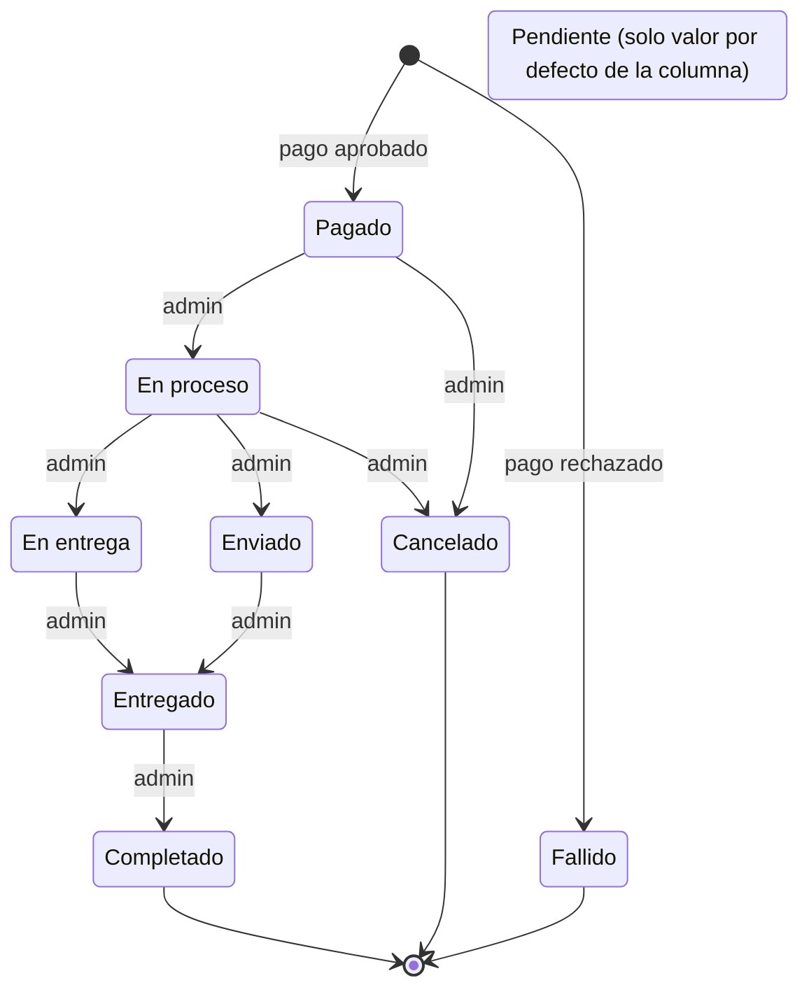

# 01 · El negocio: qué se vende, quién es quién y sus reglas

## Para principiantes

SUPER-GELATTO es una heladería que vende por internet.
El cliente entra al mostrador (la página), elige sabores, los pone en su carrito y paga.
Detrás del mostrador hay empleados con distintos carnets: el **cliente** solo ve lo suyo, el **administrador** maneja el catálogo y las ventas, y el **super administrador** es el dueño, el único que puede contratar o despedir a otros administradores.
El precio lo pone siempre la heladería, nunca el cliente: aunque alguien escriba otro precio en su pedido, la caja registradora (`registrar_venta`) usa el de la libreta.
Y cada venta pasa por estados, como un pedido que va de "pagado" a "en camino" y a "entregado".

## Detalle técnico

### Qué se vende

- **Helados por sabor** (tabla `producto`): nombre, precio, descripción, imagen, categoría, stock, si está destacado y, opcionalmente, un modelo 3D (`model_3d_url`).
- **Categorías aceptadas** al cambiar la categoría: `Clásico`, `Vegano`, `Temporada`, `Gourmet` (`server.js:2296`).
- Solo se muestran productos activos (`producto.estado = true`, `server.js:2360`). Si la base no devuelve nada, el servidor muestra un catálogo de 12 sabores escritos en el código (`server.js:184-353`, `server.js:2369-2372`).
- Pagos **simulados** (ejercicio académico, no se cobra dinero real): PSE, Nequi, Botón Bancolombia (`server.js:2524`).

### Roles

| Rol | Cómo se obtiene | Qué puede hacer (según el servidor) |
|---|---|---|
| **Visitante** (sin sesión) | No ha iniciado sesión | Ver el catálogo (`GET /api/products`), registrarse, iniciar sesión, recuperar contraseña, hablar con Gelbot con herramientas de catálogo y carrito (`chatbot.js:427`). Ver la nota 1 sobre deudas conocidas. En la **página**, sin embargo, todas las pantallas salvo login/registro/recuperar piden sesión (`App.jsx:28-29`, `App.jsx:113-150`). |
| **Cliente** | Registro con contraseña (`server.js:1127`) o primera entrada con Google (`server.js:1435`); la base guarda `rol = 'cliente'` | Lo del visitante, más: ver **sus** pedidos (`server.js:1580`), editar **su** nombre y correo (`server.js:1619`), Gelbot con `getOrders` (`chatbot.js:428`). |
| **Administrador** | `rol = 'admin'` en la base, **o** entrar con Google con un correo de la lista `ADMIN_EMAILS` verificado por Google (`server.js:810-813`) | Todo lo de `/api/admin/*`: panel, productos, estados de venta, modelos 3D, registrar su rostro, borrar clientes, subir un cliente a admin. Gelbot con todas las herramientas (`chatbot.js:599-600`). |
| **Super administrador** | El correo de la variable `SUPER_ADMIN_EMAIL` (`server.js:796-803`). No es un rol de la base: se reconoce por el correo del token. | Lo del admin, más: crear administradores (`server.js:2031`), borrar administradores (`server.js:1866-1872`), bajar un admin a cliente (`server.js:1919`), editar otros admins (`server.js:1675`). Su cuenta no se puede borrar ni cambiar de rol (`server.js:1855-1860`, `server.js:1913`). |

Reglas de los correos reservados: los correos de `ADMIN_EMAILS` y `SUPER_ADMIN_EMAIL` **no se pueden registrar** con contraseña (`server.js:1113-1115`) ni tomar al editar un perfil (`server.js:1681-1683`). Solo entran con Google verificado; al elevar una cuenta así, su contraseña se reemplaza por una aleatoria (`server.js:1418-1425`).

> **Nota 1 — deudas conocidas.** Hay deudas de seguridad conocidas que el equipo sigue aparte.
>
> **Nota 2 — permisos que no cuadran.** Un admin normal **sí puede subir** un cliente a admin (`server.js:1919` solo frena la bajada), pero **no puede crear** un admin nuevo (`server.js:2031`, solo super admin).
>
> **Nota 3 — admins de `ADMIN_EMAILS`.** Su rol de admin vive solo en el token: la base sigue diciendo `cliente` (`server.js:1420-1426` cambia la contraseña, no el rol). Por eso el login facial, que exige `rol = 'admin'` en la base (`server.js:1313`), los rechaza. La página además solo deja entrar a `/admin` si `rol` es exactamente `'admin'` (`App.jsx:44`).

### Reglas de precio y stock

| Regla | Dónde se cumple |
|---|---|
| El precio sale **siempre** de `producto.precio`; cualquier precio o total enviado por la página se ignora | `registrar_venta` (migración, líneas 111 y 236-239); `server.js:2477-2478` |
| Cada línea del carrito: cantidad entera de 1 a 99; máximo 50 líneas | `server.js:2474-2499`; migración, líneas 148-176 |
| Productos repetidos se suman; la suma tampoco puede pasar de 99 | migración, líneas 178-196 |
| Producto inexistente o inactivo → la venta no se hace | migración, líneas 222-227 |
| Si el pago se aprueba, se descuenta el stock; si no alcanza → `STOCK_INSUFICIENTE` (HTTP 409) y no queda nada guardado | migración, líneas 228-231 y 251-267; `server.js:2459` |
| Un pago rechazado se guarda como venta `Fallido` sin tocar el stock | `server.js:2576`; migración, línea 207 |
| El stock nunca baja de 0 (CHECK `producto_stock_no_negativo`) | migración, líneas 55-76 |
| `producto.stock` es la **única** fuente del stock; `inventario.stock_disponible` solo se copia al editar un producto | migración, línea 5; `server.js:2219-2225` |

### Estados de una venta (9)

Los nueve estados permitidos están en el código (`server.js:1935`) y en el CHECK `venta_estado_check` de la base (migración, líneas 30-42).

- La venta **nace** solo como `Pagado` o `Fallido` (`registrar_venta` no acepta otro estado, migración, líneas 139-142). `Pendiente` es el valor por defecto de la columna (migración, línea 28), pero ningún código crea ventas así.
- El dibujo muestra el camino **habitual**. El servidor **no obliga** a seguirlo: un admin puede poner cualquiera de los 9 estados en cualquier momento (`server.js:1952` solo comprueba que el estado exista).
- Cada cambio de estado intenta avisar al cliente por correo (`server.js:2000-2009`).

**Ventas cobradas** (las que cuentan como ingreso): `Pagado`, `En proceso`, `En entrega`, `Enviado`, `Entregado`, `Completado` (`ESTADOS_COBRADOS`, `server.js:1937`). No cuentan `Pendiente`, `Fallido` ni `Cancelado`. La página usa la misma lista (`frontend/src/utils/ingresos.js:3`) y una prueba comprueba que coincidan (`backend/tests/frontend/ingresos.test.js`).
