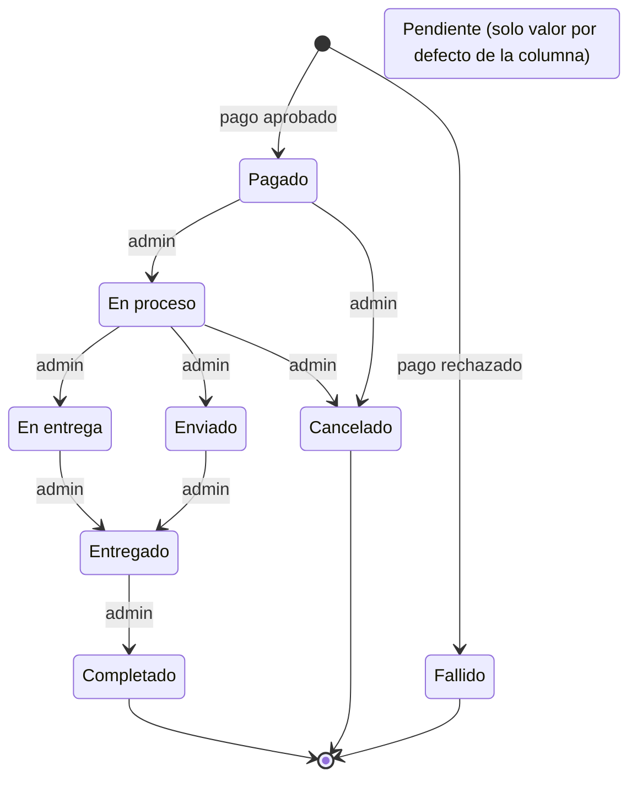

# 01 · El negocio: qué se vende, quién es quién y sus reglas

## Para principiantes

SUPER-GELATTO es una heladería que vende por internet.
El cliente entra al mostrador (la página), elige sabores (o **arma su propio helado en 3D**), los pone en su carrito y paga.
Detrás del mostrador hay empleados con distintos carnets: el **cliente** solo ve lo suyo, el **administrador** maneja el catálogo y las ventas, y el **super administrador** es el dueño, el único que puede contratar, ascender o despedir a otros administradores.
El precio lo pone siempre la heladería, nunca el cliente: aunque alguien escriba otro precio en su pedido, la caja registradora (`registrar_venta`) usa el de la libreta.
Si un sabor ya no se quiere mostrar (por ejemplo, uno que tiene ventas y por eso no se puede borrar), el administrador lo **oculta**: sale de la vitrina pero queda anotado en la libreta.
Y cada venta pasa por estados, como un pedido que va de "pagado" a "en camino" y a "entregado".
Los **Super Points** son como una tarjeta de sellos: cada compra pagada suma puntos (1 por cada $100 pagados), y en la siguiente compra se pueden cambiar por descuento. Cada punto vale $5, y cuántos puntos se pueden usar en una compra depende del **nivel**, que se calcula con el **saldo actual** de puntos (Lover, Fan, Pro o Master).

## Detalle técnico

Los números de línea cambian con cada cambio del código, por eso este documento cita **nombres de rutas, funciones y migraciones**. Verificado contra `main` el 2026-11-26.

### Qué se vende

- **Helados por sabor** (tabla `producto`): nombre, precio, descripción, imagen, categoría, stock, si está destacado, si está visible (`estado`) y, opcionalmente, un modelo 3D (`model_3d_url`, solo visto en el panel; ver [modelos-3d.md](../modelos-3d.md)).
- **Helado personalizado 3D**: el cliente arma un envase, de 1 a 3 sabores y de 0 a 3 toppings en el armador 3D. El precio es la suma de los componentes de la tabla `componente_personalizado` (envase $8.000, sabor $2.000 c/u y topping $1.000 c/u en la semilla; una bola sin toppings cuesta $10.000). No descuenta stock. Guía completa: [modelos-3d.md](../modelos-3d.md).
- **Categorías aceptadas** al cambiar la categoría: `Clásico`, `Vegano`, `Temporada`, `Gourmet`.
- La tienda y Gelbot solo muestran productos visibles (`producto.estado = true`). Si la base no devuelve nada, `GET /api/products` responde un catálogo de emergencia de 12 sabores escrito en el código (sin caché).
- **Ocultar o mostrar** (`PUT /api/admin/products/:id/visible`): cambia `estado` sin borrar nada. Un producto con ventas no se puede borrar (HTTP 409), así que se oculta. El panel lista todos, también los ocultos (`GET /api/admin/products`).
- Pagos **simulados** (ejercicio académico, no se cobra dinero real): PSE, Nequi, Botón Bancolombia.
- **Crear y editar productos** usan las mismas reglas (nombre de 1 a 120 caracteres, precio entero ≥ 1, stock entero ≥ 0, descripción de hasta 2.000 caracteres, categoría de la lista). Al crear sin stock se guardan 50.

### Roles

| Rol | Cómo se obtiene | Qué puede hacer (según el servidor) |
|---|---|---|
| **Visitante** (sin sesión) | No ha iniciado sesión | Ver el catálogo (`GET /api/products`), registrarse, iniciar sesión, recuperar contraseña y hablar con Gelbot (menú, precios, fichas, carrito). En la **página**, todas las pantallas salvo login, registro y recuperar piden sesión |
| **Cliente** | Registro con contraseña (queda con la sesión iniciada) o primera entrada con Google; la base guarda `rol = 'cliente'` | Lo del visitante, más: ver **sus** pedidos, editar **su** nombre y correo, pagar, ganar y canjear Super Points y ver sus pedidos en Gelbot |
| **Administrador** | `rol = 'admin'` en la base, **o** entrar con Google con un correo de la lista `ADMIN_EMAILS` verificado por Google | Todo lo de `/api/admin/*`: panel, productos (alta, edición, ocultar), estados de venta, modelos 3D, registrar su rostro y borrar clientes. Gelbot en modo administrador |
| **Super administrador** | El correo de la variable `SUPER_ADMIN_EMAIL`. No es un rol de la base: se reconoce por el correo del token | Lo del admin, más: **ascender cuentas a administrador, bajarlas a cliente**, crear y borrar administradores y editar a otros admins. Su cuenta no se puede borrar ni cambiar de rol |

Reglas de los correos reservados: los correos de `ADMIN_EMAILS` y `SUPER_ADMIN_EMAIL` **no se pueden registrar** con contraseña ni tomar al editar un perfil. Solo entran con Google verificado; al elevar una cuenta así, su contraseña se reemplaza por una aleatoria.

> **Solo el super admin asciende a otros** (cambio de 2026-11-19). Un administrador normal ya **no** puede subir a un cliente a admin: `PUT /api/admin/users/:id/role` solo lo permite al super admin, igual que `POST /api/admin/create-admin`.
>
> **Nota — admins de `ADMIN_EMAILS`.** Su rol de admin vive solo en el token: la base sigue diciendo `cliente`. Por eso el login facial, que exige `rol = 'admin'` en la base, los rechaza. La página además solo deja entrar a `/admin` si `rol` es exactamente `'admin'`.
>
> Hay deudas de seguridad conocidas que el equipo sigue aparte (ver la auditoría técnica).

### Reglas de precio y stock

| Regla | Dónde se cumple |
|---|---|
| El precio sale **siempre** de `producto.precio` (o de `componente_personalizado` en el personalizado); cualquier precio o total enviado por la página se ignora | función `registrar_venta` |
| Cada línea del carrito: cantidad entera de 1 a 99; máximo 50 líneas | `validarCarrito` en el servidor y `registrar_venta` |
| Productos repetidos se suman; la suma tampoco puede pasar de 99 | `registrar_venta` |
| Producto inexistente o inactivo (oculto) → la venta no se hace | `registrar_venta` (`PRODUCTO_NO_EXISTE`, `PRODUCTO_INACTIVO`) |
| Si el pago se aprueba, se descuenta el stock; si no alcanza → `STOCK_INSUFICIENTE` (HTTP 409) y no queda nada guardado | `registrar_venta` |
| Un pago rechazado se guarda como venta `Fallido` sin tocar el stock | `POST /api/payments/process` y `registrar_venta` |
| El stock nunca baja de 0 (CHECK `producto_stock_no_negativo`) | migración `20261025120000_ventas_pagos_y_productos.sql` |
| `producto.stock` es la **única** fuente del stock; `inventario.stock_disponible` solo se copia al editar un producto | `PUT /api/admin/products/:id` |
| Un helado personalizado no usa stock | `registrar_venta` |

### Estados de una venta (9)

Los nueve estados permitidos están en el código (`ESTADOS_VENTA` en `server.js`) y en el CHECK `venta_estado_check` de la base.

- La venta **nace** solo como `Pagado` o `Fallido` (`registrar_venta` no acepta otro estado). `Pendiente` es el valor por defecto de la columna, pero ningún código crea ventas así.
- El dibujo muestra el camino **habitual**. El servidor **no obliga** a seguirlo: un admin puede poner cualquiera de los 9 estados en cualquier momento (solo comprueba que el estado exista).
- Cada cambio de estado intenta avisar al cliente por correo.

**Ventas cobradas** (las que cuentan como ingreso): `Pagado`, `En proceso`, `En entrega`, `Enviado`, `Entregado`, `Completado` (`ESTADOS_COBRADOS`). No cuentan `Pendiente`, `Fallido` ni `Cancelado`. La página usa la misma lista (`frontend/src/utils/ingresos.js`) y una prueba comprueba que coincidan (`backend/tests/frontend/ingresos.test.js`).

### Super Points (programa de puntos)

**Para principiantes:** el cliente gana puntos con cada compra pagada y los usa como descuento en la siguiente. Nadie empieza con puntos de compras anteriores, y los puntos no vencen.

| Regla | Qué pasa |
|---|---|
| **Ganar** | 1 punto por cada $100 realmente pagados, redondeando hacia abajo, sobre el total después del descuento. Ejemplos: $9.000 = 90 puntos; pedido de $20.000 con $4.000 de descuento = 160 puntos |
| **Valor** | 1 punto = $5 de descuento. El cliente recupera cerca del 5 % en puntos |
| **Niveles** | Según el **saldo actual** de puntos (regla del 2026-11-19; gastar puntos puede bajar el nivel y con él el % de la compra siguiente). Lover 0–100 (máximo pagable con puntos: 5 %); Fan 101–500 (10 %); Pro 501–1000 (15 %); Master 1001 o más (20 %) |
| **Canjear** | El cliente elige cuántos puntos usar al pagar (números enteros). El máximo es el menor entre su saldo y `piso(subtotal × % del nivel ÷ $5)`. El nivel es el que da su saldo **antes** de la compra; los puntos ganados en una compra se pueden usar desde la siguiente |
| **Arranque y vencimiento** | Todos arrancan en cero. Las compras anteriores al programa no dan puntos. No vencen |
| **Pago fallido** | No gana ni gasta puntos |
| **Admin marca una venta como cobrada** | Si una venta "Fallido" o "Pendiente" pasa a un estado cobrado, el cliente gana sus puntos por el total de esa venta. Se dan una sola vez por venta |
| **Cancelación** | Al pasar una venta cobrada a "Cancelado": se devuelven los puntos canjeados; se quitan los ganados sin bajar el saldo de cero (si ya los gastó, se quita lo que haya), y el nivel se recalcula con el saldo que queda. Pasa una sola vez. Si la venta vuelve a salir de "Cancelado", los puntos no se vuelven a mover |
| **Ajustes manuales** | No existen desde el panel de admin |

### Detalle técnico de Super Points

- **Dónde viven las reglas:** en la base, en la función `public.super_points_reglas()` (migración `20261111120000_super_points.sql`; el nivel por saldo lo reemplaza `20261120120000_nivel_por_saldo.sql`). El servidor las lee con `GET /api/points/rules` y la página no guarda copias. Única excepción: una copia para el modo simulado en `server.js` (`mockDb`), que debe cambiarse junto con la migración.
- **Quién mueve los puntos:** solo el servidor (`service_role`), dentro de la misma transacción que la venta (`registrar_venta`) o que el cambio de estado (`cambiar_estado_venta`). La página solo muestra y pide; el servidor decide el descuento y el saldo.
- **Libreta:** cada movimiento es una fila de la tabla `super_points`; el saldo es la suma. Detalle en [07-modelo-datos.md](07-modelo-datos.md#super_points-la-libreta-de-puntos) y flujos en [08-flujos.md](08-flujos.md).
- **Ámbito:** solo compras con cuenta. Una compra anónima (sin usuario) no gana ni canjea puntos.
