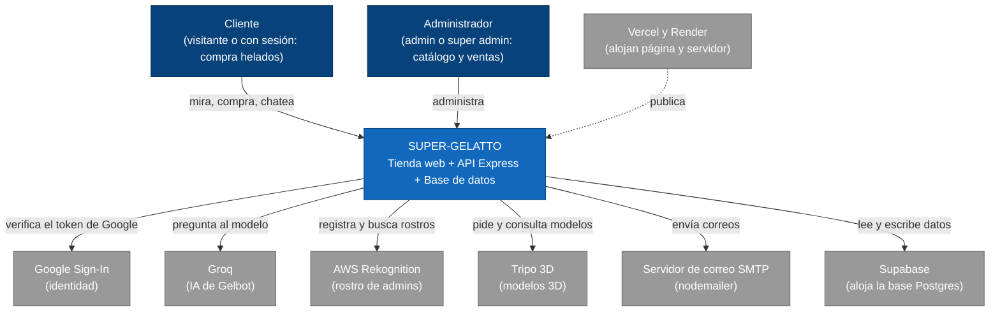

# 02 · Contexto (C4 nivel 1): la heladería y sus proveedores

## Para principiantes

Aquí miramos la heladería desde la calle, sin entrar.
Vemos quién llega (clientes, administradores) y con qué proveedores de afuera trabaja.
Igual que una heladería compra leche a un proveedor y contrata un transporte, SUPER-GELATTO usa servicios de otras empresas: Google para el carnet de entrada, Groq para que el asistente Gelbot "piense", AWS para reconocer la cara de los administradores, Tripo para fabricar modelos 3D de los helados y un servicio de correo para mandar avisos.
También alquila dos locales: Vercel para el mostrador (la página) y Render para la cocina (el servidor).
La bodega (la base de datos) está en Supabase.

## Detalle técnico

### Sistemas externos

| Servicio | Para qué | Quién lo llama | Dónde en el código | Variables de entorno (solo nombres) |
|---|---|---|---|---|
| **Supabase** (Postgres) | Guardar usuarios, productos, ventas, rostros | Solo el servidor, con la llave `service_role` | `server.js:31-33`, `server.js:452-461` | `SUPABASE_URL`, `SUPABASE_SERVICE_ROLE_KEY` (o `SUPABASE_KEY`) |
| **Google Sign-In** | Entrar con Google. La página obtiene un `credential` y el servidor lo verifica con `verifyIdToken` | Página (`@react-oauth/google`) y servidor (`google-auth-library`) | `index.jsx:6-14`, `Login.jsx:312`; `server.js:516-521`, `server.js:1365-1375` | `VITE_GOOGLE_CLIENT_ID`, `GOOGLE_CLIENT_ID` (deben ser el mismo) |
| **Groq** | Modelo de lenguaje de Gelbot (`llama-3.1-8b-instant`) con herramientas | Servidor (`groq-sdk`) | `chatbot.js:2-11`, `chatbot.js:659` | `GROQ_API_KEY` |
| **AWS Rekognition** | Login facial de administradores: guardar rostro (`IndexFaces`) y buscarlo (`SearchFacesByImage`) | Servidor (`@aws-sdk/client-rekognition`) | `server.js:25-50`, `server.js:1193-1355` | `AWS_REGION`, `AWS_ACCESS_KEY_ID`, `AWS_SECRET_ACCESS_KEY`, `AWS_SESSION_TOKEN`, `REKOGNITION_COLLECTION_ID` |
| **Tripo 3D** | Generar un modelo 3D (`text_to_model`) a partir de un texto y consultar su avance | Servidor (`fetch` a su API) | `server.js:123-182` | `TRIPO_API_KEY` |
| **Correo SMTP** | Confirmación de pago, cambio de estado, recuperar contraseña. Sin SMTP configurado usa una cuenta de prueba Ethereal | Servidor (`nodemailer`) | `server.js:626-654` | `SMTP_HOST`, `SMTP_PORT`, `SMTP_USER`, `SMTP_PASS` |
| **Render** | Aloja el servidor. El código detecta Render con la variable `RENDER` (modo producción, `trust proxy`) | — | `server.js:4`, `server.js:568-570` | `RENDER`, `PORT` |
| **Vercel** | Aloja la página. Todas las rutas se reescriben a `index.html` (SPA) | — | `frontend/vercel.json`; CORS acepta `*.vercel.app` (`server.js:583`) | `VITE_API_URL` |

> La página **no** habla directamente con Supabase, Groq, AWS ni Tripo: todo pasa por el servidor. La única excepción es Google, cuyo botón vive en la página.

Siguiente nivel de zoom: [03-contenedores.md](03-contenedores.md).
