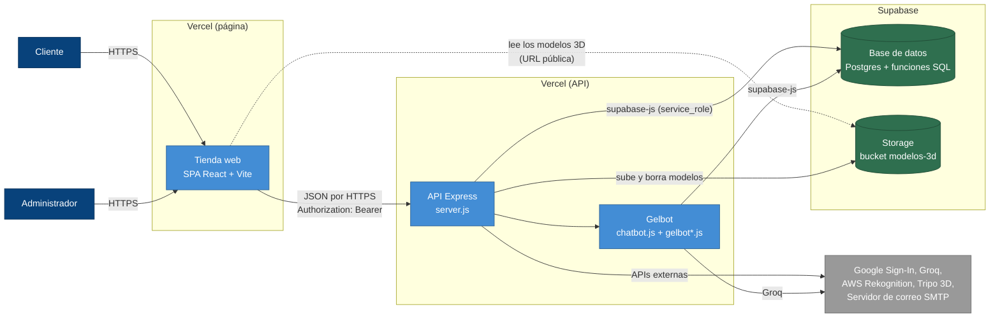

# 03 · Contenedores (C4 nivel 2): mostrador, cocina y bodega

## Para principiantes

Ahora entramos a la heladería y vemos sus tres espacios grandes.
El **mostrador** (la Tienda web) es lo que ve el cliente en su navegador; está en un local alquilado a Vercel.
La **cocina** (la API Express; una API es la puerta por la que los programas se piden cosas entre sí) recibe cada pedido del mostrador, revisa el carnet del cliente y habla con la bodega y los proveedores; está en otro local alquilado también a Vercel.
La **bodega con su libreta** (la base de datos Postgres, un programa muy usado para guardar tablas de datos) guarda todo de forma permanente; está en Supabase. Esa bodega también tiene una **vitrina de maquetas** (el Storage, donde se guardan los modelos 3D).
El mostrador nunca entra a la bodega: siempre le pide las cosas a la cocina.
Las llaves de los proveedores (contraseñas, claves) deben ir en **variables de entorno**: papelitos que se le entregan a la cocina al abrir, no pegados en la pared.

## Detalle técnico

### Tabla de piezas (nombres oficiales)

Estos nombres se usan **igual** en todos los diagramas y figuras de esta carpeta.

| Nombre oficial | Qué es | Analogía | Dónde vive | Tecnología |
|---|---|---|---|---|
| **Cliente** | Persona que compra (visitante o cliente con sesión) | Cliente de la heladería | Su navegador | — |
| **Administrador** | Admin o super admin | Encargado / dueño | Su navegador | — |
| **Tienda web** | Página de una sola página (SPA) | Mostrador | Vercel | React 19, Vite 8, Tailwind 4, React Router 7, Three.js / @react-three, @react-oauth/google |
| **API Express** | Servidor con 35 rutas | Cocina | Vercel (proyecto aparte, solo API) | Node.js, Express 4 (CommonJS), `backend/server.js` |
| **Gelbot** | Asistente de chat (módulos de la API) | Mesero que lee del menú impreso | Dentro de la API Express | `backend/gelbot/` (`chatbot.js` y `gelbot*.js`), `backend/datos/datosSabores.js`, groq-sdk |
| **Base de datos** | Postgres con las tablas del negocio | Bodega con su libreta | Supabase | Postgres, supabase-js con llave `service_role` |
| **Bucket `modelos-3d`** | Archivos GLB de los modelos 3D que genera Tripo | Vitrina donde se guardan las maquetas terminadas | Supabase Storage | Lectura pública; solo el servidor (`service_role`) sube y borra. `backend/servicios/modelos3dStorage.js` |
| **registrar_venta** | Función de la base que cobra y anota la venta (también el helado personalizado) | Caja registradora | Dentro de la Base de datos | PL/pgSQL, `security invoker` |
| **cambiar_estado_venta**, **super_points_reglas**, **super_points_resumen**, **helado_personalizado_reglas** | Otras funciones de la base | Reglamento de la tarjeta de puntos y de la lista de precios | Dentro de la Base de datos | PL/pgSQL |
| **Guardia (token de sesión)** | Revisión del token en cada petición (middleware de la API) | Guardia que pide carnet | Dentro de la API Express | JWT |
| **Google Sign-In** | Identidad con Google | Oficina que emite carnets | Externo | OAuth / ID token |
| **Groq** | Modelo de lenguaje | Intérprete alquilado de Gelbot | Externo | `openai/gpt-oss-20b` por defecto (`GROQ_MODEL`) |
| **AWS Rekognition** | Reconocimiento facial | Portero que reconoce caras | Externo | Colección de rostros |
| **Tripo 3D** | Generador de modelos 3D | Taller que esculpe maquetas | Externo | API `text_to_model` |
| **Servidor de correo SMTP** | Envío de correos | Mensajero | Externo | nodemailer |

### Diagrama de contenedores

### Cómo se conectan

| Desde → hacia | Cómo |
|---|---|
| Tienda web → API Express | `fetch` a `VITE_API_URL` + ruta. Con sesión se manda `Authorization: Bearer <token>` (ayudante `apiFetch` en `frontend/src/utils/api.js`). Solo un 401 cierra la sesión; un 403 llega a la pantalla con su mensaje |
| API Express acepta a | `localhost`, `127.0.0.1`, `FRONTEND_URL`, cualquier `*.vercel.app` o `*.netlify.app` (CORS) |
| API Express → Base de datos | Cliente `@supabase/supabase-js` con la llave `service_role` |
| API Express → Storage | Sube el modelo 3D terminado al bucket `modelos-3d` y borra el anterior (`modelos3dStorage.js`) |
| API Express → Base (modo simulado) | Si falta Supabase (solo desarrollo), una base de mentira en memoria (`mockDb`) con sus propias versiones de `registrar_venta` y de los puntos |
| Desarrollo local | Vite en el puerto 3000 reenvía `/api` al servidor en el 5000 (`frontend/vite.config.js`) |

### Despliegue

| Pieza | Dónde | Qué hay que saber |
|---|---|---|
| Tienda web | Vercel | `npm run build` (Vite). `frontend/vercel.json` reescribe toda ruta a `index.html` para que React Router funcione al recargar. Variables: `VITE_API_URL`, `VITE_GOOGLE_CLIENT_ID` |
| API Express | Vercel | `npm start` (`node server.js`). En Vercel el código se considera **producción** y: no arranca sin Supabase, no arranca sin `JWT_SECRET` de 32+ caracteres, confía en 1 proxy para leer la IP real. `backend/vercel.json` define un **cron diario** (12:00) que llama a `GET /api/health` para que la base gratuita no se pause |
| Base de datos | Supabase | Esquema base en `supabase/schema_base_2026-10-25.sql` y cambios en `supabase/migrations/` (con su `rollbacks/`). Las migraciones se ejecutan **a mano** en el editor SQL de Supabase, **antes** de publicar el código que las usa |
| CI | GitHub Actions | `.github/workflows/ci.yml`: `backend` (`npm test`) y `frontend` (`vite build`); `main` está protegida. Ver [CI.md](../CI.md) |

> **Estado: la base es la única fuente de verdad.** Productos destacados, ventas, tareas de Tripo 3D y los enlaces para recuperar contraseña viven en la base (antes había archivos JSON y memoria del servidor, que en Vercel se perdían). El estado del modelo 3D son columnas `model_3d_*` de `producto`; los enlaces de recuperación están en `reset_tokens` (solo su hash). Lo que sí sigue en memoria de cada instancia: los límites de intentos, las confirmaciones del admin en el chat y las cachés cortas.

### Variables de entorno (solo nombres)

Los valores reales van en `backend/.env` y `frontend/.env` (nunca en git) o en el panel de Vercel. `backend/.env.example` y `frontend/.env.example` traen los nombres.

| Variable | Pieza | Para qué | ¿Obligatoria? | ¿En `.env.example`? |
|---|---|---|---|---|
| `SUPABASE_URL` | API Express | Dirección de la base | Sí en producción | Sí |
| `SUPABASE_SERVICE_ROLE_KEY` | API Express | Llave de servidor de la base (preferida) | Sí en producción (o `SUPABASE_KEY`) | Sí |
| `SUPABASE_KEY` | API Express | Llave alternativa si falta la anterior (respaldo de desarrollo) | No | Sí |
| `JWT_SECRET` | API Express | Secreto para firmar los tokens (32+ caracteres) | Sí en producción | Sí |
| `GOOGLE_CLIENT_ID` | API Express | Verificar tokens de Google (sin ella, 503) | Para entrar con Google | Sí |
| `ADMIN_EMAILS` | API Express | Correos que entran como admin con Google | No | Sí |
| `SUPER_ADMIN_EMAIL` | API Express | Correo del super admin | No (sin ella no hay super admin) | Sí |
| `FRONTEND_URL` | API Express | Origen permitido (CORS) y enlace del correo de recuperación | Obligatoria en producción para recuperar contraseña | Sí |
| `GROQ_API_KEY` | Gelbot | Llave de Groq | Para el chat con ayuda del modelo (sin ella el chat responde con palabras clave) | Sí |
| `GROQ_MODEL` | Gelbot | Modelo de Groq (por defecto `openai/gpt-oss-20b`; un valor con formato raro se ignora) | No | Sí |
| `TRIPO_API_KEY` | API Express | Llave de Tripo 3D (sin ella, las rutas 3D responden 503) | Para modelos 3D | Sí |
| `TRIPO_CDN_HOSTS` | API Express | Hosts (sufijos, separados por coma) de los que se pueden descargar los modelos de Tripo | No (vacío = cualquier host público https) | Sí |
| `TRIPO_RATE_LIMIT_MAX` | API Express | Generaciones 3D por admin por hora (5 por defecto) | No | No |
| `SMTP_HOST`, `SMTP_PORT`, `SMTP_USER`, `SMTP_PASS` | API Express | Correo real (sin ellas: Ethereal de prueba en desarrollo; en producción recuperar contraseña responde 503) | Para correos reales | Sí |
| `RECUPERACION_ESPERA_MS`, `RECUPERACION_MAX_DIA` | API Express | Espera entre enlaces de recuperación (2 min) y tope diario (5) | No | Sí |
| `CRON_SECRET` | API Express | Si existe, `/api/health` exige `Authorization: Bearer <valor>` (Vercel Cron lo manda solo) | No | Sí |
| `AWS_REGION`, `AWS_ACCESS_KEY_ID`, `AWS_SECRET_ACCESS_KEY`, `AWS_SESSION_TOKEN` | API Express | Credenciales de AWS Rekognition | Para login facial | **No** |
| `REKOGNITION_COLLECTION_ID` | API Express | Nombre de la colección de rostros | No (tiene valor por defecto) | **No** |
| `LOGIN_RATE_LIMIT_MAX`, `LOGIN_RATE_LIMIT_WINDOW_MS` | API Express | Límite de las rutas de cuenta (10 / 15 min por defecto) | No | **No** |
| `PAYMENT_RATE_LIMIT_MAX`, `PAYMENT_RATE_LIMIT_WINDOW_MS` | API Express | Límite de pagos (10 / 1 min) | No | **No** |
| `CHATBOT_RATE_LIMIT_MAX`, `CHATBOT_RATE_LIMIT_WINDOW_MS` | API Express | Límite de Gelbot (20 / 1 min) | No | **No** |
| `TRUST_PROXY` | API Express | `1` = confiar en el proxy fuera de Vercel | No | **No** |
| `VERCEL`, `NODE_ENV`, `PORT` | API Express | Detectar producción y puerto (los pone Vercel) | No | **No** |
| `WEBAUTHN_RP_ID`, `WEBAUTHN_ORIGIN` | — | **Sin uso**: están en el ejemplo, pero ningún código las lee | No | Sí |
| `VITE_API_URL` | Tienda web | Dirección de la API Express | Sí en producción | Sí |
| `VITE_GOOGLE_CLIENT_ID` | Tienda web | Botón de Google | Para entrar con Google | Sí |

Siguiente zoom: [04-componentes-backend.md](04-componentes-backend.md) y [05-componentes-frontend.md](05-componentes-frontend.md).
