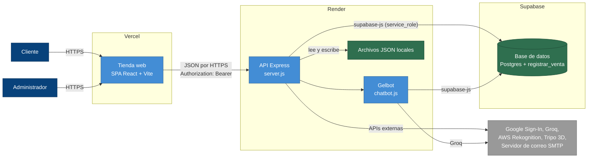

# 03 · Contenedores (C4 nivel 2): mostrador, cocina y bodega

## Para principiantes

Ahora entramos a la heladería y vemos sus tres espacios grandes.
El **mostrador** (la Tienda web) es lo que ve el cliente en su navegador; está en un local alquilado a Vercel.
La **cocina** (la API Express) recibe cada pedido del mostrador, revisa el carnet del cliente y habla con la bodega y los proveedores; está en un local alquilado a Render.
La **bodega con su libreta** (la base de datos Postgres) guarda todo de forma permanente; está en Supabase.
El mostrador nunca entra a la bodega: siempre le pide las cosas a la cocina.
Las llaves de los proveedores (contraseñas, claves) se guardan como **variables de entorno**: papelitos que se le entregan a la cocina al abrir, nunca pegados en la pared.

## Detalle técnico

### Tabla de piezas (nombres oficiales)

Estos nombres se usan **igual** en todos los diagramas y figuras de esta carpeta.

| Nombre oficial | Qué es | Analogía | Dónde vive | Tecnología |
|---|---|---|---|---|
| **Cliente** | Persona que compra (visitante o cliente con sesión) | Cliente de la heladería | Su navegador | — |
| **Administrador** | Admin o super admin | Encargado / dueño | Su navegador | — |
| **Tienda web** | Página de una sola página (SPA) | Mostrador | Vercel | React 19, Vite 8, Tailwind 4, React Router 7, Three.js / @react-three, @react-oauth/google |
| **API Express** | Servidor con las 26 rutas | Cocina | Render | Node.js, Express 4 (CommonJS), `backend/server.js` |
| **Gelbot** | Asistente con IA (módulo de la API) | Ayudante de la cocina que atiende por chat | Dentro de la API Express | `backend/chatbot.js`, groq-sdk |
| **Base de datos** | Postgres con las tablas del negocio | Bodega con su libreta | Supabase | Postgres, supabase-js con llave `service_role` |
| **registrar_venta** | Función de la base que cobra y anota la venta | Caja registradora | Dentro de la Base de datos | PL/pgSQL, `security invoker` |
| **Archivos JSON locales** | Estado guardado en el disco del servidor | Notas sueltas pegadas en la cocina | Disco de la API Express | `featured_state.json`, `fallback_sales.json`, `tripo_models_state.json` |
| **Google Sign-In** | Identidad con Google | Oficina que emite carnets | Externo | OAuth / ID token |
| **Groq** | Modelo de lenguaje | "Cerebro" alquilado de Gelbot | Externo | `llama-3.1-8b-instant` |
| **AWS Rekognition** | Reconocimiento facial | Portero que reconoce caras | Externo | Colección de rostros |
| **Tripo 3D** | Generador de modelos 3D | Taller que esculpe maquetas | Externo | API `text_to_model` |
| **Servidor de correo SMTP** | Envío de correos | Mensajero | Externo | nodemailer |

### Diagrama de contenedores

### Cómo se conectan

| Desde → hacia | Cómo | Referencia |
|---|---|---|
| Tienda web → API Express | `fetch` a `VITE_API_URL` + ruta. Con sesión se manda `Authorization: Bearer <token>` (ayudante `apiFetch`) | `frontend/src/utils/api.js:9`, `api.js:52-73` |
| API Express acepta a | `localhost`, `127.0.0.1`, `FRONTEND_URL`, cualquier `*.vercel.app` o `*.netlify.app` (CORS) | `server.js:576-594` |
| API Express → Base de datos | Cliente `@supabase/supabase-js` con la llave `service_role` (salta las reglas RLS) | `server.js:31-33`, `server.js:457-461` |
| API Express → Base (modo simulado) | Si falta Supabase, una base de mentira en memoria (`mockDb`) con su propia versión de `registrar_venta` (no descuenta stock) | `server.js:355-448`, `server.js:523-561` |
| Desarrollo local | Vite en el puerto 3000 reenvía `/api` al servidor en el 5000 | `frontend/vite.config.js:10-17`, `server.js:572` |

### Despliegue

| Pieza | Dónde | Qué hay que saber |
|---|---|---|
| Tienda web | Vercel | `npm run build` (Vite). `vercel.json` reescribe toda ruta a `index.html` para que React Router funcione al recargar. Variables: `VITE_API_URL`, `VITE_GOOGLE_CLIENT_ID`. |
| API Express | Render | `npm start` (`node server.js`). En Render el código se considera **producción** (`server.js:4`) y: no arranca sin Supabase (`server.js:495-499`), no arranca sin `JWT_SECRET` de 32+ caracteres (`server.js:504-514`), confía en 1 proxy para leer la IP real (`server.js:568-570`). |
| Base de datos | Supabase | Esquema base en `supabase/schema_base_2026-10-25.sql` y cambios en `supabase/migrations/` (con su `rollbacks/`). Las migraciones se ejecutan a mano en el editor SQL de Supabase. |

> **Ojo: estado que no está en la base.** La API Express guarda tres cosas en **Archivos JSON locales** del disco: productos destacados (`server.js:57`), ventas de respaldo (`server.js:80`) y tareas de Tripo 3D (`server.js:102`). En Render el disco se borra en cada despliegue, así que ese estado se pierde. Además, los códigos para recuperar contraseña viven solo en memoria (`server.js:624`) y se pierden al reiniciar.

### Variables de entorno (solo nombres)

Los valores reales van en `backend/.env` y `frontend/.env` (nunca en git) o en el panel de Render/Vercel.

| Variable | Pieza | Para qué | ¿Obligatoria? | ¿En `.env.example`? | Referencia |
|---|---|---|---|---|---|
| `SUPABASE_URL` | API Express | Dirección de la base | Sí en producción | Sí | `server.js:31` |
| `SUPABASE_SERVICE_ROLE_KEY` | API Express | Llave de servidor de la base (preferida) | Sí en producción (o `SUPABASE_KEY`) | Sí | `server.js:33` |
| `SUPABASE_KEY` | API Express | Llave alternativa si falta la anterior | No | Sí | `server.js:33` |
| `JWT_SECRET` | API Express | Secreto para firmar los tokens (32+ caracteres) | Sí en producción | Sí | `server.js:504-514` |
| `GOOGLE_CLIENT_ID` | API Express | Verificar tokens de Google (sin ella, 503) | Para entrar con Google | Sí | `server.js:517-521` |
| `ADMIN_EMAILS` | API Express | Correos que entran como admin con Google | No | Sí | `server.js:797` |
| `SUPER_ADMIN_EMAIL` | API Express | Correo del super admin | No (sin ella no hay super admin) | Sí | `server.js:796-803` |
| `FRONTEND_URL` | API Express | Origen permitido (CORS) y enlace del correo de recuperación | Recomendada | Sí | `server.js:576`, `server.js:1492` |
| `GROQ_API_KEY` | Gelbot | Llave de Groq | Para Gelbot | Sí | `chatbot.js:5-7` |
| `TRIPO_API_KEY` | API Express | Llave de Tripo 3D | Para modelos 3D | Sí | `server.js:124` |
| `SMTP_HOST`, `SMTP_PORT`, `SMTP_USER`, `SMTP_PASS` | API Express | Correo real (sin ellas: Ethereal de prueba) | Para correos reales | Sí | `server.js:632-643` |
| `AWS_REGION`, `AWS_ACCESS_KEY_ID`, `AWS_SECRET_ACCESS_KEY`, `AWS_SESSION_TOKEN` | API Express | Credenciales de AWS Rekognition | Para login facial | **No** | `server.js:36-45` |
| `REKOGNITION_COLLECTION_ID` | API Express | Nombre de la colección de rostros | No (tiene valor por defecto) | **No** | `server.js:37` |
| `LOGIN_RATE_LIMIT_MAX`, `LOGIN_RATE_LIMIT_WINDOW_MS` | API Express | Límite de las rutas de cuenta (10 / 15 min por defecto) | No | **No** | `server.js:883-887` |
| `PAYMENT_RATE_LIMIT_MAX`, `PAYMENT_RATE_LIMIT_WINDOW_MS` | API Express | Límite de pagos (10 / 1 min) | No | **No** | `server.js:2507-2510` |
| `CHATBOT_RATE_LIMIT_MAX`, `CHATBOT_RATE_LIMIT_WINDOW_MS` | API Express | Límite de Gelbot (20 / 1 min) | No | **No** | `server.js:2692-2695` |
| `TRUST_PROXY` | API Express | `1` = confiar en el proxy fuera de Render | No | **No** | `server.js:568` |
| `RENDER`, `NODE_ENV`, `PORT` | API Express | Detectar producción y puerto (los pone Render) | No | **No** | `server.js:4`, `server.js:572` |
| `WEBAUTHN_RP_ID`, `WEBAUTHN_ORIGIN` | — | **Sin uso**: están en el ejemplo, pero ningún código las lee | No | Sí | — |
| `VITE_API_URL` | Tienda web | Dirección de la API Express | Sí en producción | Sí | `frontend/src/utils/api.js:9` |
| `VITE_GOOGLE_CLIENT_ID` | Tienda web | Botón de Google | Para entrar con Google | Sí | `frontend/src/index.jsx:8` |

Siguiente zoom: [04-componentes-backend.md](04-componentes-backend.md) y [05-componentes-frontend.md](05-componentes-frontend.md).
