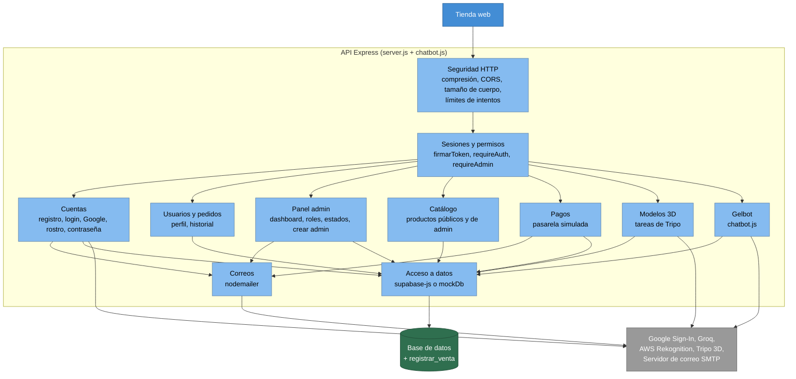

# 04 · Componentes del servidor (C4 nivel 3): la cocina por dentro

## Para principiantes

La cocina (la API Express) tiene estaciones, cada una con su trabajo: una revisa la puerta, otra atiende las cuentas de los clientes, otra el catálogo, otra los pagos y otra los correos.
Cada pedido que llega del mostrador entra por una **ventanilla** (una ruta, por ejemplo `POST /api/login`; POST significa "enviar datos" y API es la puerta por la que los programas se piden cosas entre sí).
Antes de atenderlo, un **guardia que pide carnet** (el middleware) mira si el pedido trae token y qué rol dice: algunas ventanillas atienden a cualquiera, otras solo a clientes con sesión y otras solo a administradores.
Algunas ventanillas tienen además un **límite de turnos**: si alguien insiste demasiadas veces seguidas, se le pide que espere, para frenar a los robots.
Gelbot, el ayudante del chat, también vive en esta cocina y solo puede usar las herramientas que su carnet permite.

## Detalle técnico

Casi todo el servidor está en un solo archivo, `backend/server.js` (2.826 líneas), más `backend/chatbot.js` (859 líneas). Los "componentes" de abajo son **secciones lógicas** de esos archivos, no carpetas separadas.

### Diagrama de componentes

| Componente | Responsabilidad | Dónde |
|---|---|---|
| Seguridad HTTP | Compresión; CORS; cuerpo máximo 1 MB (8 MB solo en rutas con fotos); cabeceras COOP/COEP; errores de cuerpo en JSON (413/400) | `server.js:568-621`, `server.js:2811-2820` |
| Límites de intentos | `express-rate-limit` por IP; cada ruta su propia cuenta | `server.js:879-899`, `server.js:2505-2515`, `server.js:2689-2700` |
| Sesiones y permisos | Firma (HS256, 24 h) y verificación de tokens; guardias; correos de admin y super admin | `server.js:501-514`, `server.js:789-877` |
| Cuentas | Registro, login, Google, login y registro facial, recuperar contraseña | `server.js:1061-1562` |
| Usuarios y pedidos | Historial paginado y edición de perfil | `server.js:1564-1720` |
| Panel admin | Dashboard, borrar usuarios, cambiar rol, estado de venta, crear admin | `server.js:1722-2071` |
| Catálogo | Productos públicos y CRUD de admin; datos de sabor escritos en el código | `server.js:184-353`, `server.js:901-1059`, `server.js:2073-2433` |
| Pagos | Valida carrito, simula la pasarela, llama a `registrar_venta`, manda correo | `server.js:2435-2687` |
| Modelos 3D | Inicia y consulta tareas en Tripo 3D; guarda `model_3d_url` | `server.js:101-182`, `server.js:2709-2809` |
| Correos | Transporte SMTP o Ethereal; correo de cambio de estado con datos escapados | `server.js:626-781` |
| Gelbot | Chat con IA y herramientas por rol | `backend/chatbot.js`; ruta en `server.js:2703-2707` |
| Acceso a datos | Cliente Supabase real o base simulada en memoria | `server.js:355-561` |

### Las guardias (middleware)

| Guardia | Qué exige | Dónde |
|---|---|---|
| *(ninguna)* = **público** | Nada | — |
| `requireAuth` | `Authorization: Bearer <token>` válido (cualquier rol). Deja el contenido en `req.user` | `server.js:867-875` |
| `requireAdmin` (= `requireAuthenticatedAdmin`) | Token válido con `rol` `admin` o `super_admin`. Lee el token de la petición | `server.js:836-863` |
| **Super admin** | No es un middleware: es `requireAdmin` más una comprobación del correo del token (`esSuperAdminEmail`) **dentro** de la ruta | `server.js:800-803` |

El permiso sale **solo** del rol firmado en el token, nunca de cabeceras como `x-user-role` ni del cuerpo (`server.js:834-835`).

### Límites de intentos

| Limitador | Rutas | Tope por defecto | Dónde |
|---|---|---|---|
| `limitadorRegistro`, `limitadorLogin`, `limitadorGoogleLogin`, `limitadorOlvidoClave`, `limitadorLoginFacial`, `limitadorCrearAdmin` | Una cada uno (ver tabla de rutas) | 10 por IP cada 15 min (`LOGIN_RATE_LIMIT_*`) | `server.js:883-899` |
| `limitadorPagos` | `POST /api/payments/process` | 10 por IP cada 1 min (`PAYMENT_RATE_LIMIT_*`) | `server.js:2507-2515` |
| `limitadorChatbot` | `POST /api/chatbot` | 20 por IP cada 1 min (`CHATBOT_RATE_LIMIT_*`) | `server.js:2692-2700` |

Al pasar el tope responden **429** con un mensaje en español.

### Las 26 rutas

"Quién puede" describe lo que **hace el código**, no lo que debería hacer.

| # | Método | Ruta | Línea | Guardia | Quién puede | Límite | Qué hace |
|---|---|---|---|---|---|---|---|
| 1 | POST | `/api/register` | `server.js:1062` | público | Cualquiera (no con correos reservados, `:1113`) | `limitadorRegistro` | Crea una cuenta `cliente` con contraseña cifrada (bcrypt) |
| 2 | POST | `/api/login` | `server.js:1140` | público | Cualquiera | `limitadorLogin` | Correo + contraseña → token. El rol sale de la base |
| 3 | POST | `/api/admin/faceid/rekognition-register` | `server.js:1193` | `requireAdmin` | Admin (registra **su** rostro) | — (cuerpo 8 MB) | Guarda el rostro en AWS y lo enlaza en `admin_face_rekognition` |
| 4 | POST | `/api/admin/faceid/rekognition-login` | `server.js:1257` | público | Cualquiera; solo da token si el rostro es de un usuario con `rol = 'admin'` en la base (`:1313`) | `limitadorLoginFacial` (cuerpo 8 MB) | Busca el rostro en AWS (similitud ≥ 70 %) → token |
| 5 | POST | `/api/google-login` | `server.js:1397` | público | Cualquiera con cuenta Google verificada | `limitadorGoogleLogin` | Verifica el `credential`; crea la cuenta si no existe; `ADMIN_EMAILS` → token de admin |
| 6 | POST | `/api/forgot-password` | `server.js:1466` | público | Cualquiera | `limitadorOlvidoClave` | Envía un enlace válido 1 hora; respuesta genérica (no revela si el correo existe) |
| 7 | POST | `/api/reset-password/:token` | `server.js:1521` | público | Quien tenga el código del correo | — | Cambia la contraseña (código de un solo uso) |
| 8 | GET | `/api/orders/:userId` | `server.js:1575` | `requireAuth` | El dueño o un admin (`:1580`) | — | Pedidos del usuario, paginados (`limit` ≤ 50, `offset`) |
| 9 | PUT | `/api/users/:id` | `server.js:1611` | `requireAuth` | El dueño o un admin (`:1619`); a otros admins solo el super admin (`:1675`) | — | Cambia solo nombre y correo |
| 10 | GET | `/api/admin/dashboard` | `server.js:1723` | `requireAdmin` | Admin | — | Usuarios, ventas, productos y estadísticas (sin paginar) |
| 11 | DELETE | `/api/admin/users/:id` | `server.js:1836` | `requireAdmin` | Admin borra clientes; solo super admin borra admins (`:1866-1872`); nadie borra al super admin (`:1855-1860`) | — | Borra la cuenta y desvincula sus ventas |
| 12 | PUT | `/api/admin/users/:id/role` | `server.js:1896` | `requireAdmin` | Admin puede **subir** a admin; solo super admin **baja** a cliente (`:1919`); nadie cambia al super admin (`:1913`) | — | Cambia `rol` a `admin` o `cliente` |
| 13 | PUT | `/api/admin/sales/:id/status` | `server.js:1948` | `requireAdmin` | Admin | — | Cambia el estado (uno de los 9) y avisa por correo |
| 14 | POST | `/api/admin/create-admin` | `server.js:2030` | `requireAdmin` | Solo super admin (`:2031`) | `limitadorCrearAdmin` | Crea un admin; responde sin `password_hash` |
| 15 | POST | `/api/admin/products` | `server.js:2077` | `requireAdmin` | Admin | — (cuerpo 8 MB) | Crea producto; si trae prompt, inicia modelo 3D |
| 16 | DELETE | `/api/admin/products/:id` | `server.js:2181` | `requireAdmin` | Admin | — | Borra el producto |
| 17 | PUT | `/api/admin/products/:id` | `server.js:2197` | `requireAdmin` | Admin | — | Edita nombre, precio, descripción, categoría, stock, activo; copia el stock a `inventario` |
| 18 | PUT | `/api/admin/products/:id/featured` | `server.js:2238` | `requireAdmin` | Admin | — | Marca o quita destacado (base + archivo local) |
| 19 | PUT | `/api/admin/products/:id/price` | `server.js:2265` | `requireAdmin` | Admin | — | Cambia el precio (entero > 0) |
| 20 | PUT | `/api/admin/products/:id/category` | `server.js:2293` | `requireAdmin` | Admin | — | Cambia la categoría (4 permitidas) |
| 21 | PUT | `/api/admin/products/:id/stock` | `server.js:2321` | `requireAdmin` | Admin | — | Cambia el stock (entero ≥ 0) |
| 22 | GET | `/api/products` | `server.js:2351` | público | Cualquiera | — | Catálogo activo con datos de sabor; si la base falla, catálogo del código |
| 23 | POST | `/api/payments/process` | `server.js:2520` | público | Ver sección de seguridad | `limitadorPagos` | Pago simulado + `registrar_venta` + correo |
| 24 | POST | `/api/chatbot` | `server.js:2703` | público (token opcional) | Cualquiera; las herramientas dependen del rol del token | `limitadorChatbot` | Gelbot |
| 25 | GET | `/api/admin/products/:id/model-3d` | `server.js:2712` | `requireAdmin` | Admin | — | Estado del modelo 3D; al terminar guarda `model_3d_url` |
| 26 | POST | `/api/admin/products/:id/regenerate-3d` | `server.js:2778` | `requireAdmin` | Admin | — | Inicia una nueva tarea en Tripo 3D |

Rutas que **ya no existen**: `POST /api/orders` y `POST /api/sales` (`server.js:2023-2025`).

### Gelbot (`chatbot.js`)

| Tema | Cómo funciona | Dónde |
|---|---|---|
| Identidad | Sale **solo** del token; sin token = visitante | `server.js:2702-2706` |
| Herramientas por rol | Visitante: `getProducts`, `addToCart`. Cliente: + `getOrders` (siempre los del token). Admin: todas (+ `getAllUsers`, `getAllOrders`, `deleteUser`, `deleteProduct`, `addProduct`, `getSalesSummary`) | `chatbot.js:15-121`, `chatbot.js:427-428`, `chatbot.js:599-600` |
| Confirmación | `deleteUser`, `deleteProduct` y `addProduct` no se ejecutan: se **proponen** con un código aleatorio ligado al admin, de un solo uso, que vence en 5 min. Se confirma en otra petición (`{ confirmar: código }`) | `chatbot.js:333-382`, `chatbot.js:519-538` |
| Reglas de borrado | Las mismas que la ruta 11 (super admin protegido, admins solo por super admin) | `chatbot.js:198-240` |
| Límites | Mensaje ≤ 1.000 caracteres; historial ≤ 20 turnos (se usan los 4 últimos); máximo 3 llamadas a herramientas | `chatbot.js:431` (largo del mensaje), `chatbot.js:342` (tope de llamadas a herramientas), `chatbot.js:588-591` |
| Datos no confiables | Lo que viene de clientes (nombres, correos) se marca y limpia antes de pasarlo al modelo | `chatbot.js:396-424` |
| Atajo y caché | "Agregar X al carrito" sin llamar a la IA; catálogo en caché 1 min | `chatbot.js:462-517`, `chatbot.js:570-577` |
| Modelo | Groq `llama-3.1-8b-instant`, `max_tokens` 300 | `chatbot.js:658-665` |

### Seguridad

**Lo que ya está bien**

- Tokens: un solo secreto, solo HS256, vencen en 24 h; en producción no arranca sin `JWT_SECRET` de 32+ caracteres (`server.js:504-514`, `server.js:816-832`).
- Google se verifica en el servidor; correo y nombre salen solo del token de Google verificado (`server.js:1365-1375`).
- Contraseñas con bcrypt, 10 rondas (`server.js:573`).
- Correos de administradores reservados (`server.js:805-808`).
- Precios y total los calcula la base; todo o nada (ver [07-modelo-datos.md](07-modelo-datos.md)).
- Datos escapados antes de entrar al HTML de los correos de cambio de estado y de pago (`server.js:688-692`, `server.js:2501-2503`).
- Producción no arranca en modo simulado, para no aprobar pagos que no se guardan (`server.js:495-499`).
- La verificación TLS solo se relaja fuera de producción (`server.js:6-10`).

**Deuda conocida**

Hay deudas de seguridad conocidas que el equipo sigue aparte. Lo que sigue es deuda de mantenimiento verificada en el código.

| Tema | Detalle | Dónde |
|---|---|---|
| Restos al arrancar | Intenta crear `admin_face_rekognition` llamando a `exec_sql`, función que ya no existe en la base (solo deja un aviso en el registro) | `server.js:463-489` |
| Tablas inexistentes | Al borrar un usuario intenta borrar en `admin_face_credentials` y `admin_webauthn_challenges`, que no existen (el error se ignora) | `server.js:1876-1878`, `chatbot.js:242-245` |
| Estado en disco | Destacados, ventas de respaldo y tareas 3D en Archivos JSON locales; los destacados del archivo **mandan** sobre la base en el catálogo | `server.js:57`, `server.js:80`, `server.js:102`, `server.js:2402-2405` |
| Mezcla con datos del código | El dashboard añade los 12 productos y las ventas de respaldo a lo que viene de la base | `server.js:1751-1757`, `server.js:1794-1808` |
| Librería sin uso | `@simplewebauthn/server` está instalada pero no se usa | `backend/package.json` |

### Rendimiento

| Punto | Detalle | Dónde |
|---|---|---|
| Bien | Compresión de respuestas; historial de pedidos paginado (≤ 50); índices en ventas y detalles; caché de 1 min del catálogo en Gelbot | `server.js:571`, `server.js:1567-1596`, `chatbot.js:462-471` |
| A mejorar | El dashboard trae **todos** los usuarios, ventas y productos sin paginar, y la página lo pide **cada 3 segundos** | `server.js:1727-1775`, `AdminDashboard.jsx:534-537` |
| A mejorar | `GET /api/products` no tiene caché HTTP y reconstruye los datos de sabor en cada llamada | `server.js:2351-2428` |
| A mejorar | El pago espera 1-2 s a propósito (simulación) | `server.js:2571-2573` |
