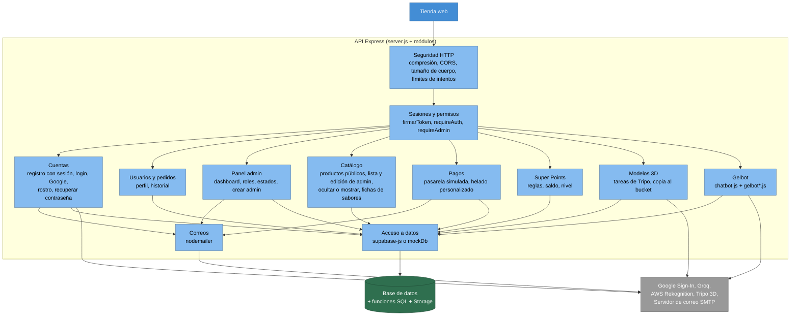

# 04 · Componentes del servidor (C4 nivel 3): la cocina por dentro

## Para principiantes

La cocina (la API Express) tiene estaciones, cada una con su trabajo: una revisa la puerta, otra atiende las cuentas de los clientes, otra el catálogo, otra los pagos y otra los correos.
Cada pedido que llega del mostrador entra por una **ventanilla** (una ruta, por ejemplo `POST /api/login`; POST significa "enviar datos" y API es la puerta por la que los programas se piden cosas entre sí).
Antes de atenderlo, un **guardia que pide carnet** (el middleware) mira si el pedido trae token y qué rol dice: algunas ventanillas atienden a cualquiera, otras solo a clientes con sesión y otras solo a administradores.
Algunas ventanillas tienen además un **límite de turnos**: si alguien insiste demasiadas veces seguidas, se le pide que espere, para frenar a los robots.
Gelbot, el ayudante del chat, también vive en esta cocina. Para los clientes es un **mesero que solo lee del menú impreso** (el servidor escribe todas sus frases); solo con un administrador usa la inteligencia artificial para redactar.

## Detalle técnico

Casi todo el servidor está en un solo archivo, `backend/server.js` (3.414 líneas al 2026-11-26), más el chatbot, que ya está repartido en módulos (`backend/gelbot/chatbot.js` de 958 líneas y los módulos `gelbot*` de la misma carpeta). Los "componentes" de abajo son **secciones lógicas**; los números de línea cambian con cada PR, por eso este documento cita **nombres de funciones y rutas**, no números de línea. (Medido con `wc -l` el 2026-11-26.)

### Módulos del backend

Rutas relativas a `backend/`: el chat está en `gelbot/`, las fichas de sabores en `datos/` y las utilidades en `servicios/`.

| Archivo | Líneas | Qué hace |
|---|---|---|
| `server.js` | 3.414 | La API Express: rutas, guardias, límites, base simulada, correos, pagos, Tripo |
| `gelbot/chatbot.js` | 958 | Entrada de Gelbot: cliente de Groq, herramientas y confirmaciones del modo admin, cachés |
| `gelbot/gelbotCliente.js` | 293 | Flujo de clientes y visitantes: atajos, una llamada al modelo y respuesta del servidor |
| `gelbot/gelbotIntencion.js` | 356 | Entiende el mensaje sin IA: qué pide, qué rechaza, cantidades, afirmaciones |
| `gelbot/gelbotFichas.js` | 374 | Ingredientes, alérgenos y dietas, siempre de la ficha del sabor y con aviso |
| `gelbot/gelbotRespuestas.js` | 271 | Todos los textos del cliente (plantillas por tema) y la frontera `paraCliente` |
| `gelbot/gelbotMenu.js` | 51 | Detecta cuándo mostrar el menú con fotos |
| `gelbot/gelbotTexto.js` | 143 | Limpia el texto del modelo (modo admin) |
| `datos/datosSabores.js` | 162 | Fichas de los sabores (ingredientes, alérgenos, nutrición) para la tienda y el chat |
| `servicios/imagenProducto.js` | 23 | Valida la URL de la foto de un producto (ruta local o `https`) |
| `servicios/modelos3dStorage.js` | 224 | Copia el modelo 3D de Tripo al bucket `modelos-3d` y borra el anterior |
| `servicios/correoIlike.js` | 6 | Escapa los comodines (`%`, `_`, `\`) de un correo para compararlo con `ilike` |

Las dependencias de los módulos del chat no forman ciclos: `gelbotIntencion` y `gelbotTexto` no dependen de nada; `gelbotMenu` usa `gelbotIntencion`; `gelbotFichas` usa `gelbotIntencion`, `datosSabores` y `gelbotTexto`; `gelbotRespuestas` usa `imagenProducto`, `gelbotIntencion`, `gelbotTexto` y `gelbotMenu`; `gelbotCliente` usa los anteriores; `chatbot.js` usa `gelbotCliente`.

### Diagrama de componentes

| Componente | Responsabilidad | Dónde (busca por nombre) |
|---|---|---|
| Seguridad HTTP | Compresión; CORS; cuerpo máximo 1 MB (8 MB solo en rutas con fotos); cabeceras COOP/COEP; errores de cuerpo en JSON (413/400) | `server.js`: `cors`, `LIMITE_CUERPO`, `RUTAS_CUERPO_GRANDE`, manejador de errores al final |
| Límites de intentos | `express-rate-limit` por IP (o por admin en Tripo); cada ruta su propia cuenta | `crearLimitadorCuenta`, `limitadorPagos`, `limitadorChatbot`, `limitadorTripo` |
| Sesiones y permisos | Firma (HS256, 24 h) y verificación de tokens; guardias; correos de admin y super admin | `firmarToken`, `verifyTokenSafely`, `requireAuth`, `requireAuthenticatedAdmin` |
| Cuentas | Registro (devuelve la sesión iniciada), login, Google, login y registro facial, recuperar contraseña | rutas `/api/register`, `/api/login`, `/api/google-login`, `/api/forgot-password`, `/api/reset-password/:token` |
| Usuarios y pedidos | Historial paginado y edición de perfil | `/api/orders/:userId`, `/api/users/:id` |
| Panel admin | Dashboard, borrar usuarios, cambiar rol, estado de venta, detalle de una venta, crear admin | rutas `/api/admin/*` |
| Catálogo | Productos públicos (con ficha de sabor), lista de admin con ocultos, alta y edición con **reglas compartidas** (`REGLAS_PRODUCTO`), rutas de un solo campo (`rutaCampoProducto`) | `/api/products`, `/api/admin/products*` |
| Pagos | Valida carrito, `puntosUsar` y líneas del helado personalizado; simula la pasarela; llama a `registrar_venta`; manda correo | `/api/payments/process`, `validarCarrito`, `validarLineaPersonalizada` |
| Super Points | Reglas, saldo, nivel e historial; el canje y el cambio de estado los resuelve la base en una sola transacción | `/api/points/rules`, `/api/me/points` |
| Modelos 3D | Reserva en la base, inicia y consulta tareas de Tripo, copia el GLB al bucket | `iniciarTareaModelo3D`, `/api/admin/products/:id/model-3d`, `modelos3dStorage.js` |
| Correos | Transporte SMTP o Ethereal; correo de cambio de estado y de pago con datos escapados | `getTransporter`, `sendStatusUpdateEmail` |
| Gelbot | Chat; ver sección abajo | `chatbot.js`, ruta `/api/chatbot` |
| Acceso a datos | Cliente Supabase real o base simulada en memoria | `createClient`, `mockDb` |

### Las guardias (middleware)

| Guardia | Qué exige |
|---|---|
| *(ninguna)* = **público** | Nada |
| `requireAuth` | `Authorization: Bearer <token>` válido (cualquier rol). Deja el contenido en `req.user` |
| `requireAdmin` (= `requireAuthenticatedAdmin`) | Token válido con `rol` `admin` o `super_admin` |
| **Super admin** | No es un middleware: es `requireAdmin` más una comprobación del correo del token (`esSuperAdminEmail`) **dentro** de la ruta |

El permiso sale **solo** del rol firmado en el token, nunca del cuerpo ni de cabeceras como `x-user-role`.

### Límites de intentos

| Limitador | Rutas | Tope por defecto |
|---|---|---|
| `limitadorRegistro`, `limitadorLogin`, `limitadorGoogleLogin`, `limitadorOlvidoClave`, `limitadorValidarEnlace`, `limitadorRestablecer`, `limitadorLoginFacial`, `limitadorCrearAdmin` | Una cada uno | 10 por IP cada 15 min (`LOGIN_RATE_LIMIT_MAX` y `LOGIN_RATE_LIMIT_WINDOW_MS`) |
| `limitadorPagos` | `POST /api/payments/process` | 10 por IP cada 1 min (`PAYMENT_RATE_LIMIT_*`) |
| `limitadorChatbot` | `POST /api/chatbot` | 20 por IP cada 1 min (`CHATBOT_RATE_LIMIT_*`) |
| `limitadorTripo` | Crear producto con prompt 3D y regenerar modelo | 5 por admin cada hora (`TRIPO_RATE_LIMIT_MAX`); solo cuenta si hay llave y prompt |

Al pasar el tope responden **429** con un mensaje en español. Además, pedir un enlace de recuperación tiene su propia espera: 2 minutos entre enlaces y 5 al día por cuenta (`RECUPERACION_ESPERA_MS`, `RECUPERACION_MAX_DIA`).

### Las 35 rutas

"Quién puede" describe lo que **hace el código**. Verificadas con `grep` de `app.get/post/put/delete` en `backend/server.js`.

| # | Método | Ruta | Guardia | Quién puede | Qué hace |
|---|---|---|---|---|---|
| 1 | POST | `/api/register` | público + `limitadorRegistro` | Cualquiera (no con correos reservados) | Crea una cuenta `cliente` (bcrypt, correo en minúsculas) y **devuelve la sesión iniciada** (`token` y `user`, igual que el login); 409 si el correo ya existe |
| 2 | POST | `/api/login` | público + `limitadorLogin` | Cualquiera | Correo + contraseña → token. El rol sale de la base |
| 3 | POST | `/api/admin/faceid/rekognition-register` | `requireAdmin` (cuerpo 8 MB) | Admin (registra **su** rostro) | Guarda el rostro en AWS y lo enlaza en `admin_face_rekognition` |
| 4 | POST | `/api/admin/faceid/rekognition-login` | público + `limitadorLoginFacial` (cuerpo 8 MB) | Cualquiera; solo da token si el rostro es de un usuario con `rol = 'admin'` en la base | Busca el rostro en AWS (similitud mínima 70 %) → token |
| 5 | POST | `/api/google-login` | público + `limitadorGoogleLogin` | Cualquiera con cuenta Google verificada | Verifica el `credential`; crea la cuenta si no existe; `ADMIN_EMAILS` → token de admin |
| 6 | POST | `/api/forgot-password` | público + `limitadorOlvidoClave` | Cualquiera | Envía un enlace; respuesta genérica (no revela si el correo existe) |
| 7 | GET | `/api/reset-password/:token` | público + `limitadorValidarEnlace` | Quien tenga el enlace | Comprueba si el enlace sirve (en la base solo se guarda su `sha256`) |
| 8 | POST | `/api/reset-password/:token` | público + `limitadorRestablecer` | Quien tenga el enlace | Cambia la contraseña; el enlace es de un solo uso y vence a los 30 minutos |
| 9 | GET | `/api/orders/:userId` | `requireAuth` | El dueño o un admin | Pedidos del usuario, paginados (`limit` ≤ 50, `offset`) |
| 10 | PUT | `/api/users/:id` | `requireAuth` | El dueño o un admin; a otros admins solo el super admin | Cambia solo nombre y correo |
| 11 | GET | `/api/admin/dashboard` | `requireAdmin` | Admin | Usuarios, ventas, productos y estadísticas, **sin paginar**; marca `soySuperAdmin` y `es_super_admin` por usuario |
| 12 | DELETE | `/api/admin/users/:id` | `requireAdmin` | Admin borra clientes; solo el super admin borra admins; nadie borra al super admin | Borra la cuenta y desvincula sus ventas |
| 13 | PUT | `/api/admin/users/:id/role` | `requireAdmin` | **Solo el super admin** cambia roles (asciende a `admin` o baja a `cliente`); nadie cambia al super admin | Cambia `rol` a `admin` o `cliente` |
| 14 | PUT | `/api/admin/sales/:id/status` | `requireAdmin` | Admin | Llama a `cambiar_estado_venta` (estado y puntos en una transacción); si sale bien, avisa por correo |
| 15 | GET | `/api/admin/sales/:id/items` | `requireAdmin` | Admin | Detalle de una venta: producto, cantidad, precio cobrado y composición si es helado personalizado |
| 16 | POST | `/api/admin/create-admin` | `requireAdmin` + `limitadorCrearAdmin` | Solo super admin | Crea un admin; responde sin `password_hash` |
| 17 | POST | `/api/admin/products` | `requireAdmin` + `limitadorTripo` (cuerpo 8 MB) | Admin | Crea producto con las mismas reglas del editor (stock 50 si no viene); si trae prompt y hay llave, inicia el modelo 3D |
| 18 | DELETE | `/api/admin/products/:id` | `requireAdmin` | Admin | Borra el producto; 409 si tiene ventas (se puede ocultar en su lugar); no toca el helado personalizado |
| 19 | PUT | `/api/admin/products/:id/image` | `requireAdmin` | Admin | Cambia la imagen (URL `https` o ruta local validada) |
| 20 | PUT | `/api/admin/products/:id` | `requireAdmin` | Admin | Edita nombre, precio, descripción, categoría, stock, estado; copia el stock a `inventario` |
| 21 | PUT | `/api/admin/products/:id/featured` | `requireAdmin` | Admin | Marca o quita destacado (solo verdadero o falso) |
| 22 | PUT | `/api/admin/products/:id/price` | `requireAdmin` | Admin | Cambia el precio (entero ≥ 1) |
| 23 | PUT | `/api/admin/products/:id/category` | `requireAdmin` | Admin | Cambia la categoría (`Clásico`, `Vegano`, `Temporada`, `Gourmet`) |
| 24 | PUT | `/api/admin/products/:id/stock` | `requireAdmin` | Admin | Cambia el stock (entero ≥ 0) |
| 25 | PUT | `/api/admin/products/:id/visible` | `requireAdmin` | Admin | **Oculta o muestra** el producto en la tienda (`estado`, solo `true` o `false`): la salida para un producto con ventas, que no se puede borrar |
| 26 | GET | `/api/admin/products` | `requireAdmin` | Admin | Lista del panel con **todos** los productos, también los ocultos (campo `estado`); nunca el helado personalizado; sin caché |
| 27 | GET | `/api/health` | público (con `CRON_SECRET` si existe) | Vercel Cron | Consulta mínima a la base para que Supabase gratis no se pause; la llama el cron diario de `backend/vercel.json` |
| 28 | GET | `/api/products` | público | Cualquiera | Catálogo activo (`estado = true`) con la ficha de sabor; caché de CDN de 30 s; si la base falla, un catálogo de emergencia del código sin caché |
| 29 | POST | `/api/payments/process` | `requireAuth` + `limitadorPagos` | Cualquier usuario con sesión | Pago simulado + `registrar_venta` con `puntosUsar` y líneas de helado personalizado + correo |
| 30 | GET | `/api/points/rules` | público | Cualquiera | Reglas de Super Points (`super_points_reglas()`); caché de 5 min |
| 31 | GET | `/api/personalizado/precios` | público | Cualquiera | Precios y límites del helado personalizado 3D (`componente_personalizado` y `helado_personalizado_reglas()`); caché de 5 min |
| 32 | GET | `/api/me/points` | `requireAuth` | Cualquier usuario con sesión; solo **sus** datos (el id sale del token) | Saldo, nivel, % máximo, lo que falta para el siguiente nivel e historial paginado (`limit` 1–50, `offset`). `private, no-store` |
| 33 | POST | `/api/chatbot` | público (token opcional) + `limitadorChatbot` | Cualquiera; el modo depende del rol del token | Gelbot |
| 34 | GET | `/api/admin/products/:id/model-3d` | `requireAdmin` | Admin | Estado del modelo 3D; al terminar Tripo, copia el GLB al bucket y guarda la URL permanente |
| 35 | POST | `/api/admin/products/:id/regenerate-3d` | `requireAdmin` + `limitadorTripo` | Admin | Inicia una nueva tarea en Tripo 3D (conserva el modelo anterior hasta que el nuevo esté listo) |

Rutas que **ya no existen**: `POST /api/orders` y `POST /api/sales`.

### Reglas compartidas de productos

El alta (`POST /api/admin/products`), el editor (`PUT /api/admin/products/:id`) y las rutas de un solo campo (`/featured`, `/price`, `/category`, `/stock`, `/visible`) usan **la misma tabla de reglas** (`REGLAS_PRODUCTO`): nombre de 1 a 120 caracteres, precio entero ≥ 1, stock entero ≥ 0, descripción de hasta 2.000 caracteres, categoría de la lista, estado verdadero o falso. Todas validan el id, guardan primero en la base y responden 404 si no hay fila. El **helado personalizado** (`producto.tipo = 'personalizado'`) está protegido: ninguna de estas rutas lo edita ni lo borra (responden 409), porque su precio sale de `componente_personalizado`. Cada cambio exitoso en `/api/admin/products` invalida la caché del catálogo de Gelbot.

### Super Points y helado personalizado en el servidor

- El nivel sale del **saldo actual** y el canje máximo del nivel lo calcula la base; el servidor solo valida que `puntosUsar` sea un entero entre 0 y 1.000.000 y traduce los errores (`PUNTOS_INSUFICIENTES`, `PUNTOS_EXCEDEN_TOPE`...).
- Una línea del carrito puede ser `{ tipo: 'personalizado', envase, sabores, toppings, cantidad }`: el servidor solo valida la **forma** (ids con formato válido, listas de hasta 10); que existan, los máximos (3 sabores y 3 toppings) y el precio los decide la base. El precio o nombre que mande el navegador se ignora.

### Modelos 3D en el servidor

- **Reserva en la base**: `iniciarTareaModelo3D` marca `producto.model_3d_estado = 'generando'` con un update condicional (una reserva de más de 15 minutos se puede retomar), así dos clics a la vez no lanzan dos tareas pagadas. Las columnas son `model_3d_task_id`, `model_3d_estado`, `model_3d_prompt`, `model_3d_actualizado` y `model_3d_url`.
- **Copia permanente**: cuando Tripo termina, `modelos3dStorage.js` descarga el GLB (60 s y 50 MB como máximo, solo `https`, nunca IPs ni la red interna; lista opcional `TRIPO_CDN_HOSTS`), comprueba que sea un GLB y lo sube al bucket `modelos-3d` (`producto-<id>/<taskId>.glb`). Solo entonces el producto pasa a `listo` con la URL del bucket y se borra el archivo anterior.
- Una copia que falla por algo pasajero se reintenta en la siguiente consulta durante 10 minutos; después queda en `error`.

### Gelbot: `chatbot.js` y los módulos `gelbot*`

La explicación completa, con diagrama, temas y seguridad, está en [docs/chatbot_documentation.md](../chatbot_documentation.md). Resumen:

| Tema | Cómo funciona |
|---|---|
| Identidad | Sale **solo** del token; sin token = visitante. Un cliente o visitante nunca recibe herramientas de administrador |
| Clientes y visitantes | **Solo textos escritos por el servidor**, con plantillas por tema (`gelbotRespuestas.js`) y datos de la base. Hay como máximo **una llamada** a Groq por mensaje, y su texto se descarta: el modelo solo elige un tema cerrado (`elegirTema`) o una herramienta (`getProducts`, `addToCart`, `getOrders` con sesión) |
| Sin modelo | Muchos mensajes se resuelven sin llamar al modelo (confirmar una oferta, ficha, precio, pedido claro, menú, gracias, cómo pagar...). Si el modelo falla o no hay llave, el servidor entiende lo básico con palabras clave |
| Ingredientes y alergias | Siempre la ficha completa del sabor (`datosSabores.js`) con aviso; si el cliente cuenta una alergia y pide un producto, no se agrega sin confirmación |
| Tarjetas con foto | El menú se devuelve como tarjetas (hasta 24 productos activos) con la foto validada (`imagenProducto.js`) |
| Modo admin | Hasta dos llamadas al modelo, herramientas de lectura (`getProducts`, `getOrders`, `getAllUsers`, `getAllOrders`, `getSalesSummary`) y tres acciones con confirmación (`deleteUser`, `deleteProduct`, `addProduct`): se proponen con un código de un solo uso, ligado al admin, que vence en 5 minutos, y se ejecutan solo al confirmar en otra petición |
| Reglas de borrado | Las mismas que la ruta de borrar usuarios (super admin protegido, admins solo por el super admin) |
| Límites | Mensaje de hasta 1.000 caracteres; historial de hasta 20 turnos (se usan los 4 últimos); máximo 3 llamadas a herramientas por respuesta; 20 mensajes por minuto por IP |
| Datos no confiables | En modo admin, lo que escriben los clientes (nombres, correos, productos) se limpia y se marca antes de dárselo al modelo |
| Cachés | Catálogo 1 minuto (se invalida al cambiar productos); reglas de puntos y datos del helado 3D 5 minutos |
| Modelo | `openai/gpt-oss-20b` por defecto; se cambia con `GROQ_MODEL` (esfuerzo de razonamiento bajo). El modelo anterior, `llama-3.1-8b-instant`, ya no se usa |

### Seguridad

**Lo que ya está bien**

- Tokens: un solo secreto, solo HS256, vencen en 24 h; en producción no arranca sin `JWT_SECRET` de 32+ caracteres.
- Google se verifica en el servidor; correo y nombre salen solo del token de Google verificado.
- Contraseñas con bcrypt, 10 rondas; el login solo acepta hashes bcrypt.
- Correos de administradores reservados: no se registran con contraseña.
- **Solo el super admin asciende a otros** a administrador (y también los baja o crea administradores).
- Recuperar contraseña: el enlace se guarda como hash, es de un solo uso, vence a los 30 minutos y la petición tiene espera y tope diario.
- Precios y total los calcula la base; todo o nada (ver [07-modelo-datos.md](07-modelo-datos.md)).
- Pagar exige sesión; el dueño de la venta sale del token.
- Datos escapados antes de entrar al HTML de los correos de cambio de estado y de pago.
- Producción no arranca en modo simulado, para no aprobar pagos que no se guardan.
- La llave pública de Supabase no sirve para nada: todas las tablas tienen RLS y sin privilegios para `anon` ni `authenticated`; solo el servidor entra con `service_role`.
- Descargas de modelos 3D protegidas contra que el servidor sea usado para leer su propia red.
- Chat de clientes: solo textos del servidor, sin herramientas de admin y con el mensaje normalizado.

**Deuda conocida**

Hay deudas de seguridad conocidas que el equipo sigue aparte (ver la auditoría técnica). Lo que sigue es deuda de mantenimiento verificada en el código:

| Tema | Detalle |
|---|---|
| Restos al arrancar | Intenta crear `admin_face_rekognition` llamando a `exec_sql`, función que ya no existe en la base (solo deja un aviso en el registro) |
| Tablas inexistentes | Al borrar un usuario intenta borrar en `admin_face_credentials` y `admin_webauthn_challenges`, que no existen (el error se ignora) |
| Base simulada | `mockDb` duplica reglas de negocio (`registrar_venta`, puntos, estados) para desarrollo; hay que mantenerla igual que las funciones SQL |
| Estado en memoria | Los límites de intentos, las confirmaciones del admin del chat y las cachés viven en la memoria de cada instancia de Vercel; con varias instancias el efecto es aproximado (la confirmación falla "cerrada": el admin repite la orden) |
| Catálogo de emergencia | Si la base falla o devuelve una lista vacía, `GET /api/products` responde un catálogo de ejemplo escrito en el código (sin caché) |
| Librería sin uso | `@simplewebauthn/server` está instalada pero no se usa |
| Archivo muy grande | `server.js` concentra demasiadas responsabilidades |

### Rendimiento y caché

| Punto | Detalle |
|---|---|
| Bien | Compresión; historial de pedidos y de puntos paginados; índices en ventas; sondeos de la página cada 30 s con pausa en pestaña oculta; caché de CDN de 30 s en `/api/products` (más 30 s sirviendo la copia vieja mientras se renueva); reglas de puntos y precios del helado 3D a 5 min; modelos 3D comprimidos y guardados con caché de un año |
| Invalidación | La caché del catálogo del chat se borra al cambiar un producto; la del CDN tarda hasta unos 60 s en reflejar un cambio del panel (las otras pestañas se refrescan al recibir el aviso) |
| A mejorar | El dashboard trae **todos** los usuarios, ventas y productos sin paginar |
| A mejorar | El pago espera 1-2 s a propósito (simulación) |
