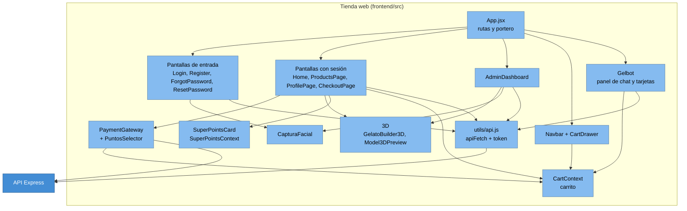

# 05 · Componentes de la página (C4 nivel 3): el mostrador por dentro

## Para principiantes

El mostrador (la Tienda web) tiene varias vitrinas: la de entrada (login y registro), la del catálogo, la del perfil, la de pago y la oficina del administrador.
Un **portero** en la página (las rutas protegidas) decide qué vitrina puedes ver según tu carnet; pero ojo, el portero de verdad es el de la cocina: la página solo esconde botones, el servidor es el que dice sí o no.
El **carrito** es como la canasta que lleva el cliente: la página la recuerda en el navegador aunque cierres la pestaña.
Para hablar con la cocina hay un **mensajero** (`apiFetch`) que siempre lleva el carnet (token) del cliente pegado al pedido.
Y hay piezas especiales: **Gelbot** (el chat, ahora con un panel rediseñado y tarjetas con fotos de los sabores), la pasarela de pago, el **armador de helado 3D** y los visores 3D.

## Detalle técnico

Código en `frontend/src/`. Es una SPA de React 19 con React Router 7; cada pantalla se carga solo cuando se necesita (`lazy` en `App.jsx`) y Vite separa Three.js, la interfaz y React en paquetes distintos (`vite.config.js`). Este documento cita **nombres de archivos y funciones**, no números de línea.

### Diagrama de componentes

### Pantallas (rutas de la página)

| Ruta en el navegador | Pantalla | Portero | Llama a la API |
|---|---|---|---|
| `/login` | `pages/Login.jsx` | Solo sin sesión | `POST /api/login`, `POST /api/google-login`, `POST /api/admin/faceid/rekognition-login` |
| `/register` | `pages/Register.jsx` | Solo sin sesión | `POST /api/register` (el cliente queda con la sesión iniciada y entra directo a la tienda) |
| `/forgot-password` | `pages/ForgotPassword.jsx` | Solo sin sesión | `POST /api/forgot-password` |
| `/reset-password/:token` | `pages/ResetPassword.jsx` | Solo sin sesión | `GET /api/reset-password/:token` (valida el enlace) y `POST` (guarda la nueva contraseña) |
| `/` | `pages/Home.jsx` | Con sesión (`ProtectedRoute`) | `GET /api/products`; contiene el armador 3D y la sección de Super Points |
| `/productos` | `pages/ProductsPage.jsx` | Con sesión | `GET /api/products` |
| `/perfil` | `pages/ProfilePage.jsx` | Con sesión | `GET /api/orders/:id`, `PUT /api/users/:id`, `GET /api/me/points` |
| `/checkout` | `pages/CheckoutPage.jsx` | Con sesión | vía `PaymentGateway` → `POST /api/payments/process`; recalcula los helados personalizados con `GET /api/personalizado/precios` |
| `/admin` | `pages/AdminDashboard.jsx` | `AdminRoute`: sesión y `rol === 'admin'` | Rutas `/api/admin/*` |
| cualquier otra | — | — | Redirige a `/` |

`ProtectedRoute` y `AdminRoute` además pintan `Navbar` y `Gelbot`. Como `/` pide sesión, un visitante sin cuenta solo ve las pantallas de entrada.

### Componentes

| Componente | Qué hace | Habla con |
|---|---|---|
| `Navbar` + `CartDrawer` | Menú, botón de SuperPoints y cajón del carrito. El cajón muestra "Ganarás +N" con las reglas reales (`SuperPointsContext`, de `GET /api/points/rules`): $100 pagados = 1 punto, 1 punto = $5 de descuento, tope por nivel. La altura de la barra es una constante compartida con el chat (`utils/layout.js`) | `CartContext`, `SuperPointsContext` |
| `Gelbot` | Ventana de chat **rediseñada**: panel color cacao debajo de la barra, compacto en escritorio y pantalla completa en celular respetando el teclado, botón flotante que se oculta al abrir, accesible (`role="dialog"`, conversación con `role="log"`). Manda el token como `Bearer`. Muestra las respuestas del servidor, **tarjetas con foto** de los sabores (un toque agrega el helado; los toques repetidos se ignoran) y, para administradores, tablas y botones Confirmar o Cancelar | `POST /api/chatbot`, `CartContext` |
| `PaymentGateway` + `PuntosSelector` | Modal de pago simulado (PSE, Nequi, Bancolombia) y selector de cuántos Super Points usar. Manda el carrito (con las líneas personalizadas) y `puntosUsar` | `POST /api/payments/process` |
| `SuperPointsCard` | Saldo, nivel, avance al siguiente nivel e historial en el perfil | `GET /api/me/points` |
| `GelatoBuilder3D` | **Armador de helado personalizado**: 17 piezas `.glb` fijas de `public/360/` (3 envases, 6 sabores, 8 toppings), precios y límites tomados de la base, y agrega el helado al carrito con su composición. Si falla el archivo de una pieza, solo esa pieza muestra un aviso | `GET /api/personalizado/precios` |
| `Model3DPreview` | Visor del modelo 3D generado por Tripo para un producto (**solo en el panel de administración**) | URL del modelo en el bucket `modelos-3d` |
| `CapturaFacial` | Toma la foto de la cámara para el login facial y para registrar el rostro del admin (ver [reconocimiento-facial.md](../reconocimiento-facial.md)) | (la pantalla que lo usa) |
| `AvisoPendiente` | Muestra un aviso que debe verse en la página siguiente (por ejemplo, al salir del panel porque la cuenta ya no es de administrador) | `sessionStorage` |
| `FlavorModal`, `FlavorImage`, `FrameAnimation` | Ficha de sabor, imagen con respaldo, animación por cuadros | — |
| `QrVerification` | **Sin uso**: ningún archivo lo importa | Rutas que no existen |

### El panel de administración

`AdminDashboard.jsx` es una sola pantalla grande (más de 3.000 líneas). Hoy incluye, entre otras cosas:

- **Productos:** lista con **todos** los productos (también los ocultos, con la etiqueta "Oculto"), edición en línea de precio, stock y categoría, **interruptor para ocultar o mostrar** (con botón Deshacer; un cambio a la vez por producto), alta de producto con las mismas reglas del servidor y aviso con botón Ocultar cuando un producto no se puede borrar por tener ventas.
- **Modelos 3D:** generar o regenerar el modelo con un prompt, con sondeo cada 3 s mientras genera y cada 10 s mientras el servidor lo guarda, y vista del modelo anterior mientras tanto.
- **Usuarios:** el selector de rol queda habilitado **solo para el super admin** (el servidor es quien decide de verdad).
- **Ventas:** estados, detalle de cada venta con la composición de los helados personalizados.
- **Rostro:** registrar el rostro propio.
- El panel se actualiza con un **sondeo cada 30 s** que se pausa si la pestaña está oculta (`utils/sondeo.js`), y avisa a las otras pestañas cuando cambian los productos.
- Un 403 de "no eres admin" saca a la portada con un aviso en lugar de dejar un panel vacío.

### Estado y ayudantes (`frontend/src/utils/` y `context/`)

| Pieza | Qué guarda o hace |
|---|---|
| `context/CartContext.jsx` | Carrito por usuario en `localStorage` (clave por id de usuario o "invitado"); `addToCart`, `clearCart`, `totalPrice`; maneja líneas del helado personalizado |
| `utils/api.js` (`apiFetch`) | Antepone `VITE_API_URL`, agrega `Content-Type` y `Authorization: Bearer <token>`. **Solo un 401** borra la sesión y manda a `/login`; un 403 vuelve a la pantalla con el mensaje del servidor |
| `utils/sesion.js` | Sesión igual para todos los caminos de entrada (contraseña, Google, rostro y registro): token y usuario en `localStorage` y `sessionStorage`; solo se considera válida mientras el token (24 h) no venza |
| `utils/ingresos.js` | Lista `ESTADOS_COBRADOS` (copia de la del servidor, verificada por una prueba) y `soloVentasCobradas` |
| `utils/personalizado.js`, `usePreciosPersonalizado.js` | Precio, descripción y recálculo del helado personalizado con los precios de la base |
| `utils/superPoints.js`, `superPointsApi.js` | Cálculos y llamadas de Super Points |
| `utils/tarjetasGelbot.js`, `panelGelbot.js` | Tarjetas del chat y medidas del panel |
| `utils/sondeo.js`, `sondeoModelo3D.js` | Sondeos con pausa y sin solapamiento |
| `utils/precargaModelos.js`, `piezas3d.js` | Solo precarga el modelo 3D elegido; aísla las piezas que fallan |
| `utils/editorProductos.js`, `edicionRapida.js`, `cambiosEnCurso.js`, `visibilidadProductos.js` | Reglas del editor, edición en línea y cambios en vuelo del panel |
| `utils/fotoPerfil.js` | Achica la foto de perfil a 256 px en JPEG antes de guardarla |
| Proveedor de Google | `GoogleOAuthProvider` envuelve la app con `VITE_GOOGLE_CLIENT_ID` |

Casi todas estas funciones son puras y tienen su prueba en `backend/tests/frontend/` (ver [06-pruebas-y-calidad.md](06-pruebas-y-calidad.md)).

### Desajustes y deudas conocidas entre la página y el servidor

| Tema | Detalle |
|---|---|
| `QrVerification` | Llama a `/api/admin/verificar-qr` y `/api/admin/enrolar-qr`, que no existen. Sin efecto: el componente no se usa |
| `AdminRoute` exige `rol === 'admin'` | El servidor acepta `admin` o `super_admin`; el super admin normal se reconoce por su correo y su token trae `rol` de la base, así que no hay problema en la práctica, pero un token con `super_admin` no vería el panel |
| Panel sin paginar | El dashboard (`GET /api/admin/dashboard`) trae todos los usuarios y ventas y se repite cada 30 s |
| Pruebas de pantallas | No hay: solo se prueban funciones puras de `utils/` |
| Imágenes y modelos pesados | La carpeta `public/` incluye imágenes y un video; los modelos 3D del armador ya están comprimidos (34 MB) |
