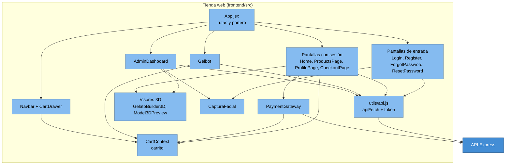

# 05 · Componentes de la página (C4 nivel 3): el mostrador por dentro

## Para principiantes

El mostrador (la Tienda web) tiene varias vitrinas: la de entrada (login y registro), la del catálogo, la del perfil, la de pago y la oficina del administrador.
Un **portero** en la página (las rutas protegidas) decide qué vitrina puedes ver según tu carnet; pero ojo, el portero de verdad es el de la cocina: la página solo esconde botones, el servidor es el que dice sí o no.
El **carrito** es como la canasta que lleva el cliente: la página la recuerda en el navegador aunque cierres la pestaña.
Para hablar con la cocina hay un **mensajero** (`apiFetch`) que siempre lleva el carnet (token) del cliente pegado al pedido.
Y hay piezas especiales: Gelbot (el chat), la pasarela de pago y los visores 3D, que muestran helados que puedes girar con el ratón.

## Detalle técnico

Código en `frontend/src/`. Es una SPA de React 19 con React Router 7; cada pantalla se carga solo cuando se necesita (`App.jsx:7-17`) y Vite separa Three.js, la interfaz y React en paquetes distintos (`vite.config.js:24-38`).

### Diagrama de componentes

### Pantallas (rutas de la página)

| Ruta en el navegador | Pantalla | Portero | Llama a la API | Referencia |
|---|---|---|---|---|
| `/login` | `pages/Login.jsx` | Solo sin sesión | `POST /api/login`, `POST /api/google-login`, `POST /api/admin/faceid/rekognition-login` | `App.jsx:95-98`; `Login.jsx:75`, `:115`, `:143` |
| `/register` | `pages/Register.jsx` | Solo sin sesión | `POST /api/register` | `Register.jsx:110` |
| `/forgot-password` | `pages/ForgotPassword.jsx` | Solo sin sesión | `POST /api/forgot-password` | `ForgotPassword.jsx:49` |
| `/reset-password/:token` | `pages/ResetPassword.jsx` | Solo sin sesión | `POST /api/reset-password/:token` (y un `GET` que no existe, ver abajo) | `ResetPassword.jsx:20`, `:138` |
| `/` | `pages/Home.jsx` | Con sesión (`ProtectedRoute`) | `GET /api/products` | `App.jsx:113-120`; `Home.jsx:60` |
| `/productos` | `pages/ProductsPage.jsx` | Con sesión | `GET /api/products` | `ProductsPage.jsx:25` |
| `/perfil` | `pages/ProfilePage.jsx` | Con sesión | `GET /api/orders/:id`, `PUT /api/users/:id` | `ProfilePage.jsx:103`, `:151` |
| `/checkout` | `pages/CheckoutPage.jsx` | Con sesión | vía `PaymentGateway` → `POST /api/payments/process` | `PaymentGateway.jsx:133` |
| `/admin` | `pages/AdminDashboard.jsx` | `AdminRoute`: sesión y `rol === 'admin'` | Rutas `/api/admin/*` y `GET /api/products` | `App.jsx:42-54`; `AdminDashboard.jsx:159-889` |
| cualquier otra | — | — | Redirige a `/` | `App.jsx:155` |

`ProtectedRoute` y `AdminRoute` además pintan `Navbar` y `Gelbot` (`App.jsx:27-54`). Como `/` pide sesión, un visitante sin cuenta solo ve las pantallas de entrada.

### Componentes

| Componente | Qué hace | Habla con | Referencia |
|---|---|---|---|
| `Navbar` + `CartDrawer` | Menú, botón de SuperPoints, cajón del carrito. Los SuperPoints son solo un cálculo en pantalla (total / 10); no se guardan | `CartContext` | `Navbar.jsx:6`, `CartDrawer.jsx:93` |
| `Gelbot` | Ventana de chat; manda el token como `Bearer`; puede agregar al carrito y mostrar tablas | `POST /api/chatbot`, `CartContext` | `Gelbot.jsx:142-144`, `:220-221` |
| `PaymentGateway` | Modal de pago simulado (PSE, Nequi, Bancolombia). Manda el carrito y `userId`; **no** manda token | `POST /api/payments/process` | `PaymentGateway.jsx:127-150` |
| `GelatoBuilder3D` | Constructor 3D del inicio (cono, copa, vaso) con modelos `.glb` fijos de `public/` | — | `GelatoBuilder3D.jsx:98-100` |
| `Model3DPreview` | Visor del modelo 3D generado por Tripo para un producto (panel admin) | URL del modelo | `Model3DPreview.jsx:16`; `AdminDashboard.jsx:10` |
| `CapturaFacial` | Toma la foto de la cámara para el login facial y para registrar el rostro del admin | (la pantalla que lo usa) | `Login.jsx:332-337`; `AdminDashboard.jsx:11`, `:188` |
| `FlavorModal`, `FlavorImage`, `FrameAnimation` | Ficha de sabor, imagen con respaldo, animación por cuadros | — | `Home.jsx:9-10`, `ProductsPage.jsx:6` |
| `QrVerification` | **Sin uso**: ningún archivo lo importa | Rutas que no existen | `QrVerification.jsx:38`, `:76` |

### Estado y ayudantes

| Pieza | Qué guarda o hace | Referencia |
|---|---|---|
| `context/CartContext.jsx` | Carrito por usuario en `localStorage` (clave por id de usuario o "invitado"); `addToCart`, `clearCart`, `totalPrice` | `CartContext.jsx:16-34` |
| `utils/api.js` (`apiFetch`) | Antepone `VITE_API_URL`, agrega `Content-Type` y `Authorization: Bearer <token>`. Si la respuesta es **401 o 403**, borra la sesión y manda a `/login` | `api.js:9`, `api.js:52-73` |
| Token y usuario | El token se guarda en `localStorage` **y** `sessionStorage`; el usuario, en `localStorage` solo si es admin | `api.js:21-26`; `App.jsx:62-71` |
| `utils/ingresos.js` | Lista `ESTADOS_COBRADOS` (copia de la del servidor) y `soloVentasCobradas` para las cifras del panel | `ingresos.js:1-8`; `AdminDashboard.jsx:13` |
| Proveedor de Google | `GoogleOAuthProvider` envuelve la app con `VITE_GOOGLE_CLIENT_ID` | `index.jsx:6-14` |

### Desajustes entre la página y el servidor

| La página hace | Pero el servidor | Efecto |
|---|---|---|
| `PUT /api/admin/products/:id/image` (`AdminDashboard.jsx:446`) | No tiene esa ruta | Cambiar la imagen de un producto falla |
| `GET /api/reset-password/:token` (`ResetPassword.jsx:20`) | Solo tiene `POST` (`server.js:1521`) | **Recuperar la contraseña no funciona**: la respuesta 404 no es JSON, la página muestra "Error de conexión con el servidor" y nunca enseña el formulario de nueva contraseña (`ResetPassword.jsx:17-38`, `:195`) |
| `QrVerification` llama a `/api/admin/verificar-qr` y `/api/admin/enrolar-qr` | No existen | Sin efecto: el componente no se usa |
| `apiFetch` cierra la sesión también con **403** (`api.js:67`) | Usa 403 para "no tienes permiso" (por ejemplo, un admin que intenta borrar a otro admin) | Un admin normal es expulsado al intentar una acción reservada al super admin |
| `AdminRoute` exige `rol === 'admin'` (`App.jsx:44`) | Acepta `admin` o `super_admin` (`server.js:849`) | Un token con `super_admin` no vería el panel (solo pasaría si en la base algún usuario tuviera `rol = 'super_admin'`; el super admin normal se reconoce por su correo) |
| El panel pide el dashboard cada 3 s (`AdminDashboard.jsx:534-537`) | El dashboard no está paginado | Mucha carga con muchos usuarios o ventas |
