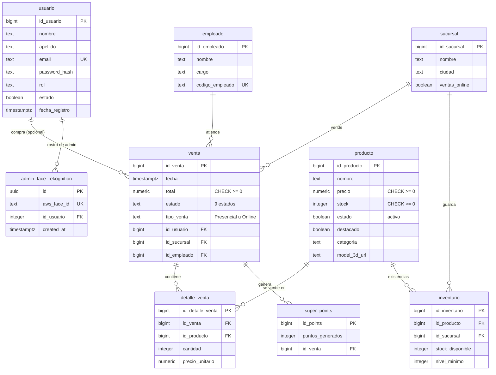

# 07 · Modelo de datos: la bodega y su libreta

## Para principiantes

La bodega (la base de datos) guarda todo en una libreta con varias hojas, llamadas **tablas**.
Hay una hoja para los clientes (`usuario`), otra para los sabores (`producto`), otra para cada venta (`venta`) y otra para el detalle de qué se llevó en cada venta (`detalle_venta`).
Las hojas se conectan entre sí: una venta apunta al cliente que compró, y cada línea del detalle apunta al sabor vendido.
La **caja registradora** (`registrar_venta`) es la única que anota ventas: revisa precios y existencias, escribe la venta y su detalle y saca los helados de la bodega, todo de una vez; si algo falla, no anota nada.
Solo la cocina (el servidor) tiene la llave de esa caja: ni el mostrador ni un extraño pueden usarla.

## Detalle técnico

Fuentes: `supabase/schema_base_2026-10-25.sql` (foto de las tablas) y `supabase/migrations/20261025120000_ventas_pagos_y_productos.sql` (en adelante, "migración"). La tabla `admin_face_rekognition` no está en `supabase/`: se crea con `backend/scripts/create-rekognition-table.sql` (también en el `migration.sql` de la raíz). Las columnas se confirmaron, solo leyendo, contra la base real el 2026-10-26.

### Diagrama entidad-relación (9 tablas)

### Tablas y columnas clave

| Tabla | Para qué | Columnas clave y reglas | Referencia |
|---|---|---|---|
| `usuario` | Cuentas | `email` único; `password_hash` (bcrypt); `rol` texto (`cliente` / `admin`); `codigo_acceso` sin uso en el código | schema:4-16 |
| `producto` | Catálogo | `precio` ≥ 0; `stock` entero ≥ 0, por defecto 50, **única fuente del stock**; `destacado` (por defecto `false`); `model_3d_url`; `estado` = activo | schema:39-55; migración:44-76 |
| `venta` | Cabecera de cada venta | `estado` con CHECK de 9 valores (por defecto `Pendiente`); `total` ≥ 0; `tipo_venta` `Presencial`/`Online`; `id_usuario` opcional (`on delete set null`) | schema:57-71; migración:20-42 |
| `detalle_venta` | Líneas de una venta | `precio_unitario` copiado de `producto.precio` al vender; borrar la venta borra su detalle (`cascade`); no se puede borrar un producto con ventas (`restrict`) | schema:73-82 |
| `inventario` | Stock por sucursal (heredado) | `stock_disponible` ≥ 0; el servidor solo lo copia al editar un producto | schema:84-95; `server.js:2219-2225` |
| `sucursal`, `empleado` | Tiendas físicas y personal | Ningún código de la app las escribe | schema:18-37 |
| `super_points` | Puntos de fidelidad | Ningún código la escribe; los SuperPoints de la página son un cálculo en pantalla | schema:97-104 |
| `admin_face_rekognition` | Enlace entre un rostro de AWS y un admin | `aws_face_id` único; borrar el usuario borra el enlace (`cascade`) | `backend/scripts/create-rekognition-table.sql:4-11` |

### La función `registrar_venta` (la caja registradora)

Firma: `public.registrar_venta(p_id_usuario bigint, p_items jsonb, p_estado text) returns jsonb` (migración:121-126).

| Propiedad | Detalle | Migración |
|---|---|---|
| Quién la ejecuta | **Solo** `service_role` (se le quita el permiso a `public`, `anon` y `authenticated`). Confirmado en la base real | 292-295 |
| Seguridad | `security invoker` y `search_path` vacío (no se le puede colar otra tabla con el mismo nombre) | 124-125 |
| Entrada | `p_items = [{ id_producto, cantidad }]`, 1 a 50 líneas; cantidad entera 1-99; `p_estado` solo `Pagado` o `Fallido`; `p_id_usuario` puede ser nulo (compra anónima) | 107-109, 138-176 |
| Precio | Siempre `producto.precio`; lo que mande la página se ignora | 111, 235-239 |
| Repetidos | Se suman en una línea; la suma tampoco puede pasar de 99 | 178-196 |
| Bloqueo | Si es `Pagado`, bloquea los productos en orden de id (evita bloqueos cruzados entre compras) | 205-213 |
| Todo o nada | Ante cualquier error no queda venta, ni detalle, ni cambio de stock | 113 |
| Stock | Solo se descuenta si es `Pagado`, con doble guarda `stock >= cantidad` | 251-267 |
| Salida | `{ id_venta, total, estado, items: [{ id_producto, nombre, cantidad, precio_unitario, subtotal }] }` | 119, 269-285 |

**Códigos de error** (SQLSTATE `P0001`, el mensaje es el código) y cómo los traduce el servidor (`server.js:2458-2472`):

| Código | Cuándo | HTTP |
|---|---|---|
| `STOCK_INSUFICIENTE` | No alcanza el stock | 409 |
| `PRODUCTO_NO_EXISTE`, `PRODUCTO_INACTIVO` | Sabor borrado o desactivado | 400 |
| `CANTIDAD_INVALIDA`, `ITEM_INVALIDO`, `CARRITO_VACIO`, `CARRITO_DEMASIADO_GRANDE` | Carrito mal formado | 400 |
| `USUARIO_NO_EXISTE` | El `p_id_usuario` no existe | 400 |
| `ESTADO_INVALIDO` u otro error | — | 500 (mensaje genérico) |

### Índices

Creados por la migración (líneas 89-103):

| Índice | Sirve para |
|---|---|
| `venta_id_usuario_fecha_idx (id_usuario, fecha desc)` | Historial de pedidos de un cliente (`GET /api/orders/:userId`) |
| `venta_fecha_idx (fecha desc)` | Listados y reportes por fecha |
| `venta_id_empleado_idx`, `venta_id_sucursal_idx` | Llaves foráneas de `venta` |
| `detalle_venta_id_venta_idx`, `detalle_venta_id_producto_idx` | Llaves foráneas de `detalle_venta` |
| `inventario_id_producto_idx`, `inventario_id_sucursal_idx` | Llaves foráneas de `inventario` |

La migración también alinea las secuencias de id con los datos reales (líneas 78-86) y es **idempotente** (se puede ejecutar dos veces). Para deshacerla en una emergencia: `supabase/rollbacks/20261025120000_ventas_pagos_y_productos.rollback.sql`.

### Permisos

- La API Express entra con la llave `service_role`, que salta las reglas por fila (RLS) (`server.js:32-33`).
- La migración **no** activa RLS ni crea políticas: queda para una fase aparte (migración:10).
- La función `exec_sql` (que permitía ejecutar SQL arbitrario) ya **no existe** en la base; el servidor aún intenta llamarla al arrancar y solo deja un aviso (`server.js:476`).

### Tablas que hay en la base real y el código no usa

La base real tiene además seis tablas heredadas que no consulta ni `server.js`, ni `chatbot.js`, ni `backend/scripts/`, ni `frontend/src/`: `proveedor`, `pedido`, `users`, `reset_tokens`, `rostros_admin`, `rostros_admin_muestras` (solo aparece un nombre `rostros_admin` vacío en la base simulada, `server.js:363`; `migration.sql` de la raíz borra las dos de rostros). A la inversa, el código intenta borrar filas de `admin_face_credentials` y `admin_webauthn_challenges`, que **no** existen en la base (`server.js:1877-1878`).
