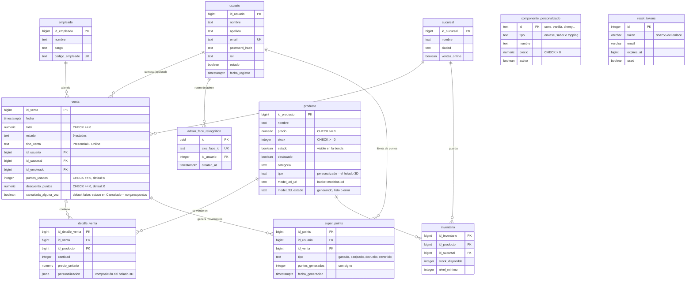

# 07 · Modelo de datos: la bodega y su libreta

## Para principiantes

La bodega (la base de datos) guarda todo en una libreta con varias hojas, llamadas **tablas**.
Hay una hoja para los clientes (`usuario`), otra para los sabores (`producto`), otra para cada venta (`venta`) y otra para el detalle de qué se llevó en cada venta (`detalle_venta`).
Las hojas se conectan entre sí: una venta apunta al cliente que compró, y cada línea del detalle apunta al sabor vendido.
La **caja registradora** (`registrar_venta`) es la única que anota ventas: revisa precios y existencias, escribe la venta y su detalle y saca los helados de la bodega, todo de una vez; si algo falla, no anota nada.
Solo la cocina (el servidor) tiene la llave de esa caja: ni el mostrador ni un extraño pueden usarla.

## Detalle técnico

Fuentes: `supabase/schema_base_2026-10-25.sql` (foto de las tablas) y las migraciones de `supabase/migrations/` (9 archivos, del `20261025120000` al `20261120130000`, cada una con su rollback en `supabase/rollbacks/`). La tabla `admin_face_rekognition` no está en `supabase/`: se crea con `backend/scripts/create-rekognition-table.sql`. Las tablas y columnas se confirmaron, solo leyendo (SELECT), contra la base real el 2026-11-26: **16 tablas en `public`, todas con RLS**. Las migraciones se aplican **a mano** en el SQL Editor de Supabase.

### Diagrama entidad-relación (11 tablas dibujadas de las 16 que hay)

### Tablas y columnas clave

| Tabla | Para qué | Columnas clave y reglas |
|---|---|---|
| `usuario` | Cuentas | `email` único; `password_hash` (bcrypt); `rol` texto (`cliente` / `admin`); `codigo_acceso` sin uso en el código |
| `producto` | Catálogo | `precio` ≥ 0; `stock` entero ≥ 0, por defecto 50, **única fuente del stock**; `estado` = visible en la tienda (ocultar = `false`); `destacado`; `categoria`; `tipo` (`personalizado` marca el producto del helado 3D, único); `tags`, `rating`, `reviews`, `long_desc`; estado del modelo 3D en `model_3d_url`, `model_3d_task_id`, `model_3d_estado`, `model_3d_prompt`, `model_3d_actualizado` |
| `venta` | Cabecera de cada venta | `estado` con CHECK de 9 valores (por defecto `Pendiente`); `total` ≥ 0 (lo realmente pagado, después del descuento); `tipo_venta` `Presencial`/`Online`; `id_usuario` opcional (`on delete set null`); `puntos_usados` y `descuento_puntos` ≥ 0; `cancelada_alguna_vez`: si alguna vez estuvo en `Cancelado` nunca gana Super Points |
| `detalle_venta` | Líneas de una venta | `precio_unitario` copiado del precio vigente al vender; **`personalizacion` (JSON, opcional)**: la composición del helado 3D con nombres y precios del momento; borrar la venta borra su detalle (`cascade`); no se puede borrar un producto con ventas (`restrict`, por eso se oculta) |
| `componente_personalizado` | Precios del helado 3D | `id` (los mismos ids del armador: `cone`, `cup`, `glass`, `vanilla`, `chocolate`, `fresa`, `mango`, `menta`, `mora`, `cherry`, `chips`, `coco`, `cream`, `gummies`, `nuts`, `sprinkles`, `syrup`), `tipo` (`envase`, `sabor`, `topping`), `nombre`, `precio` (CHECK `> 0`), `activo`. 17 filas. Solo la lee el servidor. Es la **única** fuente de precios del personalizado |
| `inventario` | Stock por sucursal (heredado) | `stock_disponible` ≥ 0; el servidor solo lo copia al editar un producto |
| `sucursal`, `empleado` | Tiendas físicas y personal | Ningún código de la app las escribe |
| `super_points` | Libreta de Super Points | Solo la escribe la base (`registrar_venta`, `cambiar_estado_venta`); el saldo es la suma de `puntos_generados` |
| `reset_tokens` | Enlaces de recuperar contraseña | `token` guarda el **sha256** del enlace (nunca el enlace), `email`, `expires_at` (milisegundos), `used`. Índice único por `token` e índice por `email` (migración `20261110130000`). El enlace es de un solo uso y vence a los 30 minutos |
| `admin_face_rekognition` | Enlace entre un rostro de AWS y un admin | `aws_face_id` único; borrar el usuario borra el enlace (`cascade`). Ver [reconocimiento-facial.md](../reconocimiento-facial.md) |

### Storage (archivos)

- **Bucket `modelos-3d`** (migración `20261118120000_bucket_modelos_3d.sql`): público de lectura, `file_size_limit` 50 MB y solo `model/gltf-binary`. Una sola política sobre `storage.objects`: `modelos_3d_lectura_publica` (SELECT). Sin INSERT, UPDATE ni DELETE para `anon` ni `authenticated`; el servidor sube y borra con `service_role`.
- Ruta de cada archivo: `producto-<id>/<taskId>.glb` (inmutable: se sube con caché de un año).
- Regenerar no borra el modelo bueno: `model_3d_url` conserva el anterior mientras el estado es `generando` (la consulta lo devuelve como `urlAnterior`). Cuando el nuevo queda `listo`, el update reemplaza la URL y recién entonces se borra del bucket el archivo anterior de ese mismo producto.
- `producto.model_3d_estado` pasa a `listo` solo después de copiar el GLB. Si la copia falla por algo pasajero, sigue `generando` y se reintenta hasta 10 minutos desde `model_3d_actualizado`. Pasa a `error` si el enlace de Tripo venció, si el modelo pesa más de 50 MB, si el enlace apunta a un host no permitido o si se agotaron los 10 minutos.
- **Bucket `helados`** (imágenes): solo lectura pública; las políticas de INSERT y UPDATE se quitaron (migración `20261110120000_storage_helados_solo_lectura.sql`). Las imágenes se suben a mano desde el panel de Supabase.
- Guía completa: [modelos-3d.md](../modelos-3d.md).

### `super_points`: la libreta de puntos

Cada movimiento es una fila. El saldo de un cliente es la suma de `puntos_generados` de sus filas.

| Tipo | Signo | Cuándo se escribe |
|---|---|---|
| `ganado` | positivo | Venta pagada (o venta pendiente/fallida que pasa a cobrada), por `piso(total ÷ 100)` |
| `canjeado` | negativo | Venta pagada con `p_puntos_usar > 0` |
| `devuelto` | positivo | Venta cancelada: vuelven los puntos canjeados |
| `revertido` | cero o negativo | Venta cancelada: se quitan los ganados sin dejar el saldo bajo cero. Aunque quite 0, marca la venta como revertida |

- Restricciones: un mismo `tipo` no se repite en la misma venta (`super_points_venta_tipo_key`), así cada movimiento ocurre una sola vez. Cada tipo tiene su signo (`super_points_signo_check`).
- El nivel sale del **saldo** (la suma de todos los movimientos), regla del 2026-11-19 (`20261120120000_nivel_por_saldo.sql`). Gastar puntos puede bajar el nivel. `ganados` se sigue calculando solo como dato informativo.
- Índice `super_points_id_usuario_fecha_idx (id_usuario, fecha_generacion desc)` para saldo e historial.
- Sin permisos para `anon` ni `authenticated`: solo el servidor (`service_role`) la lee y escribe.

### Funciones de la base

| Función | Qué hace | Migración | Quién la ejecuta |
|---|---|---|---|
| `super_points_reglas()` | Valores del programa: `pesos_por_punto` 100, `valor_punto` 5 y la lista de niveles (nombre, mínimo, máximo, `pct`). Es el **único** lugar con estos valores | `20261111120000_super_points.sql` | `service_role` |
| `super_points_resumen(p_id_usuario)` | Devuelve `saldo`, `ganados`, `nivel`, `pct_max`, `valor_saldo`, `puntos_para_siguiente` y `siguiente_nivel`. Desde el 2026-11-19 el nivel sale del `saldo` (un saldo negativo cuenta como 0) | reemplazada por `20261120120000_nivel_por_saldo.sql` | `service_role` |
| `cambiar_estado_venta(p_id_venta, p_estado)` | Cambia el estado y mueve los puntos **en la misma transacción**. Bloquea la venta y luego al cliente. A un estado cobrado desde `Pendiente` o `Fallido` otorga puntos (una vez); a `Cancelado` devuelve y revierte (una vez). Errores `ESTADO_INVALIDO`, `VENTA_NO_EXISTE` | `20261111120000_super_points.sql` | `service_role` |
| `helado_personalizado_reglas()` | Límites del helado 3D: `max_sabores` 3 y `max_toppings` 3. Es el **único** lugar con esos límites | `20261120130000_helado_personalizado.sql` | `service_role` |
| `registrar_venta(...)` | La caja registradora (ver abajo) | `20261120130000_helado_personalizado.sql` (la última versión) | `service_role` |

Las funciones están en `public` con `search_path` vacío y se les quita el permiso a `public`, `anon` y `authenticated`.

### La función `registrar_venta` (la caja registradora)

Firma actual: `public.registrar_venta(p_id_usuario bigint, p_items jsonb, p_estado text, p_puntos_usar integer default 0) returns jsonb`. La versión vigente la define `20261120130000_helado_personalizado.sql` (misma firma que la de Super Points, que a su vez reemplazó a la de 3 parámetros de `20261025120000`; las llamadas anteriores siguen funcionando).

| Propiedad | Detalle |
|---|---|
| Quién la ejecuta | **Solo** `service_role` |
| Seguridad | `security invoker` y `search_path` vacío (no se le puede colar otra tabla con el mismo nombre) |
| Entrada | `p_items` de 1 a 50 líneas. Línea normal: `{ id_producto, cantidad }` (cantidad entera 1-99). Línea personalizada: `{ tipo: "personalizado", envase, sabores, toppings, cantidad }`. `p_estado` solo `Pagado` o `Fallido`; `p_id_usuario` puede ser nulo (compra anónima, sin puntos); `p_puntos_usar` entero ≥ 0 (en `Fallido` se ignora) |
| Precio | Siempre el de la base (`producto.precio` o la suma de `componente_personalizado`); lo que mande la página se ignora |
| Helado personalizado | Exactamente 1 envase, de 1 a `max_sabores` sabores y de 0 a `max_toppings` toppings sin repetir; cada id debe existir, estar activo y ser del tipo correcto; va en su propia fila de `detalle_venta` con su `personalizacion`; **no bloquea ni descuenta stock**; el producto personalizado no se puede pedir como línea normal |
| Repetidos | Los productos normales repetidos se suman en una línea; la suma tampoco puede pasar de 99 |
| Bloqueos | Si es `Pagado`, bloquea la fila del cliente antes de leer el saldo (dos pagos simultáneos se hacen en fila) y los productos en orden de id (evita bloqueos cruzados) |
| Canje | Se revisa `p_puntos_usar` contra el saldo (`PUNTOS_INSUFICIENTES`) y contra el tope del nivel **antes** de esta compra (`PUNTOS_EXCEDEN_TOPE`). Tope = `piso(subtotal × pct ÷ 100 ÷ 5)`. Descuento = puntos × 5. Si el nivel no trae `pct_max`, el tope es 0 |
| Total y puntos ganados | `total = subtotal − descuento`; gana `piso(total ÷ 100)` si es `Pagado` y hay usuario |
| Todo o nada | Ante cualquier error no queda venta, ni detalle, ni cambio de stock, ni movimiento de puntos |
| Stock | Solo se descuenta si es `Pagado` y es un producto normal, con doble guarda `stock >= cantidad` |
| Salida | `{ id_venta, total, subtotal, estado, items, puntos_usados, descuento, puntos_ganados, saldo }`; las líneas personalizadas traen además `personalizacion` |

**Códigos de error** (SQLSTATE `P0001`, el mensaje es el código) y cómo los traduce el servidor (`ERRORES_VENTA` en `server.js`):

| Código | Cuándo | HTTP |
|---|---|---|
| `STOCK_INSUFICIENTE` | No alcanza el stock | 409 |
| `PRODUCTO_NO_EXISTE`, `PRODUCTO_INACTIVO` | Sabor borrado, desactivado u oculto | 400 |
| `CANTIDAD_INVALIDA`, `ITEM_INVALIDO`, `CARRITO_VACIO`, `CARRITO_DEMASIADO_GRANDE` | Carrito mal formado | 400 |
| `USUARIO_NO_EXISTE` | El `p_id_usuario` no existe | 400 |
| `PUNTOS_INVALIDOS`, `PUNTOS_INSUFICIENTES`, `PUNTOS_EXCEDEN_TOPE` | Canje no permitido | 400 |
| `PERSONALIZADO_INVALIDO`, `PERSONALIZADO_NO_DISPONIBLE` | Composición no válida o producto personalizado no disponible | 400 |
| `ESTADO_INVALIDO` u otro error | — | 500 (mensaje genérico) |

### Índices

Creados por la migración `20261025120000` (y los de `super_points`, `reset_tokens` y el personalizado en las suyas):

| Índice | Sirve para |
|---|---|
| `venta_id_usuario_fecha_idx (id_usuario, fecha desc)` | Historial de pedidos de un cliente (`GET /api/orders/:userId`) |
| `venta_fecha_idx (fecha desc)` | Listados y reportes por fecha |
| `venta_id_empleado_idx`, `venta_id_sucursal_idx` | Llaves foráneas de `venta` |
| `detalle_venta_id_venta_idx`, `detalle_venta_id_producto_idx` | Llaves foráneas de `detalle_venta` |
| `inventario_id_producto_idx`, `inventario_id_sucursal_idx` | Llaves foráneas de `inventario` |
| `producto_tipo_personalizado_key` | Garantiza un solo producto personalizado |
| `reset_tokens_token_key`, `reset_tokens_email_idx` | Buscar rápido un enlace de recuperación |

Las migraciones son **idempotentes** (se pueden ejecutar dos veces) y cada una tiene su rollback en `supabase/rollbacks/` para una emergencia.

### Permisos y seguridad de la base

- La API Express entra con la llave `service_role`, la llave de servidor de la base.
- **RLS activo en las 16 tablas** y sin privilegios para `anon` ni `authenticated` (migración `20261104120000_rls_tablas_publicas.sql`, que también cierra las tablas futuras): con la llave pública no se puede leer ni escribir nada.
- La función `exec_sql` (que permitía ejecutar SQL arbitrario) ya **no existe** en la base; el servidor aún intenta llamarla al arrancar y solo deja un aviso.

### Tablas que hay en la base real y el código no usa

La base real tiene además siete tablas heredadas que no consulta ni `server.js`, ni los módulos del chat, ni `frontend/src/`: `proveedor`, `pedido`, `users`, `rostros_admin`, `rostros_admin_muestras`, `sucursal` y `empleado` (las dos últimas solo existen por las llaves foráneas de `venta` e `inventario`). A la inversa, el código intenta borrar filas de `admin_face_credentials` y `admin_webauthn_challenges`, que **no** existen en la base (el error se ignora).
