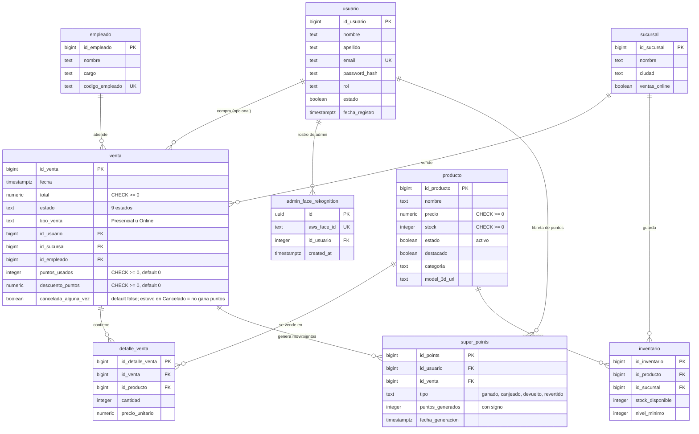

# 07 · Modelo de datos: la bodega y su libreta

## Para principiantes

La bodega (la base de datos) guarda todo en una libreta con varias hojas, llamadas **tablas**.
Hay una hoja para los clientes (`usuario`), otra para los sabores (`producto`), otra para cada venta (`venta`) y otra para el detalle de qué se llevó en cada venta (`detalle_venta`).
Las hojas se conectan entre sí: una venta apunta al cliente que compró, y cada línea del detalle apunta al sabor vendido.
La **caja registradora** (`registrar_venta`) es la única que anota ventas: revisa precios y existencias, escribe la venta y su detalle y saca los helados de la bodega, todo de una vez; si algo falla, no anota nada.
Solo la cocina (el servidor) tiene la llave de esa caja: ni el mostrador ni un extraño pueden usarla.

## Detalle técnico

Fuentes: `supabase/schema_base_2026-10-25.sql` (foto de las tablas) y `supabase/migrations/20261025120000_ventas_pagos_y_productos.sql` (en adelante, "migración"). La tabla `admin_face_rekognition` no está en `supabase/`: se crea con `backend/scripts/create-rekognition-table.sql` (también en el `migration.sql` de la raíz). Las columnas se confirmaron, solo leyendo, contra la base real el 2026-10-26.

### Diagrama entidad-relación (9 tablas)

### Tablas y columnas clave

| Tabla | Para qué | Columnas clave y reglas | Referencia |
|---|---|---|---|
| `usuario` | Cuentas | `email` único; `password_hash` (bcrypt); `rol` texto (`cliente` / `admin`); `codigo_acceso` sin uso en el código | schema:4-16 |
| `producto` | Catálogo | `precio` ≥ 0; `stock` entero ≥ 0, por defecto 50, **única fuente del stock**; `destacado` (por defecto `false`); `model_3d_url`; `estado` = activo | schema:39-55; migración:44-76 |
| `venta` | Cabecera de cada venta | `estado` con CHECK de 9 valores (por defecto `Pendiente`); `total` ≥ 0 (desde Super Points: lo realmente pagado, después del descuento); `tipo_venta` `Presencial`/`Online`; `id_usuario` opcional (`on delete set null`); `puntos_usados` y `descuento_puntos` ≥ 0, por defecto 0; `cancelada_alguna_vez` (por defecto false): si alguna vez estuvo en `Cancelado` nunca gana Super Points | schema:57-71; migración:20-42; `20261111120000_super_points.sql:91-111` |
| `detalle_venta` | Líneas de una venta | `precio_unitario` copiado de `producto.precio` al vender; borrar la venta borra su detalle (`cascade`); no se puede borrar un producto con ventas (`restrict`) | schema:73-82 |
| `inventario` | Stock por sucursal (heredado) | `stock_disponible` ≥ 0; el servidor solo lo copia al editar un producto | schema:84-95; `server.js:2219-2225` |
| `sucursal`, `empleado` | Tiendas físicas y personal | Ningún código de la app las escribe | schema:18-37 |
| `super_points` | Libreta de Super Points | Solo la escribe la base (`registrar_venta`, `cambiar_estado_venta`); el saldo es la suma de `puntos_generados`. Ver la sección de abajo | schema:97-104; `20261111120000_super_points.sql:29-84` |
| `admin_face_rekognition` | Enlace entre un rostro de AWS y un admin | `aws_face_id` único; borrar el usuario borra el enlace (`cascade`) | `backend/scripts/create-rekognition-table.sql:4-11` |

### `super_points`: la libreta de puntos

Cada movimiento es una fila. El saldo de un cliente es la suma de `puntos_generados` de sus filas.

| Tipo | Signo | Cuándo se escribe |
|---|---|---|
| `ganado` | positivo | Venta pagada (o venta pendiente/fallida que pasa a cobrada), por `piso(total ÷ 100)` |
| `canjeado` | negativo | Venta pagada con `p_puntos_usar > 0` |
| `devuelto` | positivo | Venta cancelada: vuelven los puntos canjeados |
| `revertido` | cero o negativo | Venta cancelada: se quitan los ganados sin dejar el saldo bajo cero. Aunque quite 0, marca la venta como revertida |

- Restricciones: un mismo `tipo` no se repite en la misma venta (`super_points_venta_tipo_key`), así cada movimiento ocurre una sola vez. Cada tipo tiene su signo (`super_points_signo_check`).
- El nivel usa solo los `ganado` de ventas **sin** `revertido`.
- Índice `super_points_id_usuario_fecha_idx (id_usuario, fecha_generacion desc)` para saldo e historial.
- Sin permisos para `anon` ni `authenticated` (`revoke all`, migración línea 84): solo el servidor (`service_role`) la lee y escribe.
- La tabla estaba vacía: no hubo nada que migrar. Migración `20261111120000_super_points.sql:29-84`.

### Funciones de Super Points

| Función | Qué hace | Migración | Quién la ejecuta |
|---|---|---|---|
| `super_points_reglas()` | Valores del programa: `pesos_por_punto` 100, `valor_punto` 5 y la lista de niveles (nombre, mínimo, máximo, `pct`). Es el **único** lugar con estos valores | líneas 109-126 | `service_role` |
| `super_points_resumen(p_id_usuario)` | Devuelve `saldo`, `ganados`, `nivel`, `pct_max`, `valor_saldo`, `puntos_para_siguiente` y `siguiente_nivel` (en Master, 0 y `null`). El nivel sale de `ganados` (no de `saldo`) | líneas 135-183 | `service_role` |
| `cambiar_estado_venta(p_id_venta, p_estado)` | Cambia el estado y mueve los puntos **en la misma transacción**. Bloquea la venta y luego al cliente. A un estado cobrado desde `Pendiente` o `Fallido` otorga puntos (una vez); a `Cancelado` devuelve y revierte (una vez). Salir de `Cancelado` no mueve nada. Errores `ESTADO_INVALIDO`, `VENTA_NO_EXISTE` | líneas 446-533 | `service_role` |

Las cuatro funciones están en `public` con `search_path` vacío y se les quita el permiso a `public`, `anon` y `authenticated` (líneas 539-546).

### La función `registrar_venta` (la caja registradora)

Firma actual: `public.registrar_venta(p_id_usuario bigint, p_items jsonb, p_estado text, p_puntos_usar integer default 0) returns jsonb` (migración `20261111120000_super_points.sql:202-430`). Reemplaza a la versión de 3 parámetros de `20261025120000`; el parámetro nuevo tiene valor por defecto, así que las llamadas de 3 argumentos siguen funcionando.

| Propiedad | Detalle | Migración (`20261111120000`) |
|---|---|---|
| Quién la ejecuta | **Solo** `service_role` | 539-546 |
| Seguridad | `security invoker` y `search_path` vacío (no se le puede colar otra tabla con el mismo nombre) | 204-206 |
| Entrada | `p_items = [{ id_producto, cantidad }]`, 1 a 50 líneas; cantidad entera 1-99; `p_estado` solo `Pagado` o `Fallido`; `p_id_usuario` puede ser nulo (compra anónima, sin puntos); `p_puntos_usar` entero ≥ 0 (en `Fallido` se ignora) | 228-249 |
| Precio | Siempre `producto.precio`; lo que mande la página se ignora | 337-341 |
| Repetidos | Se suman en una línea; la suma tampoco puede pasar de 99 | 275-293 |
| Bloqueo del cliente | Si es `Pagado`, bloquea su fila antes de leer el saldo: dos pagos simultáneos del mismo cliente se hacen en fila | 295-307 |
| Bloqueo de productos | Si es `Pagado`, bloquea los productos en orden de id (evita bloqueos cruzados entre compras) | 309-315 |
| Canje | Se revisa `p_puntos_usar` contra el saldo (`PUNTOS_INSUFICIENTES`) y contra el tope del nivel **antes** de esta compra (`PUNTOS_EXCEDEN_TOPE`). Tope = `piso(subtotal × pct ÷ 100 ÷ 5)`. Descuento = puntos × 5 | 343-361 |
| Total y puntos ganados | `total = subtotal − descuento`; gana `piso(total ÷ 100)` si es `Pagado` y hay usuario | 363-366 |
| Todo o nada | Ante cualquier error no queda venta, ni detalle, ni cambio de stock, ni movimiento de puntos | 368-405 |
| Stock | Solo se descuenta si es `Pagado`, con doble guarda `stock >= cantidad` | 378-394 |
| Libreta | Escribe `canjeado` (si hubo canje) y `ganado` (si ganó puntos) | 396-405 |
| Salida | `{ id_venta, total, subtotal, estado, items, puntos_usados, descuento, puntos_ganados, saldo }` | 407-428 |

**Códigos de error** (SQLSTATE `P0001`, el mensaje es el código) y cómo los traduce el servidor (`server.js:2452-2472`, `ERRORES_VENTA`):

| Código | Cuándo | HTTP |
|---|---|---|
| `STOCK_INSUFICIENTE` | No alcanza el stock | 409 |
| `PRODUCTO_NO_EXISTE`, `PRODUCTO_INACTIVO` | Sabor borrado o desactivado | 400 |
| `CANTIDAD_INVALIDA`, `ITEM_INVALIDO`, `CARRITO_VACIO`, `CARRITO_DEMASIADO_GRANDE` | Carrito mal formado | 400 |
| `USUARIO_NO_EXISTE` | El `p_id_usuario` no existe | 400 |
| `PUNTOS_INVALIDOS` | `p_puntos_usar` negativo | 400 |
| `PUNTOS_INSUFICIENTES` | Se quiere canjear más que el saldo | 400 |
| `PUNTOS_EXCEDEN_TOPE` | Se quiere canjear más que el % del nivel | 400 |
| `ESTADO_INVALIDO` u otro error | — | 500 (mensaje genérico) |

### Índices

Creados por la migración (líneas 89-103):

| Índice | Sirve para |
|---|---|
| `venta_id_usuario_fecha_idx (id_usuario, fecha desc)` | Historial de pedidos de un cliente (`GET /api/orders/:userId`) |
| `venta_fecha_idx (fecha desc)` | Listados y reportes por fecha |
| `venta_id_empleado_idx`, `venta_id_sucursal_idx` | Llaves foráneas de `venta` |
| `detalle_venta_id_venta_idx`, `detalle_venta_id_producto_idx` | Llaves foráneas de `detalle_venta` |
| `inventario_id_producto_idx`, `inventario_id_sucursal_idx` | Llaves foráneas de `inventario` |

La migración también alinea las secuencias de id con los datos reales (líneas 78-86) y es **idempotente** (se puede ejecutar dos veces). Para deshacerla en una emergencia: `supabase/rollbacks/20261025120000_ventas_pagos_y_productos.rollback.sql`.

### Permisos

- La API Express entra con la llave `service_role`, la llave de servidor de la base (`server.js:32-33`).
- La función `exec_sql` (que permitía ejecutar SQL arbitrario) ya **no existe** en la base; el servidor aún intenta llamarla al arrancar y solo deja un aviso (`server.js:476`).

### Tablas que hay en la base real y el código no usa

La base real tiene además ocho tablas heredadas que no consulta ni `server.js`, ni `chatbot.js`, ni `backend/scripts/`, ni `frontend/src/`: `proveedor`, `pedido`, `users`, `reset_tokens`, `rostros_admin`, `rostros_admin_muestras`, `sucursal`, `empleado` (`super_points` ya no está aquí: la usa el programa de puntos; solo aparece un nombre `rostros_admin` vacío en la base simulada, `server.js:363`; `migration.sql` de la raíz borra las dos de rostros). A la inversa, el código intenta borrar filas de `admin_face_credentials` y `admin_webauthn_challenges`, que **no** existen en la base (`server.js:1877-1878`).
