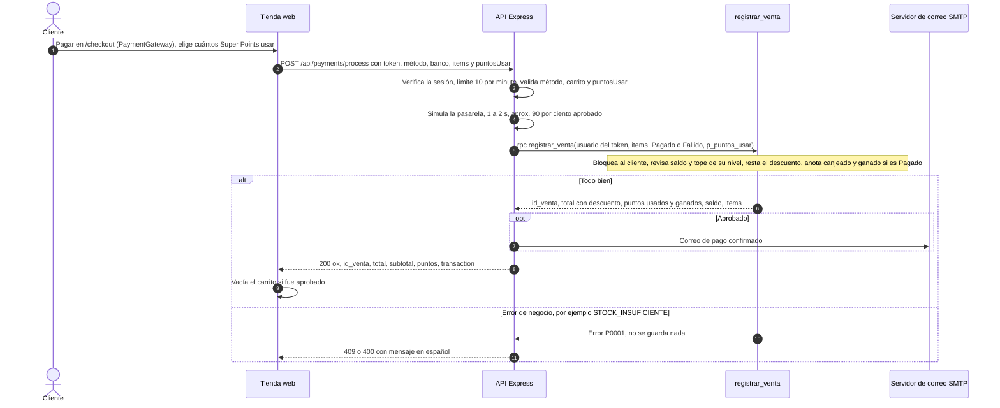
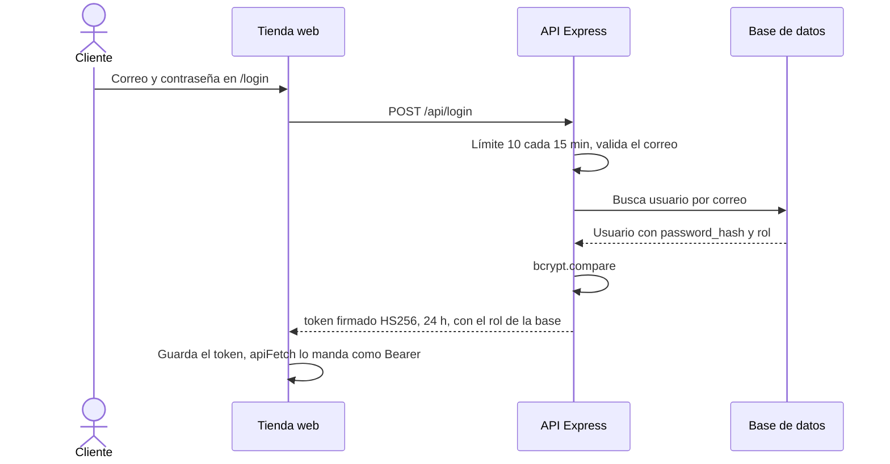
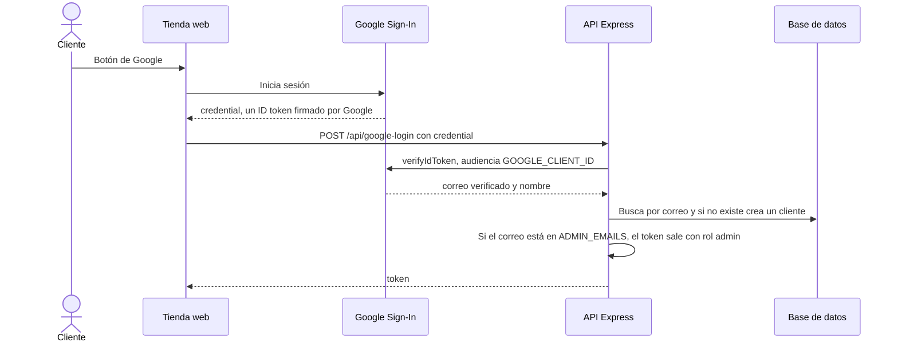
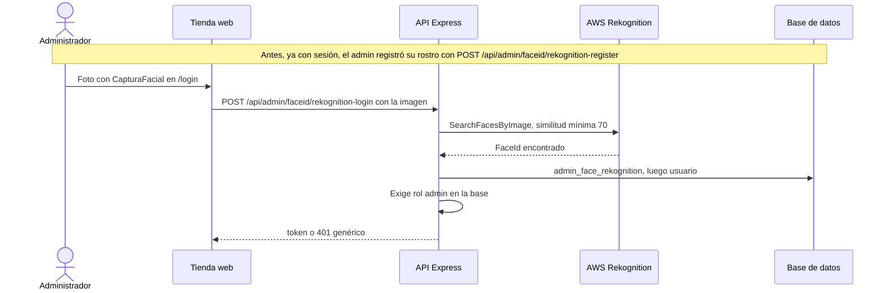
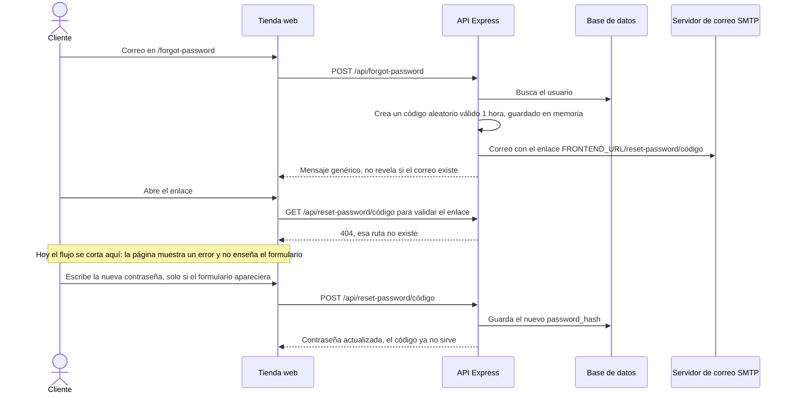
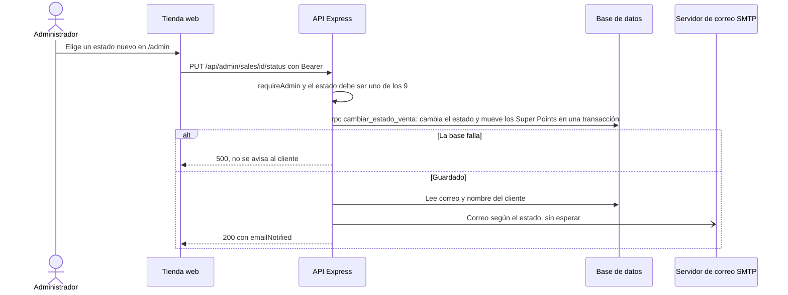
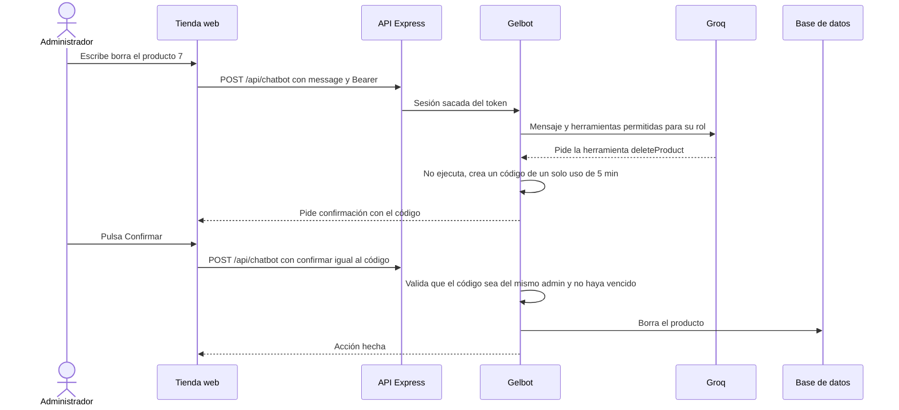
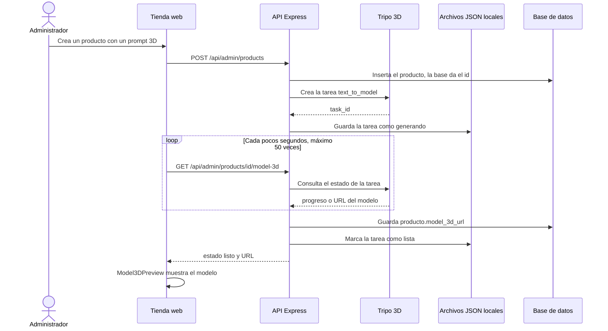
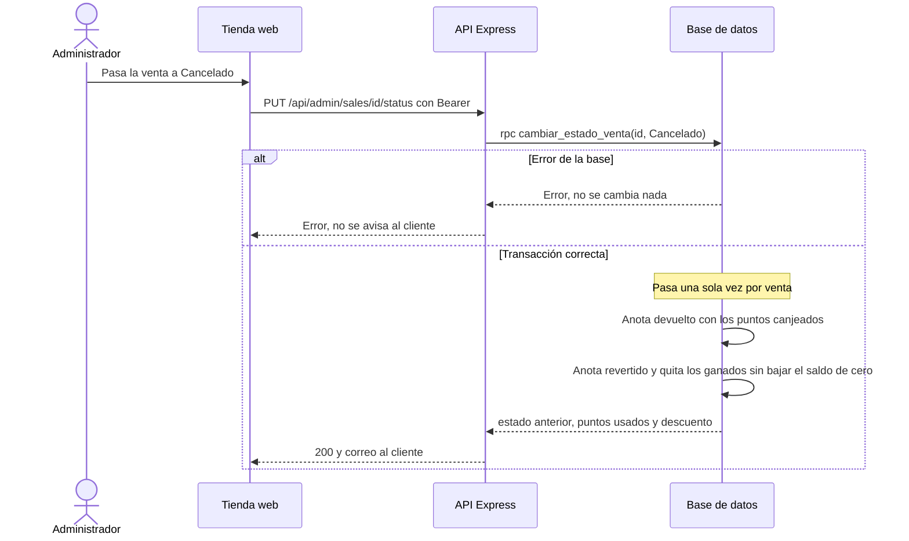

# 08 · Flujos: lo que pasa paso a paso

## Para principiantes

Aquí seguimos un pedido de principio a fin, como si fuéramos detrás de él por la heladería.
Por ejemplo, en una compra: el cliente llena su canasta en el mostrador, va a pagar, la cocina revisa el pedido, la caja registradora cobra con los precios de la libreta y saca los helados de la bodega, y al final un mensajero le lleva un correo de confirmación.
Cada dibujo de abajo es una "tira cómica" que se lee de arriba hacia abajo: cada flecha es un mensaje de una pieza a otra.
Los nombres de las piezas son los mismos de la [tabla de piezas](03-contenedores.md#tabla-de-piezas-nombres-oficiales).

*Figura: el viaje de una compra. [Descarga el archivo y ábrelo en el navegador para verla animada](figuras/viaje-compra.html).*

## Detalle técnico

### 1. Compra

| Paso | Referencia |
|---|---|
| Llamada de la página (sin token) | `PaymentGateway.jsx:127-150` |
| Límite y validaciones (incluye `puntosUsar`) | `server.js:2771-2807`; `validarPuntosUsar` en `server.js:2719-2723` |
| Resultado simulado y espera | `server.js:2818-2834` |
| `registrar_venta` con `p_puntos_usar` | `server.js:2839-2850`; migración `20261111120000_super_points.sql:202-430` |
| Canje: saldo, tope y descuento | migración `20261111120000_super_points.sql:343-366` |
| Correo de confirmación (muestra el descuento) | `server.js:2885-2941` |
| Respuesta (total, descuento, puntos usados y ganados) | `server.js:2953-2960` |
| Vaciar carrito | `CheckoutPage.jsx:62-66` |

### 2. Iniciar sesión

**a) Con correo y contraseña**

Referencias: `Login.jsx:115`; `server.js:1140-1188`; firma en `server.js:816-822`; guardado en `api.js:21-26`.

**b) Con Google**

Referencias: `Login.jsx:75`, `Login.jsx:312`; `server.js:1365-1463`; elevación en `server.js:810-813` y `server.js:1418-1426`.

**c) Facial (solo administradores)**

Referencias: registro `server.js:1193-1254`; login `server.js:1257-1355`; `Login.jsx:143`.

### 3. Recuperar la contraseña

Referencias: `server.js:1466-1518`, `server.js:1521-1562`; códigos en memoria `server.js:624`; páginas `ForgotPassword.jsx:49`, `ResetPassword.jsx:20` (validación con `GET`, que el servidor no tiene), `ResetPassword.jsx:195` (pantalla de error), `ResetPassword.jsx:138` (envío con `POST`).

> **Error conocido:** la recuperación de contraseña está rota de punta a punta. El servidor solo acepta `POST /api/reset-password/:token`; la página primero pide un `GET` a esa dirección, recibe 404 y se queda en la pantalla de error. Ver [05-componentes-frontend.md](05-componentes-frontend.md#desajustes-entre-la-página-y-el-servidor).

### 4. Cambio de estado de una venta y correo

Referencias: `AdminDashboard.jsx:333`; `server.js:2149-2229` (ruta; la llamada a la base en `server.js:2163`); plantilla de correo `server.js:679-781`. Los puntos del cambio de estado (cobrar o cancelar) se describen en la sección 7.

### 5. Gelbot con confirmación

Referencias: `Gelbot.jsx:142-144`, `Gelbot.jsx:220-221`; `server.js:2703-2707`; `chatbot.js:333-382`, `chatbot.js:519-538`, `chatbot.js:544-549`, `chatbot.js:716-731`. Un visitante o cliente nunca recibe las herramientas de admin (`chatbot.js:599-600`).

### 6. Producto con modelo 3D

Referencias: `server.js:2077-2179` (crear e iniciar Tripo), `server.js:126-182` (llamadas a Tripo), `server.js:2712-2775` (consulta y guardado), `server.js:2778-2809` (regenerar); sondeo en la página `AdminDashboard.jsx:740-760`.

### 7. Cancelar una venta y devolver Super Points

Cuando un admin pasa una venta cobrada a "Cancelado", la base hace todo en una sola transacción: devuelve lo canjeado y quita lo ganado.

- Si el cliente ya gastó los puntos ganados, se quita solo lo que tenga. El movimiento `revertido` anota lo que realmente se quitó, y el nivel deja de contar todos los puntos ganados en esa venta.
- Si un admin saca la venta de "Cancelado", los puntos no se vuelven a mover.
- Una venta sin movimientos (Fallido, Pendiente o anterior al programa) no mueve nada al cancelarse.

Referencias: `server.js:2149-2229` (ruta; la llamada en `server.js:2163`); función `cambiar_estado_venta` en `supabase/migrations/20261111120000_super_points.sql:446-533` (reversa en las líneas 497-520).
