# 08 · Flujos: lo que pasa paso a paso

## Para principiantes

Aquí seguimos un pedido de principio a fin, como si fuéramos detrás de él por la heladería.
Por ejemplo, en una compra: el cliente llena su canasta en el mostrador, va a pagar, la cocina revisa el pedido, la caja registradora cobra con los precios de la libreta y saca los helados de la bodega, y al final un mensajero le lleva un correo de confirmación.
Cada dibujo de abajo es una "tira cómica" que se lee de arriba hacia abajo: cada flecha es un mensaje de una pieza a otra.
Los nombres de las piezas son los mismos de la [tabla de piezas](03-contenedores.md#tabla-de-piezas-nombres-oficiales).


*Figura: el viaje de una compra. [Descarga el archivo y ábrelo en el navegador para verla animada](figuras/viaje-compra.html).*

## Detalle técnico

Los flujos citan **rutas y funciones** (los números de línea cambian con cada PR). Verificado contra `main` el 2026-11-26.

### 1. Compra

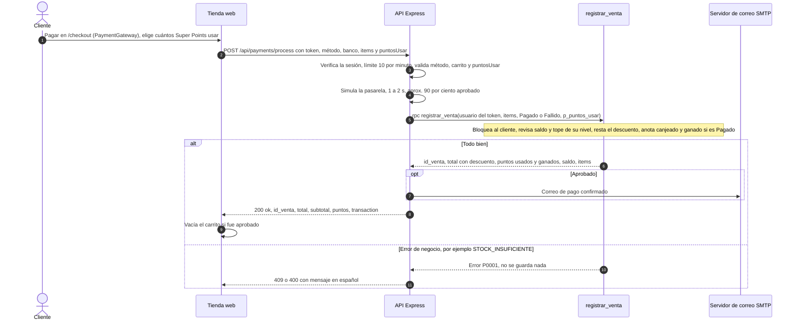

| Paso | Dónde |
|---|---|
| Llamada de la página | `PaymentGateway.jsx` (manda el token con `apiFetch`) |
| Límite y validaciones (incluye `puntosUsar` y las líneas personalizadas) | ruta `POST /api/payments/process`, `validarCarrito`, `validarPuntosUsar` |
| Resultado simulado y espera | misma ruta (90 % aprobado, 1 a 2 s) |
| `registrar_venta` con `p_puntos_usar` | migración `20261120130000_helado_personalizado.sql` (versión vigente) |
| Correo de confirmación (muestra el descuento y la composición del helado personalizado) | misma ruta |
| Vaciar carrito | `CheckoutPage.jsx` |

### 2. Registrarse e iniciar sesión

**a) Registro con correo y contraseña (queda con la sesión iniciada)**

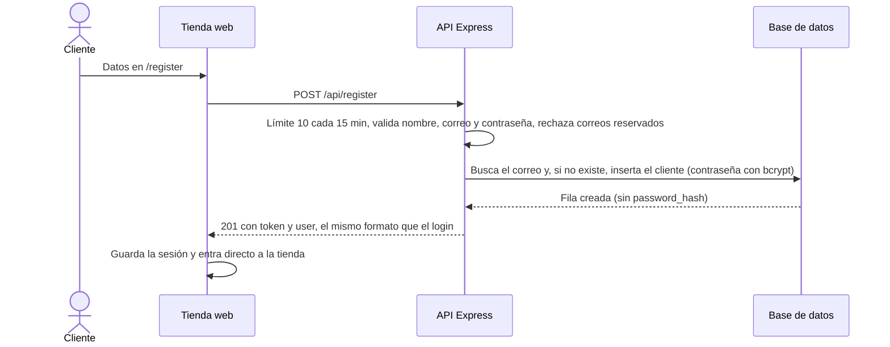

Si dos registros llegan a la vez con el mismo correo, el segundo recibe 409 (candado único de la base). Si la base no devolvió la fila, se registra sin sesión y la página manda a `/login`.

**b) Con correo y contraseña**

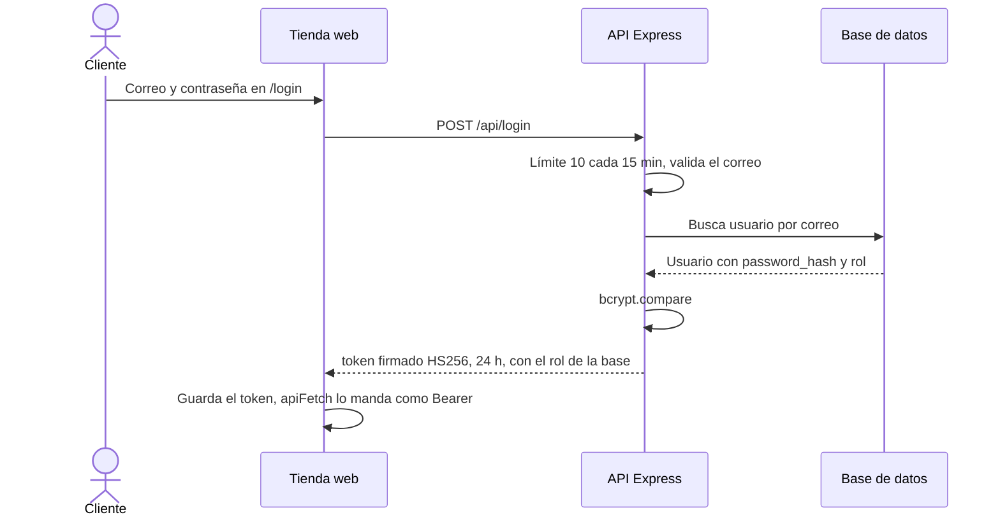

**c) Con Google**

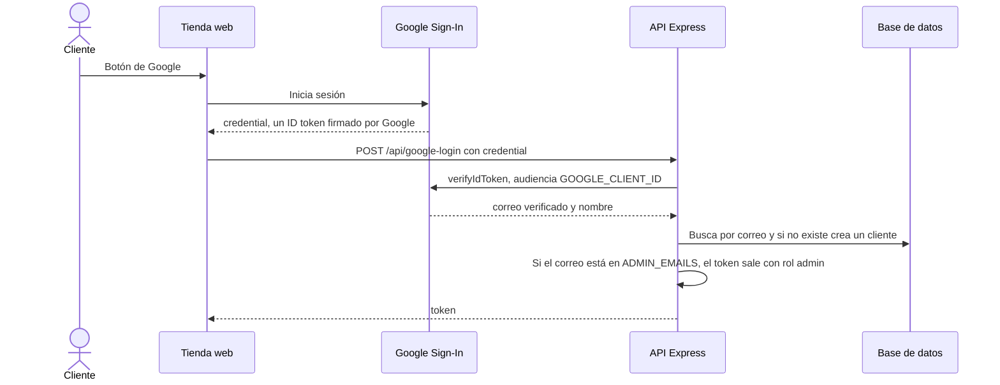

**d) Facial (solo administradores)**

Se explica completo en [reconocimiento-facial.md](../reconocimiento-facial.md). En resumen: la foto viaja a `POST /api/admin/faceid/rekognition-login`, AWS Rekognition busca el rostro (similitud mínima 70), la base dice a qué usuario pertenece y se exige `rol = 'admin'`; la respuesta es el mismo `token` y `user` del login.

Todos los caminos guardan la sesión igual (`frontend/src/utils/sesion.js`) y esta dura lo que dura el token (24 h).

### 3. Recuperar la contraseña

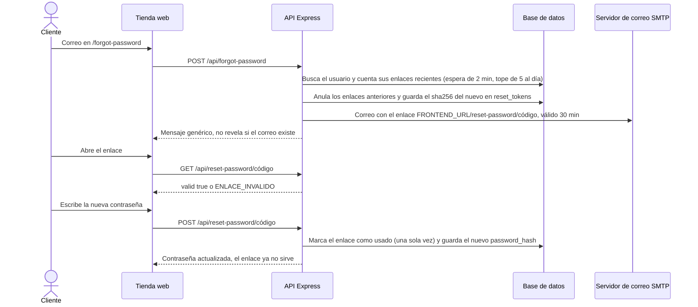

Antes estaba rota (la página validaba con un `GET` que el servidor no tenía); se arregló en el PR #5 y hoy tiene su prueba (`backend/tests/api/recuperarContrasena.test.js`). Sin SMTP real o sin `FRONTEND_URL` en producción, la ruta responde 503 en lugar de mandar enlaces a localhost.

### 4. Cambio de estado de una venta y correo

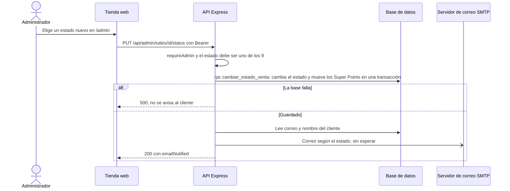

Los puntos del cambio de estado (cobrar o cancelar) se describen en la sección 8.

### 5. Gelbot: chat con textos del servidor

Detalle completo en [chatbot_documentation.md](../chatbot_documentation.md). Para un **cliente o visitante**:

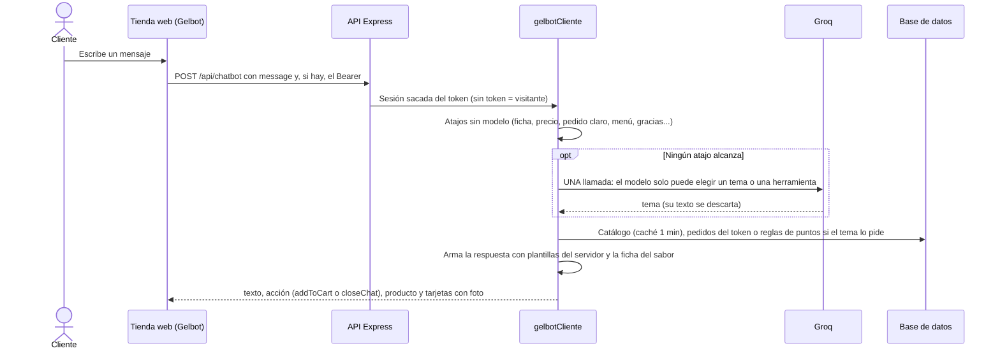

Para un **administrador** el flujo es el de dos llamadas, con confirmación para las acciones que cambian datos:

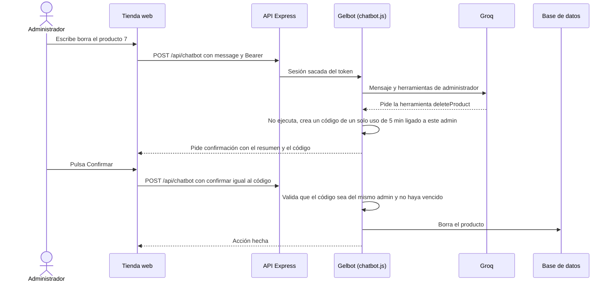

Un visitante o cliente nunca recibe las herramientas de administrador.

### 6. Producto con modelo 3D

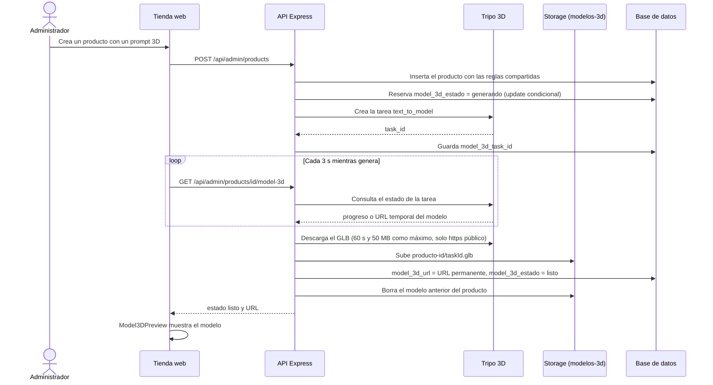

Detalle y límites en [modelos-3d.md](../modelos-3d.md).

### 7. Helado personalizado 3D

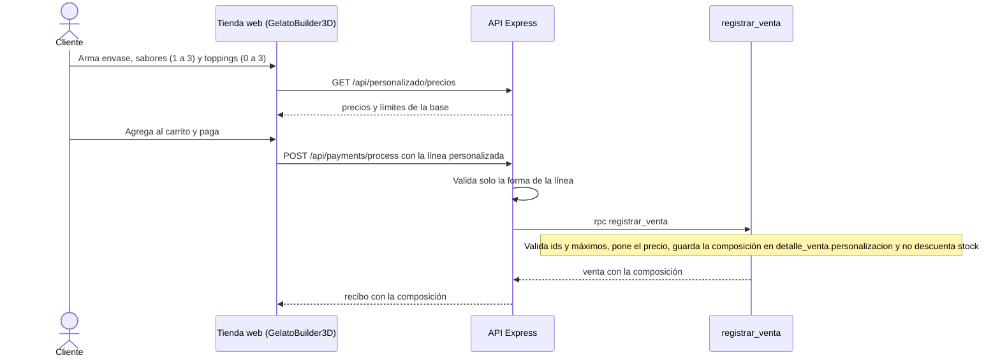

### 8. Cancelar una venta y devolver Super Points

Cuando un admin pasa una venta cobrada a "Cancelado", la base hace todo en una sola transacción: devuelve lo canjeado y quita lo ganado.

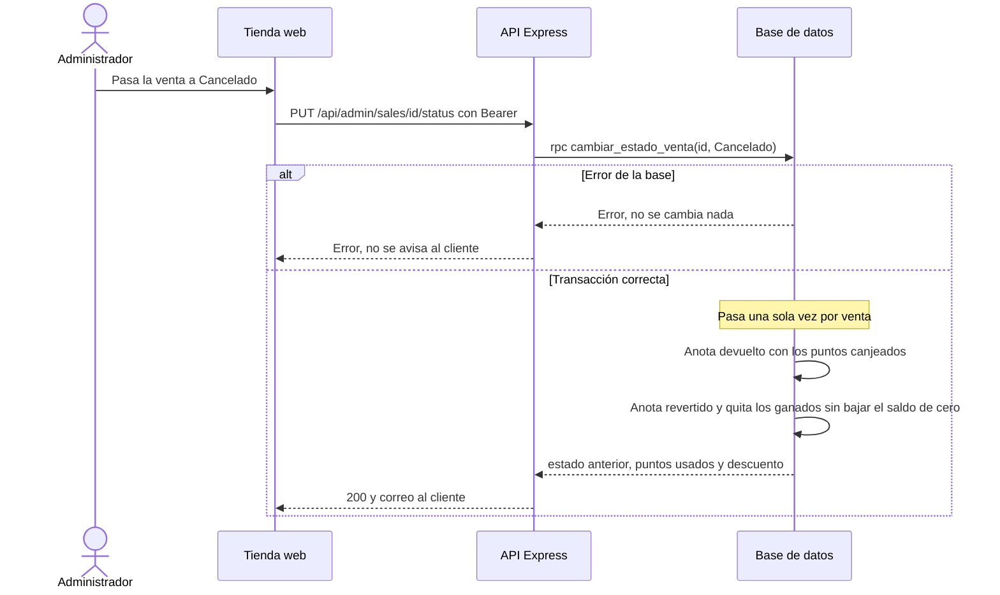

- Si el cliente ya gastó los puntos ganados, se quita solo lo que tenga. El movimiento `revertido` anota lo que realmente se quitó, y el nivel se recalcula con el saldo que queda (regla del 2026-11-19: el nivel sale del saldo actual).
- Si un admin saca la venta de "Cancelado", los puntos no se vuelven a mover.
- Una venta sin movimientos (Fallido, Pendiente o anterior al programa) no mueve nada al cancelarse.

La función `cambiar_estado_venta` está en `supabase/migrations/20261111120000_super_points.sql`.

### 9. Ocultar o mostrar un producto

```mermaid
sequenceDiagram
  actor A as Administrador
  participant W as Tienda web (panel)
  participant API as API Express
  participant DB as Base de datos
  A->>W: Intenta borrar un producto que tiene ventas
  W->>API: DELETE /api/admin/products/id
  API-->>W: 409, no se puede borrar
  W->>W: Aviso con el botón Ocultar
  A->>W: Pulsa Ocultar
  W->>API: PUT /api/admin/products/id/visible con estado false
  API->>DB: update producto set estado = false
  API-->>W: ok; el panel lo marca como Oculto (con Deshacer)
  Note over API,DB: La tienda y Gelbot solo leen estado = true; la caché del chat se invalida y la del CDN tarda hasta unos 60 s
```

El panel pide la lista con `GET /api/admin/products`, que incluye también los ocultos.
