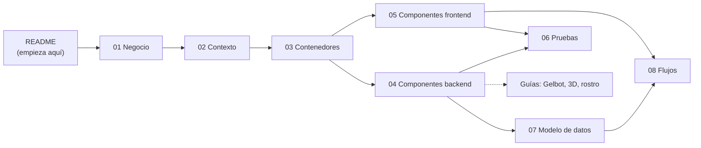

# Arquitectura de SUPER-GELATTO (modelo C4)

## Para principiantes

Imagina la heladería por dentro. El **mostrador** es la página web: ahí el cliente mira los sabores, arma su helado en 3D y pide.
La **cocina** es el servidor: recibe los pedidos, revisa que todo esté bien y prepara la respuesta.
La **bodega con su libreta** es la base de datos: ahí se anota cada cliente, cada sabor y cada venta.
En la puerta hay un **guardia que pide carnet** (el inicio de sesión): sin carnet no entras a la parte de empleados.
Y la **caja registradora** (`registrar_venta`) cobra, anota la venta y saca los helados de la bodega, todo de una sola vez.
Para atender por chat hay un **mesero que solo lee del menú impreso** (Gelbot): nunca inventa lo que dice.
Estos documentos son como un mapa con zoom: primero se ve la heladería desde lejos y, en cada documento, nos acercamos un poco más.

*Figura: la heladería como máquina. [Descarga el archivo y ábrelo en el navegador para verla animada](figuras/heladeria-maquina.html).*

## Qué cambió (2026-11-26)

Esta versión de la documentación se puso al día con `main` después del PR #25 (commit `f8ab6ee`). Lo nuevo y lo corregido:

- **Números reales.** `server.js` tiene 3.414 líneas y `chatbot.js` 958 (antes decía 2.826 y 859). Hay **35 rutas** (antes 26 o 28). Las pruebas son **3.389 en 89 archivos** (antes 322 en 20).
- **Módulos nuevos documentados:** `gelbotCliente.js`, `gelbotRespuestas.js`, `gelbotFichas.js`, `gelbotMenu.js`, `gelbotIntencion.js`, `gelbotTexto.js`, `datosSabores.js`, `modelos3dStorage.js`, `imagenProducto.js` y `correoIlike.js` ([04](04-componentes-backend.md)).
- **Chatbot nuevo:** los clientes y visitantes reciben **solo textos escritos por el servidor**; el modelo (`openai/gpt-oss-20b`, configurable con `GROQ_MODEL`) solo elige un tema o una herramienta, con una llamada como máximo. Antes el modelo escribía la respuesta y se usaba `llama-3.1-8b-instant` ([guía de Gelbot](../chatbot_documentation.md)).
- **Funciones nuevas** (PR #9 a #25): estado en la base (adiós a los archivos JSON); modelos 3D comprimidos y guardados en el bucket `modelos-3d`; editor y alta de productos con reglas compartidas; sesión al registrarse; Super Points con nivel según el saldo; helado personalizado 3D pagable (`componente_personalizado`, `detalle_venta.personalizacion`); ocultar o mostrar productos (`PUT /api/admin/products/:id/visible` y `GET /api/admin/products`); solo el super admin asciende a otros; rediseño del chat; recuperar contraseña de punta a punta.
- **Calidad:** CI con GitHub Actions ([CI.md](../CI.md)) y rama `main` protegida.
- **Dónde vive cada cosa:** la página y la API están en **Vercel** y la base en **Supabase**. Las figuras ya no mencionan Render.
- **Figura nueva:** [el mesero que solo lee del menú](figuras/gelbot-mesero.svg) (Gelbot).
- **Guías nuevas:** [Gelbot](../chatbot_documentation.md) (reescrita), [modelos 3D](../modelos-3d.md), [reconocimiento facial](../reconocimiento-facial.md) y [cómo se construyó el proyecto](../como-se-construyo.md).
- **Referencias por nombre:** las tablas citan nombres de rutas y funciones en vez de números de línea, porque estos cambian con cada PR.

## Índice

### Guías (explicadas para principiantes, con parte técnica)

| Guía | Qué cuenta |
|---|---|
| [Gelbot, el asistente del chat](../chatbot_documentation.md) | Qué hace para el cliente y para el admin, el diagrama de flujo, los temas, qué nunca llega al cliente y la confirmación de acciones |
| [Los modelos 3D](../modelos-3d.md) | El armador de helado personalizado, los modelos de Tripo, el bucket `modelos-3d` y sus límites |
| [Reconocimiento facial](../reconocimiento-facial.md) | Cómo un admin entra con su cara, qué se guarda, protecciones, privacidad y pendientes |
| [Cómo se construyó el proyecto](../como-se-construyo.md) | Línea de tiempo, tecnologías, cómo correrlo, forma de trabajar y cómo contribuir |
| [Integración continua](../CI.md) y [pasarela de pago](../PAYMENT_GATEWAY.md) | El revisor automático de GitHub y el pago simulado |

### Qué es C4

C4 es una forma de dibujar un sistema en cuatro niveles de zoom, como un mapa:

| Nivel | Pregunta que responde | Documento |
|---|---|---|
| 1. Contexto | ¿Quién usa el sistema y con qué servicios de afuera habla? | [02-contexto.md](02-contexto.md) |
| 2. Contenedores | ¿En qué piezas grandes se divide (página, servidor, base)? ¿Dónde vive cada una? | [03-contenedores.md](03-contenedores.md) |
| 3. Componentes | ¿Qué partes tiene cada pieza por dentro? | [04-componentes-backend.md](04-componentes-backend.md), [05-componentes-frontend.md](05-componentes-frontend.md) |
| 4. Código | El código mismo | `backend/server.js`, `backend/gelbot/` (`chatbot.js` y `gelbot*.js`), `backend/datos/`, `backend/servicios/`, `frontend/src/` |

Todos los datos están verificados contra el código de `main` en el commit `f8ab6ee` (2026-11-26). Las referencias son **nombres** (rutas, funciones, migraciones); para ubicarlas en el código se busca el nombre con `grep`.

### Mapa de los documentos

| Documento | Qué cuenta | A quién va dirigido |
|---|---|---|
| [01-negocio.md](01-negocio.md) | Qué vende la heladería, quién es quién (roles), reglas de precio, stock, Super Points y estados de una venta | Todo el equipo, incluido quien no programa |
| [02-contexto.md](02-contexto.md) | C4 nivel 1: el sistema y los servicios externos | Todo el equipo |
| [03-contenedores.md](03-contenedores.md) | C4 nivel 2: página, servidor, base y Storage; variables de entorno; despliegue; **tabla de piezas** (nombres oficiales) | Quien instala o publica la app |
| [04-componentes-backend.md](04-componentes-backend.md) | C4 nivel 3 del servidor: módulos, las 35 rutas, permisos, límites de intentos, chatbot y seguridad | Programadores del backend, revisores de seguridad |
| [05-componentes-frontend.md](05-componentes-frontend.md) | C4 nivel 3 de la página: pantallas, componentes, panel, carrito, ayudante de API | Programadores del frontend |
| [06-pruebas-y-calidad.md](06-pruebas-y-calidad.md) | Las 3.419 pruebas: qué cubre cada carpeta, CI y rama protegida | Todo programador antes de unir una rama |
| [07-modelo-datos.md](07-modelo-datos.md) | Tablas, columnas, `registrar_venta`, funciones, Storage, índices y permisos | Quien toca la base de datos |
| [08-flujos.md](08-flujos.md) | Paso a paso de compra, registro e inicio de sesión, recuperar contraseña, estados, chatbot, modelos 3D, helado personalizado, cancelación y ocultar productos | Todo el equipo |

### Glosario

| Término | Qué significa | Analogía de la heladería |
|---|---|---|
| **Frontend** / página / SPA | La parte que se ve en el navegador. Aquí es una "SPA" (aplicación de una sola página) hecha con React. | El mostrador |
| **Backend** / servidor / API | El programa que recibe los pedidos de la página y responde. Aquí es Express (Node.js). | La cocina |
| **API** | La lista de "ventanillas" (rutas) por las que la página le pide cosas al servidor, por ejemplo `POST /api/login`. | Las ventanillas de la cocina, cada una para un tipo de pedido |
| **Ruta** / endpoint | Una ventanilla concreta: un método (`GET`, `POST`, `PUT`, `DELETE`) más una dirección (`/api/products`). | "Ventanilla 3: pedidos para llevar" |
| **Base de datos** | Donde se guardan los datos de forma permanente. Aquí es Postgres alojado en Supabase. | La bodega con su libreta |
| **Tabla** / columna | Una hoja de la libreta (tabla) y sus encabezados (columnas). | La hoja "ventas" con columnas fecha, total, estado |
| **Storage** / bucket | Un lugar de la base para guardar archivos (aquí, los modelos 3D). | La vitrina de maquetas |
| **RLS** | Reglas que cierran cada tabla a quien no debe verla. | Candado en cada hoja de la libreta |
| **Token** / JWT | Un "carnet" firmado que el servidor entrega al iniciar sesión y que la página muestra en cada petición. Vence en 24 h. | El carnet que muestra el guardia |
| **Rol** | Qué tipo de persona eres: cliente, admin o super admin. Va escrito dentro del token. | El color del carnet |
| **Middleware** | Un paso que revisa la petición antes de que llegue a la ruta (por ejemplo, revisar el token). | El guardia en la puerta de la cocina |
| **Límite de intentos** (rate limiting) | Tope de peticiones por minuto desde la misma conexión, contra bots. | "Máximo 10 pedidos por persona cada minuto" |
| **Despliegue** | Publicar la app en internet. La página y el servidor van en Vercel (dos proyectos). | Abrir la tienda al público |
| **Variable de entorno** | Un dato de configuración (por ejemplo una llave secreta) que se le da al servidor desde afuera; las llaves deben ir aquí. Se guarda en `.env`, que no se sube a git. | La clave de la caja fuerte, que no se pega en la vitrina |
| **Servicio externo** | Un proveedor de afuera con el que habla el servidor (Google, Groq, AWS, Tripo, correo). | Los proveedores de leche, frutas y transporte |
| **Modelo (IA)** | El programa de Groq que entiende frases. En Gelbot solo elige un tema; no escribe lo que ve el cliente. | El intérprete que le susurra al mesero |
| **Transacción "todo o nada"** | Varias operaciones que se hacen juntas o no se hace ninguna. | La caja registradora: si falla algo, no se cobra ni se saca helado de la bodega |
| **Modo simulado** (mockDb) | Si falta la configuración de Supabase, el servidor usa una base de mentira en memoria (solo para desarrollo). | Una libreta de práctica que se borra al cerrar |
| **Prueba automática** | Un programa que comprueba que otra parte del código hace lo que debe. | El control de calidad que prueba cada helado |
| **CI** | El revisor automático de GitHub que corre las pruebas en cada propuesta de cambio. | El inspector en la puerta de la bodega |

### Estado de los documentos viejos

Revisados contra el código de `main` (`f8ab6ee`). **No son fuente de verdad**: si chocan con estos documentos, gana el código.

| Documento | Estado | Qué falla |
|---|---|---|
| `README.md` (raíz) | Actualizado el 2026-11-26 | Antes decía que la autenticación era de Supabase y que los SuperPoints solo se calculaban en pantalla |
| `docs/chatbot_documentation.md` | Reescrito el 2026-11-26 | Describía el diseño viejo (el modelo escribía la respuesta) |
| `docs/CI.md` | Al día | Solo se corrigió el número de pruebas |
| `docs/PAYMENT_GATEWAY.md` | Desactualizado en parte | Vigente: métodos PSE/Nequi/Bancolombia, ~90 % aprobado, latencia 1-2 s y `forceDecline`. Falla: dice que solo los pagos aprobados crean la venta; también se guardan los rechazados con estado `Fallido`. La respuesta real trae además `id_venta`, `total` y `transaction.items`. El `amount` y los precios que manda la página se ignoran (precio de la base). Ahora exige sesión, descuenta stock, soporta Super Points y helado personalizado y tiene límite de 10 intentos por minuto |
| `docs/historico/VALIDATIONS.md` | Desactualizado en parte (histórico) | Las reglas de registro (correo, contraseña, nombre) siguen vigentes. Describe una ruta de "Pedidos (Venta)" que se eliminó: el total lo calcula `registrar_venta`. `venta.id_usuario` puede ser nulo (compra anónima). El stock real está en `producto.stock` |
| `frontend/README.md` | Vigente | Explica de dónde salieron las imágenes, animaciones y modelos 3D decorativos; no describe arquitectura |
