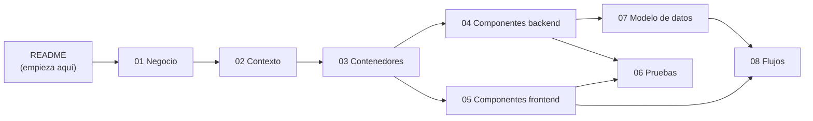

# Arquitectura de SUPER-GELATTO (modelo C4)

## Para principiantes

Imagina la heladería por dentro. El **mostrador** es la página web: ahí el cliente mira los sabores y pide.
La **cocina** es el servidor: recibe los pedidos, revisa que todo esté bien y prepara la respuesta.
La **bodega con su libreta** es la base de datos: ahí se anota cada cliente, cada sabor y cada venta.
En la puerta hay un **guardia que pide carnet** (el inicio de sesión): sin carnet no entras a la parte de empleados.
Y la **caja registradora** (`registrar_venta`) cobra, anota la venta y saca los helados de la bodega, todo de una sola vez.
Estos documentos son como un mapa con zoom: primero se ve la heladería desde lejos y, en cada documento, nos acercamos un poco más.

*Figura: la heladería como máquina. [Descarga el archivo y ábrelo en el navegador para verla animada](figuras/heladeria-maquina.html).*

## Detalle técnico

### Qué es C4

C4 es una forma de dibujar un sistema en cuatro niveles de zoom, como un mapa:

| Nivel | Pregunta que responde | Documento |
|---|---|---|
| 1. Contexto | ¿Quién usa el sistema y con qué servicios de afuera habla? | [02-contexto.md](02-contexto.md) |
| 2. Contenedores | ¿En qué piezas grandes se divide (página, servidor, base)? ¿Dónde vive cada una? | [03-contenedores.md](03-contenedores.md) |
| 3. Componentes | ¿Qué partes tiene cada pieza por dentro? | [04-componentes-backend.md](04-componentes-backend.md), [05-componentes-frontend.md](05-componentes-frontend.md) |
| 4. Código | El código mismo | `backend/server.js`, `backend/chatbot.js`, `frontend/src/` |

Todos los datos están verificados contra el código de `main` en el commit `69f7fac`.
Las referencias tienen la forma `archivo:línea` (por ejemplo `server.js:863` = línea 863 de `backend/server.js`).

### Mapa de los documentos

| Documento | Qué cuenta | A quién va dirigido |
|---|---|---|
| [01-negocio.md](01-negocio.md) | Qué vende la heladería, quién es quién (roles), reglas de precio, stock y estados de una venta | Todo el equipo, incluido quien no programa |
| [02-contexto.md](02-contexto.md) | C4 nivel 1: el sistema y los servicios externos | Todo el equipo |
| [03-contenedores.md](03-contenedores.md) | C4 nivel 2: página, servidor, base; variables de entorno; despliegue; **tabla de piezas** (nombres oficiales) | Quien instala o publica la app |
| [04-componentes-backend.md](04-componentes-backend.md) | C4 nivel 3 del servidor: módulos, las 26 rutas, permisos, límites de intentos y seguridad | Programadores del backend, revisores de seguridad |
| [05-componentes-frontend.md](05-componentes-frontend.md) | C4 nivel 3 de la página: pantallas, componentes, carrito, ayudante de API | Programadores del frontend |
| [06-pruebas-y-calidad.md](06-pruebas-y-calidad.md) | Las 322 pruebas: qué cubre cada carpeta y cómo correrlas | Todo programador antes de unir una rama |
| [07-modelo-datos.md](07-modelo-datos.md) | Tablas, columnas, `registrar_venta`, índices y permisos | Quien toca la base de datos |
| [08-flujos.md](08-flujos.md) | Paso a paso de compra, inicio de sesión, recuperar contraseña, estados, chatbot y modelos 3D | Todo el equipo |

### Glosario

| Término | Qué significa | Analogía de la heladería |
|---|---|---|
| **Frontend** / página / SPA | La parte que se ve en el navegador. Aquí es una "SPA" (aplicación de una sola página) hecha con React. | El mostrador |
| **Backend** / servidor / API | El programa que recibe los pedidos de la página y responde. Aquí es Express (Node.js). | La cocina |
| **API** | La lista de "ventanillas" (rutas) por las que la página le pide cosas al servidor, por ejemplo `POST /api/login`. | Las ventanillas de la cocina, cada una para un tipo de pedido |
| **Ruta** / endpoint | Una ventanilla concreta: un método (`GET`, `POST`, `PUT`, `DELETE`) más una dirección (`/api/products`). | "Ventanilla 3: pedidos para llevar" |
| **Base de datos** | Donde se guardan los datos de forma permanente. Aquí es Postgres alojado en Supabase. | La bodega con su libreta |
| **Tabla** / columna | Una hoja de la libreta (tabla) y sus encabezados (columnas). | La hoja "ventas" con columnas fecha, total, estado |
| **Token** / JWT | Un "carnet" firmado que el servidor entrega al iniciar sesión y que la página muestra en cada petición. Vence en 24 h. | El carnet que muestra el guardia |
| **Rol** | Qué tipo de persona eres: cliente, admin o super admin. Va escrito dentro del token. | El color del carnet |
| **Middleware** | Un paso que revisa la petición antes de que llegue a la ruta (por ejemplo, revisar el token). | El guardia en la puerta de la cocina |
| **Límite de intentos** (rate limiting) | Tope de peticiones por minuto desde la misma conexión, contra bots. | "Máximo 10 pedidos por persona cada minuto" |
| **Despliegue** | Publicar la app en internet. La página va en Vercel y el servidor en Render. | Abrir la tienda al público |
| **Variable de entorno** | Un dato de configuración (por ejemplo una llave secreta) que se le da al servidor desde afuera; las llaves deben ir aquí. Se guarda en `.env`, que no se sube a git. | La clave de la caja fuerte, que no se pega en la vitrina |
| **Servicio externo** | Un proveedor de afuera con el que habla el servidor (Google, Groq, AWS, Tripo, correo). | Los proveedores de leche, frutas y transporte |
| **Transacción "todo o nada"** | Varias operaciones que se hacen juntas o no se hace ninguna. | La caja registradora: si falla algo, no se cobra ni se saca helado de la bodega |
| **Modo simulado** (mockDb) | Si falta la configuración de Supabase, el servidor usa una base de mentira en memoria (solo para desarrollo). | Una libreta de práctica que se borra al cerrar |
| **Prueba automática** | Un programa que comprueba que otra parte del código hace lo que debe. | El control de calidad que prueba cada helado |

### Estado de los documentos viejos

Se revisaron contra el código de `69f7fac`. **No son fuente de verdad**: si chocan con estos documentos, gana el código.

| Documento | Estado | Qué falla |
|---|---|---|
| `README.md` (raíz) | Desactualizado | Dice que la autenticación es "mediante Supabase": no, el servidor firma sus propios tokens (`server.js:816-822`) y verifica Google él mismo (`server.js:1365-1375`); Supabase solo es la base. Dice que los SuperPoints "se acumulan": solo se calculan en pantalla (`CartDrawer.jsx:93`), nada escribe en la tabla `super_points`. Dice "CSS nativo": se usa Tailwind 4 (`frontend/package.json`). El enlace para clonar apunta a una copia personal, no al repositorio oficial del equipo. No menciona Groq, AWS Rekognition, Tripo 3D, Render, Vercel, las pruebas ni las variables obligatorias (`JWT_SECRET`, `GOOGLE_CLIENT_ID`). |
| `VALIDATIONS.md` | Desactualizado en parte | Las reglas de registro (correo, contraseña, nombre) siguen vigentes (`server.js:1062-1115`). Falla: describe una ruta de "Pedidos (Venta)" que valida el `total` enviado; esa ruta se eliminó y ahora el total lo calcula la base (`server.js:2023-2025`, función `registrar_venta`). Dice que la llave foránea "asegura que toda venta pertenezca a un usuario": `venta.id_usuario` puede ser nulo (compra anónima). Pone el CHECK de stock en `inventario`: el stock real está en `producto.stock` con su propio CHECK (migración, líneas 5 y 55-76). La limpieza XSS escapa `& < > " ' /`, no solo `< >` (`server.js:667-676`). |
| `docs/PAYMENT_GATEWAY.md` | Desactualizado en parte | Vigente: métodos PSE/Nequi/Bancolombia, ~90 % aprobado, latencia 1-2 s, `forceDecline` (`server.js:2524-2573`). Falla: dice que solo los pagos aprobados crean la venta; también se guardan los rechazados con estado `Fallido` (`server.js:2576`). La respuesta real trae además `id_venta`, `total` y `transaction.items` (`server.js:2678-2686`). El `amount` y los precios que manda la página se ignoran (precio de la base). No menciona el descuento de stock, el límite de 10 intentos por minuto (`server.js:2507-2515`) ni que la ruta no exige sesión. |
| `docs/chatbot_documentation.md` | Desactualizado | Faltan las herramientas `deleteProduct` y `getSalesSummary` (`chatbot.js:79`, `chatbot.js:109`). `getOrders` no es para "todos": solo con sesión (`chatbot.js:427-428`). La identidad ya no viaja en el cuerpo: sale solo del token (`server.js:2702-2706`). No cuenta que borrar usuario, borrar producto y agregar producto piden confirmación con un código de un solo uso que vence en 5 minutos (`chatbot.js:339-382`), ni el límite de 20 mensajes por minuto (`server.js:2692-2700`). |
| `frontend/README.md` | Vigente | Explica de dónde salieron las imágenes, animaciones y modelos 3D decorativos; no describe arquitectura. Aclaración: además del uso manual de Tripo AI que menciona, el servidor también llama a la API de Tripo 3D para generar modelos de productos (ver [08-flujos.md](08-flujos.md#6-producto-con-modelo-3d)). |
