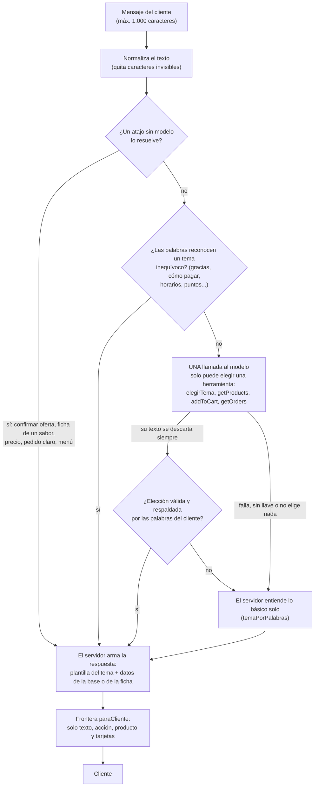

# Gelbot: el asistente de Super Gelatto

Gelbot es el chat de la tienda. Tiene dos modos muy distintos:

- **Clientes y visitantes** (casi todos): Gelbot responde **solo con textos escritos por el servidor**. La inteligencia artificial únicamente ayuda a entender qué quiso decir la persona.
- **Administradores**: Gelbot es un analista de negocio que consulta datos, propone acciones y espera una confirmación.

Estado verificado contra `main` después del PR #25 (2026-11-26).

## Para principiantes: el mesero que solo lee del menú impreso

Imagina un mesero que no puede inventar nada. Cuando le hablas, un **intérprete** (la IA) escucha tu frase y le susurra al mesero una sola cosa: "esto es una pregunta de precio" o "esto es un pedido de fresa".
Pero el intérprete **nunca habla con el cliente**. El mesero toma entonces su **menú impreso** (las plantillas del servidor y los datos reales de la base) y lee la respuesta de ahí.
Si el intérprete se duerme o dice tonterías, el mesero entiende lo básico solo, y si no entiende, lee un "no te entendí" y te muestra el menú.

Por eso Gelbot **no puede inventar un precio, un ingrediente ni una promesa de salud**: lo que ve el cliente sale siempre del servidor.

*Figura: [ábrela en el navegador para verla con movimiento](arquitectura/figuras/gelbot-mesero.html).*

## Diseño actual de un vistazo

| Pieza | Qué hace |
|---|---|
| Ruta `POST /api/chatbot` | Recibe el mensaje; la identidad sale **solo del token** (sin token = visitante). Límite de 20 mensajes por minuto por IP (`CHATBOT_RATE_LIMIT_MAX`) |
| `backend/chatbot.js` | Punto de entrada. Cliente de Groq, herramientas del **modo admin**, confirmaciones, caché del catálogo (1 min) y de las reglas de puntos y del helado 3D (5 min) |
| `backend/gelbotCliente.js` | Flujo de clientes y visitantes: atajos sin modelo, **una** llamada al modelo y respuesta del servidor |
| `backend/gelbotIntencion.js` | Entiende el mensaje sin IA: qué pide, qué rechaza ("no quiero fresa, quiero mango"), cantidad, afirmaciones cortas |
| `backend/gelbotFichas.js` | Ingredientes, alérgenos y dietas, siempre desde la ficha del sabor, con aviso |
| `backend/gelbotRespuestas.js` | Todos los textos del cliente (plantillas por tema) y la "frontera" `paraCliente` |
| `backend/gelbotMenu.js` | Detecta cuándo hay que mostrar el menú con fotos |
| `backend/gelbotTexto.js` | Limpia el texto del modelo (en el modo admin): quita razonamiento, código y nombres de herramientas |
| `backend/datosSabores.js` | Fichas de los sabores (ingredientes, alérgenos, nutrición); la tienda y el chat usan la misma fuente |
| `backend/imagenProducto.js` | Valida la URL de la foto de un producto antes de mostrarla en una tarjeta |
| Modelo | `openai/gpt-oss-20b` por defecto; se cambia con la variable `GROQ_MODEL` (un valor con formato raro se ignora) |

## Flujo de un mensaje de cliente o visitante

Reglas de oro que cumple el flujo:

- **Ante la duda, no se agrega al carrito.** Solo agrega si el cliente pidió con sus palabras ("agrégame", "quiero dos de fresa") o confirmó con un "sí" justo después de que el bot ofreció agregar. Compras contadas ("compré fresa ayer"), futuras, quejas y negaciones ("no quiero fresa") no agregan.
- **El modelo no elige el sabor por el cliente.** La pista del modelo solo vale si el cliente nombró ese sabor; si no, se pregunta con el menú a la vista.
- **Salud primero.** Si el cliente nombra un sabor y pregunta por ingredientes o salud, se muestra la ficha, diga lo que diga el modelo.
- **Como máximo una llamada al modelo por mensaje de cliente.** Muchos mensajes ni siquiera la hacen.

## Temas que entiende (clientes y visitantes)

El modelo solo puede elegir uno de estos temas cerrados (`elegirTema`):

| Tema | Qué responde el servidor |
|---|---|
| `saludo`, `despedida`, `gracias` | Plantilla amable. La despedida cierra el chat; "gracias" no lo cierra |
| `menu` | Menú con **tarjetas con foto** (hasta 24 productos activos); tocar una tarjeta agrega el helado |
| `precio` | El precio real de la base, con formato `$9.000` |
| `ficha` | Ingredientes, alérgenos y datos nutricionales **de la ficha** del sabor, con aviso |
| `alergenos` | Aviso general: no se da de memoria, se remite a la ficha y al equipo |
| `agregar` | Agrega al carrito si el pedido es claro; si no, pregunta cuál sabor con el menú a la vista |
| `pedidos` | Los últimos 5 pedidos del cliente (solo con sesión; sin sesión pide iniciar sesión) |
| `pagar` | Cómo pagar (carrito, "Continuar al Pago"; PSE, Nequi o Botón Bancolombia) |
| `superpoints` | Reglas leídas de la base (`super_points_reglas()`), con texto de respaldo si no se pueden leer |
| `personalizado` | Cómo armar el helado 3D, con precios y límites de la base |
| `queja` | Disculpa y remite al equipo; el chat no resuelve reclamos |
| `ayuda`, `quien`, `contacto` | Qué puede hacer Gelbot, quién es y "no tengo ese dato, pregúntale al equipo" |
| `otro` | "No te entendí" y, si procede, el menú con fotos |

Las herramientas que ve el modelo en este modo son solo `elegirTema`, `getProducts` y `addToCart`, más `getOrders` si hay sesión. Aunque pida otra cosa, el servidor ignora lo que no esté permitido. Un tema de baja gravedad (queja, despedida, pedidos) solo se acepta si las palabras del cliente lo respaldan.

## Ingredientes, alergias y salud

- Los ingredientes y alérgenos **salen siempre de la ficha** (`datosSabores.js`), nunca del modelo. La ficha solo se usa si el nombre del producto coincide exactamente (ante la duda, "no hay ficha registrada").
- Toda respuesta de ficha lleva un aviso: es la información de la ficha y, si hay alergia, se confirma con el equipo por posible contacto cruzado.
- **Si el cliente cuenta una alergia o condición y pide un producto**, no se agrega solo: el servidor muestra la ficha y ofrece agregarlo, y solo un "sí" explícito justo después lo agrega.
- Si pide "sin azúcar" (u otro cambio) y la ficha registra ese ingrediente, el servidor añade una línea "Ojo: la ficha indica...".
- Las preguntas de dieta (vegano, sin gluten, sin lácteos) y de calorías no se contestan de memoria: se remiten a la ficha.

## Seguridad: qué nunca le llega al cliente

| Nunca llega al cliente | Cómo se garantiza |
|---|---|
| Texto escrito por el modelo (incluido su "razonamiento") | El texto del modelo se descarta; la respuesta sale de las plantillas del servidor |
| Herramientas o datos de administrador | Un cliente o visitante nunca recibe esas herramientas; la identidad sale solo del token, nunca del cuerpo de la petición |
| Datos de otros clientes | `getOrders` usa siempre el id del token |
| Precios inventados | Los precios salen de la base, con formato fijo |
| Ingredientes o consejos de salud inventados | Solo la ficha, siempre con aviso |
| Campos internos | `paraCliente` deja pasar únicamente: texto, acción (`addToCart` o `closeChat`), producto, cantidad y tarjetas |
| Fotos o enlaces peligrosos | Las URL de las fotos se validan (`imagenProducto.js`): solo rutas locales o `https`, sin usuario ni clave |
| Instrucciones escondidas en el mensaje | Se normalizan los caracteres invisibles; el modelo solo puede elegir entre temas y herramientas cerrados |
| La llave de Groq o el mensaje del usuario en los registros | Los errores del modelo se clasifican (llave, límite, modelo) y se registran sin la llave ni el texto del cliente |

Si el modelo está caído, no hay llave o responde algo inválido, el cliente igual recibe una respuesta útil: el servidor entiende lo básico con sus palabras clave.

## Modo administrador

Un token con rol `admin` o `super_admin` activa un flujo distinto, con IA más libre pero con controles:

1. **Hasta dos llamadas al modelo**: la primera decide qué herramienta usar; el servidor la ejecuta y, en la segunda, el modelo redacta el resultado (sin permitirle llamar herramientas). El texto pasa por `cleanText` para quitar código y nombres de herramientas.
2. **Herramientas de solo lectura**: `getProducts`, `getOrders`, `getAllUsers` (hasta 50), `getAllOrders` (últimas 10 ventas), `getSalesSummary` (número de ventas e ingresos de hoy, la semana, el mes o todo; solo cuenta ventas cobradas).
3. **Acciones que cambian datos** (`deleteUser`, `deleteProduct`, `addProduct`): el modelo **no las ejecuta**, solo las propone. El servidor devuelve un resumen y un código aleatorio de un solo uso, ligado a ese administrador, que vence en 5 minutos; el admin pulsa Confirmar o Cancelar y recién entonces se ejecuta (otra petición con `confirmar`). Máximo una acción por mensaje.
4. **Las mismas reglas que el panel**: no se puede borrar al super admin ni a uno mismo, y solo el super admin borra administradores.
5. **Datos escritos por clientes** (nombres, correos, nombres de productos) se limpian y se encierran entre marcas de "datos no confiables": el modelo tiene prohibido obedecer lo que haya ahí.
6. **Tope**: máximo 3 llamadas a herramientas por respuesta, historial de hasta 20 turnos (se usan los últimos 4) y mensaje de hasta 1.000 caracteres.
7. Las tablas de usuarios y ventas se muestran con acciones del frontend (`showUsersTable`, `showSalesTable`).

## La ventana de chat (frontend)

`frontend/src/components/Gelbot.jsx` fue rediseñado: panel color cacao debajo de la barra superior, compacto en escritorio y pantalla completa en celular (respetando el teclado), botón flotante que se oculta al abrir, foco gestionado y accesible (`role="dialog"`, conversación anunciada con `role="log"`). Las tarjetas de sabores son botones accesibles; un toque agrega el helado y los toques repetidos se ignoran. El carrito recibe la cantidad que decide el servidor.

## Cómo probarlo

1. Pon una `GROQ_API_KEY` válida en `backend/.env` (sin ella el chat igual responde con las palabras clave, solo sin ayuda del modelo).
2. Inicia sesión (o entra de visitante), abre Gelbot y prueba: "¿qué sabores tienes?", "cuánto cuesta la fresa", "¿qué ingredientes tiene el chocolate?", "quiero dos de mango". Como administrador: "¿cuánto vendimos hoy?" o "elimina al producto 7" (te pedirá confirmar).
3. Las pruebas automáticas del chat están en `backend/tests/api/chatbot*.test.js` y `backend/tests/frontend/panelGelbot.test.js` / `tarjetasGelbot.test.js`; se corren con `cd backend && npm test`.

Más contexto: [arquitectura del servidor](arquitectura/04-componentes-backend.md#gelbot-chatbotjs-y-los-módulos-gelbot) y [flujo paso a paso](arquitectura/08-flujos.md#5-gelbot-chat-con-textos-del-servidor).
