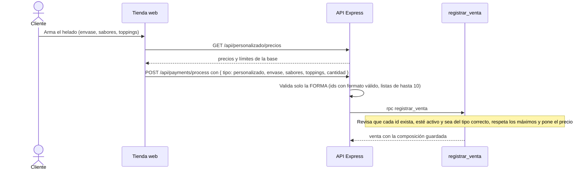

# Los modelos 3D de Super Gelatto

Esta guía explica las tres cosas "en 3D" del proyecto: el **armador de helado personalizado**, los **modelos que genera la inteligencia artificial para cada producto** y **dónde se guardan** esos archivos. Verificado contra `main` después del PR #25 (2026-11-26).

## Para principiantes: la vitrina de maquetas

Imagina la heladería con una **vitrina de maquetas** de helados:

- Algunas maquetas ya vienen hechas por la casa: **el cono, la copa, el vaso, las bolas de sabores y los toppings**. Con ellas el cliente **arma su propio helado** girándolo con el dedo. Eso es el **armador 3D** (`GelatoBuilder3D`).
- Otras maquetas las **encarga el administrador a un taller externo** (**Tripo 3D**): escribe "un helado de mango con chile" y el taller esculpe la maqueta. Eso se llama **generar un modelo 3D**.
- Cuando el taller termina, la heladería **no se queda con el enlace prestado** (vence en pocos minutos): **hace una copia y la guarda en su propia bodega de maquetas**, un lugar llamado **`modelos-3d`** dentro de Supabase. Así la maqueta no desaparece.
- Y cuando el cliente paga el helado que armó, **la caja registradora (`registrar_venta`) no confía en lo que diga el cliente**: mira ella misma la **lista de precios de la casa** (la tabla `componente_personalizado`) y cobra eso.

Las maquetas son archivos pesados, así que se **comprimieron**: los 17 modelos del armador pasaron de 166 MB a unos 34 MB (según el commit `968763a`; hoy la carpeta `frontend/public/360` pesa 34 MB), y la página solo baja el modelo que el cliente está mirando.

## Detalle técnico

### 1. El armador de helado personalizado (clientes)

- **Dónde está:** `frontend/src/components/GelatoBuilder3D.jsx`, en la pantalla de inicio. Usa Three.js con React Three Fiber.
- **Piezas:** 17 archivos `.glb` fijos en `frontend/public/360/`: 3 envases (`cone`, `cup`, `glass`), 6 sabores (`vanilla`, `chocolate`, `fresa`, `mango`, `menta`, `mora`) y 8 toppings (`cherry`, `chips`, `coco`, `cream`, `gummies`, `nuts`, `sprinkles`, `syrup`). Si el archivo de una pieza falla, solo esa pieza muestra un aviso y el resto sigue.
- **Carga liviana:** al abrir la pantalla solo se precarga el modelo que se ve por defecto (`utils/precargaModelos.js`); los demás bajan cuando el cliente los elige. Los modelos están comprimidos con `meshopt` y texturas WebP.
- **Precios y límites vienen de la base**, no de la página: el armador los pide a `GET /api/personalizado/precios` (caché de 5 minutos). Hasta que cargan, no se puede agregar el helado al carrito. El hook es `usePreciosPersonalizado`.

#### Las reglas (la base manda)

| Regla | Valor | Dónde vive |
|---|---|---|
| Envase | exactamente 1 | `registrar_venta` |
| Sabores | de 1 a 3 (`max_sabores`) | función `helado_personalizado_reglas()` |
| Toppings | de 0 a 3 (`max_toppings`) | función `helado_personalizado_reglas()` |
| Repetidos | no se permiten (el armador no los permite) | `registrar_venta` |
| Precio | envase + suma de sabores + suma de toppings | tabla `componente_personalizado` |
| Precios de partida | envase $8.000, cada sabor $2.000, cada topping $1.000 (una bola sin toppings = $10.000) | semilla de la migración; se pueden cambiar por SQL |
| Ningún componente es gratis | `precio > 0` (CHECK) | tabla `componente_personalizado` |
| Stock | un personalizado **no descuenta stock** (no se agota) | `registrar_venta` |

`componente_personalizado` tiene 17 filas (los mismos ids que usa la página: `cone`, `cup`, `glass`, `vanilla`... `syrup`) con columnas `id`, `tipo` (`envase`, `sabor` o `topping`), `nombre`, `precio` y `activo`. Está cerrada con RLS: solo el servidor la lee.

#### Cómo se paga

- El servidor ignora cualquier precio, nombre o foto que mande el navegador para una línea personalizada.
- Cada helado personalizado va en **su propia fila** de `detalle_venta`, y la columna `detalle_venta.personalizacion` (JSON) guarda la composición **con los nombres y precios del momento**, para que un cambio de precio posterior no reescriba la historia.
- Para poder vender, existe un producto real "Helado personalizado 3D" (`producto.tipo = 'personalizado'`, único, con `estado = false`): **no aparece en la tienda ni en Gelbot** (solo leen `estado = true`) y el panel **no puede editarlo ni borrarlo** (responde 409 con un mensaje claro).
- Errores nuevos de la caja registradora: `PERSONALIZADO_INVALIDO` y `PERSONALIZADO_NO_DISPONIBLE` (HTTP 400). Si la base no entrega precios, la página no agrega el helado, y en el pago recalcula los personalizados antes de mostrar el total.
- El carrito, el pago, el recibo por correo y el panel (detalle de una venta, `GET /api/admin/sales/:id/items`) muestran la composición.

Pruebas: `backend/tests/db/helado_personalizado.test.js`, `backend/tests/api/heladoPersonalizado.test.js` y `backend/tests/frontend/personalizado.test.js`.

### 2. Los modelos 3D de los productos (Tripo, solo panel de administración)

- **Para qué sirve:** un administrador puede pedir, al crear un producto o con el botón de regenerar, un modelo 3D descrito con un texto (`prompt`). El servicio externo **Tripo 3D** (`api.tripo3d.ai`, tarea `text_to_model`) lo fabrica. **Sigue en uso.**
- **Dónde se ve:** el visor `frontend/src/components/Model3DPreview.jsx` se usa en el **panel de administración** (`AdminDashboard.jsx`). **La tienda para clientes no muestra todavía estos modelos**: `GET /api/products` no entrega `model_3d_url`. Lo único en 3D que ve el cliente es el armador de la sección 1.
- **Cómo se pide** (rutas de administrador): `POST /api/admin/products` (con prompt), `POST /api/admin/products/:id/regenerate-3d` y `GET /api/admin/products/:id/model-3d` (el panel la consulta cada 3 segundos mientras genera y cada 10 mientras guarda).
- **Freno de gasto:** cada tarea de Tripo cuesta dinero, por eso hay un tope de 5 generaciones por administrador cada hora (`TRIPO_RATE_LIMIT_MAX`), el prompt tiene máximo 1.000 caracteres, y la **reserva** se hace en la base con un update condicional: dos clics a la vez no lanzan dos tareas. Una reserva de más de 15 minutos se puede retomar. Sin `TRIPO_API_KEY` la función queda apagada (503).

#### El estado vive en la base

Antes el estado de cada tarea 3D estaba en un archivo del servidor, que en Vercel se perdía. Hoy son columnas de `producto`:

| Columna | Qué guarda |
|---|---|
| `model_3d_task_id` | Id de la tarea en Tripo |
| `model_3d_estado` | `generando`, `listo` o `error` (vacío = sin modelo) |
| `model_3d_prompt` | El texto usado para generar |
| `model_3d_actualizado` | Cuándo se reservó la generación |
| `model_3d_url` | URL **permanente** del modelo en el bucket |

### 3. Dónde se guardan: el bucket `modelos-3d` y `backend/servicios/modelos3dStorage.js`

Cuando Tripo termina (`success`), el servidor:

1. valida que la URL de Tripo sea `https`, sin usuario ni clave, **nunca una IP escrita a mano ni `localhost`** (para que el servidor no pueda ser usado para leer su propia red); si existe `TRIPO_CDN_HOSTS`, solo esos hosts;
2. **descarga** el archivo con tope de **60 segundos y 50 MB** (hasta 3 redirecciones, cada una revisada);
3. comprueba que de verdad sea un GLB (los primeros 4 bytes `glTF`);
4. lo **sube** al bucket `modelos-3d` en `producto-<id>/<taskId>.glb` (con tope de 30 s de subida y caché de un año, porque el archivo nunca cambia);
5. solo entonces guarda `model_3d_url` y marca `listo`, y **borra del bucket el archivo anterior** de ese producto.

Regenerar **no borra el modelo bueno**: mientras el nuevo se genera, `model_3d_url` conserva el anterior (el panel lo muestra como "anterior").

| Límite | Valor |
|---|---|
| Tamaño máximo de un modelo | 50 MB (en el servidor y en el bucket) |
| Tiempo máximo de descarga | 60 s |
| Tiempo máximo de subida | 30 s |
| Reintentos si la copia falla por algo pasajero | hasta 10 minutos desde la reserva; luego queda en `error` |
| Pasa a `error` de inmediato | enlace de Tripo vencido (403, 404 o 410), modelo de más de 50 MB, URL no permitida |

El **bucket** `modelos-3d` (migración `20261118120000_bucket_modelos_3d.sql`) es **público de lectura**, acepta solo `model/gltf-binary` y tiene una única política (`modelos_3d_lectura_publica`, solo SELECT). Nadie con la llave pública puede subir, cambiar ni borrar: el servidor lo hace con `service_role`.

### 4. Specs y planes (el diseño detrás)

Las ideas se pensaron por escrito antes de programarlas, en `docs/superpowers/`:

- Diseño: [`specs/2026-11-18-modelos-tripo-storage-design.md`](superpowers/specs/2026-11-18-modelos-tripo-storage-design.md)
- Plan de implementación: [`plans/2026-11-18-modelos-tripo-storage.md`](superpowers/plans/2026-11-18-modelos-tripo-storage.md)
- También hay spec y plan de Super Points ([spec](superpowers/specs/2026-11-04-super-points-design.md), [plan](superpowers/plans/2026-11-04-super-points.md)) y el plan de la [documentación C4](superpowers/plans/2026-10-27-documentacion-c4.md).

### Pendientes y diferencias honestas

- **Modelos livianos desde el origen (no hecho):** el diseño proponía pedirle a Tripo modelos más livianos (límite de caras o de calidad de textura), pero el código solo envía `type` y `prompt` a Tripo. Los modelos de Tripo pueden llegar pesados (el diseño habla de 10 MB o más) y el tope de 50 MB es lo único que los frena. Comprimir en el servidor se descartó por el límite de tiempo de Vercel.
- **Modelos de producto sin uso para el cliente:** hoy solo el panel los ve; mostrarlos en la tienda es trabajo futuro.
- **Los 17 modelos del armador se comprimieron a mano** (no por el servidor) antes de subirlos al repositorio.

### Cómo probarlo

1. Armador: `cd frontend && npm run dev` (con el backend corriendo), abre la pantalla de inicio, arma un helado, agrégalo al carrito y paga (pago simulado).
2. Modelos de Tripo: necesita `TRIPO_API_KEY` en `backend/.env` y la migración del bucket aplicada. Crea un producto con prompt desde el panel de administración.
3. Pruebas: `cd backend && npm test` (incluye `modelos3dStorage`, `modelosTripoStorage`, `tripoFrenos`, `tripoSinLlave`, `db/modelo_3d`, `db/bucketModelos3d`, `heladoPersonalizado` y las del frontend `modelos3d`, `leerGlb`, `piezas3d`, `precargaModelos`).

Más contexto: [contenedores](arquitectura/03-contenedores.md), [modelo de datos](arquitectura/07-modelo-datos.md) y [flujos](arquitectura/08-flujos.md).
