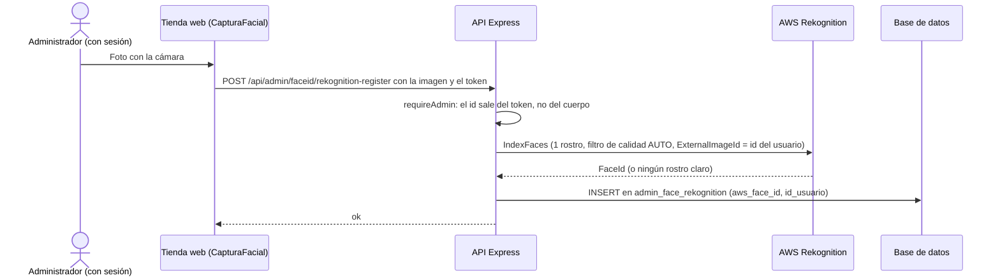
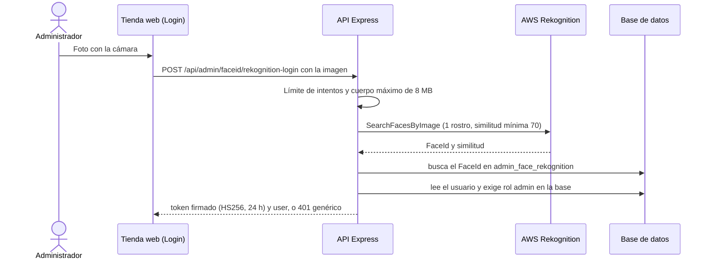

# Reconocimiento facial de los administradores

Esta guía explica cómo un administrador puede **entrar con su cara** en lugar de la contraseña. Es una función **solo para administradores**: los clientes no la usan. Verificado contra `main` después del PR #25 (2026-11-26). No incluye ningún valor de llave.

## Para principiantes: el portero que reconoce caras

Imagina que el dueño de la heladería contrata a un **portero** que reconoce caras. Funciona en dos tiempos:

1. **Presentación (registro).** El administrador, ya dentro del local con su carnet, se para frente a la cámara. Se saca una foto y se la manda al portero (**AWS Rekognition**, un servicio de reconocimiento de caras de Amazon). El portero **no guarda la foto**: apunta una "descripción numérica" de la cara en su libreta y devuelve un número de ficha (el `FaceId`). La heladería anota en **su propia libreta** (la base de datos) "la ficha tal pertenece al administrador número X".
2. **Entrada (login).** Otro día, el administrador llega sin carnet y se saca una foto. El portero la compara con su libreta: si se parece lo suficiente a una ficha, dice cuál. La heladería busca en **su** libreta a quién pertenece esa ficha, comprueba que de verdad sea un **administrador**, y recién entonces le entrega un carnet nuevo (la sesión de 24 horas).

Si algo no cuadra, la respuesta es siempre la misma frase genérica ("Reconocimiento facial no reconocido o acceso denegado"), para no darle pistas a un curioso.

## Detalle técnico

### Piezas

| Pieza | Qué hace |
|---|---|
| `frontend/src/components/CapturaFacial.jsx` | Abre la cámara (`getUserMedia`, 640x480 ideal, cámara frontal), muestra la vista previa, saca la foto y la convierte a JPEG (calidad 0,9) en base64. Pide confirmar o repetir. Apaga la cámara al terminar |
| `frontend/src/pages/Login.jsx` | Botón "Entrar con Reconocimiento Facial"; manda la foto a `POST /api/admin/faceid/rekognition-login` y guarda la sesión que responde |
| `frontend/src/pages/AdminDashboard.jsx` | Sección "Reconocimiento Facial Universal": el administrador con sesión registra **su** rostro con `POST /api/admin/faceid/rekognition-register` |
| `backend/server.js` | Las dos rutas, el cliente de AWS (`@aws-sdk/client-rekognition`) y el límite de intentos |
| AWS Rekognition | Una **colección** de rostros (nombre por defecto `supergelatto-admins`, región por defecto `us-east-2`; se cambian con `REKOGNITION_COLLECTION_ID` y `AWS_REGION`) |
| Tabla `admin_face_rekognition` | La libreta propia: `id` (uuid), `aws_face_id` (único), `id_usuario` (referencia a `usuario`, con borrado en cascada) y `created_at` |
| `backend/scripts/create-collection.js` | Crea la colección en AWS (se corre una vez a mano) |
| `backend/scripts/create-rekognition-table.sql` | Crea la tabla (se pega en el SQL Editor de Supabase) |
| `backend/scripts/sync-rekognition.js` | Herramienta de mantenimiento: lista las caras de AWS y los registros de la base, y **vincula** las que están en AWS pero no en la base usando el número de usuario que guarda `ExternalImageId` |

### Registro del rostro

### Login con el rostro

La respuesta correcta es **idéntica a la del login con contraseña** (la misma función `sesionDe`): `token` y `user`, sin `password_hash` ni otros campos internos (lo comprueba `tests/api/loginFacial.test.js`).

### Qué se guarda y dónde

| Dato | Dónde | Detalle |
|---|---|---|
| La foto | **En ningún lado del proyecto** | Viaja del navegador al servidor en el cuerpo de la petición, el servidor la pasa a AWS y la descarta; no se escribe en la base ni en el disco. En la base y en el chat no queda copia |
| Representación del rostro | AWS Rekognition, colección propia | AWS guarda una descripción numérica del rostro (no la imagen) y un `FaceId`; el servidor le pone `ExternalImageId` = el id numérico del administrador |
| Vínculo ficha-usuario | Tabla `admin_face_rekognition` | Solo `aws_face_id`, `id_usuario` y fecha. Tiene RLS activo y sin permisos para la llave pública: solo el servidor la lee y escribe |
| Credenciales de AWS | Variables de entorno del servidor | `AWS_REGION`, `AWS_ACCESS_KEY_ID`, `AWS_SECRET_ACCESS_KEY`, opcionalmente `AWS_SESSION_TOKEN`, `REKOGNITION_COLLECTION_ID`. Nunca en el código ni en git. Las pruebas no llaman a AWS: reemplazan el cliente |
| Registros del servidor | Registro de Vercel | Al iniciar con el rostro se anota el porcentaje de similitud y el `FaceId` encontrado (no la foto) |

### Protecciones

- **Quién puede registrar:** solo un administrador con sesión (`requireAdmin`), y registra **su propio** rostro (el id sale del token).
- **Quién puede entrar:** el rostro debe estar vinculado en la base **y** esa cuenta debe tener `rol = 'admin'` **en la base**. Un rostro conocido de una cuenta que no es admin recibe el mismo 401 genérico.
- **Límite de intentos:** `POST /api/admin/faceid/rekognition-login` tiene `limitadorLoginFacial`: 10 intentos por IP cada 15 minutos por defecto (`LOGIN_RATE_LIMIT_MAX`, `LOGIN_RATE_LIMIT_WINDOW_MS`), y al pasarlos responde 429. Probado en `backend/tests/api/limiteLogin.test.js`.
- **Validación y tamaño:** la imagen debe ser un texto base64 (si no, 400). Estas dos rutas aceptan hasta 8 MB de cuerpo (el resto de la API, 1 MB); una foto de 3 MB se acepta y una de más de 8 MB responde 413 (`limiteLogin.test.js`). En el registro, AWS aplica su filtro de calidad y exige un rostro claro.
- **Sesión:** el token vence a las 24 horas y se firma con el mismo secreto y algoritmo que cualquier otro login.
- **Pruebas:** `backend/tests/api/loginFacial.test.js` (forma de la respuesta, cuenta que no es admin → 401) y `limiteLogin.test.js` (límite y tamaño).

### Pendientes y riesgos (anotados con honestidad)

- **Umbral de parecido de 70 %.** Es el valor del código; el propio AWS recomienda umbrales mucho más altos cuando se usa para verificar identidad. Conviene que el equipo decida si lo sube y lo pruebe.
- **Sin prueba de vida.** El sistema compara fotos; no comprueba que haya una persona real frente a la cámara. Es una limitación conocida del enfoque actual.
- **Borrar un administrador no borra su rostro en AWS.** Al borrar la cuenta se borra el vínculo de la base, pero el código no llama a `DeleteFaces`; la descripción del rostro sigue en la colección de AWS hasta que alguien la borre a mano. Es un tema de **privacidad** a resolver. Además, `sync-rekognition.js` puede volver a vincular una ficha huérfana a un número de usuario.
- **Registrar varias veces agrega varias fichas** para la misma persona; no hay un tope por administrador.
- **Los administradores que entran por correo de la lista `ADMIN_EMAILS`** (y el super admin, que se reconoce por correo) pueden no tener `rol = 'admin'` en la base; en ese caso el login facial los rechaza (ver [01-negocio.md](arquitectura/01-negocio.md)).
- **Mensajes de error con detalles de AWS:** ante una falla de AWS el servidor devuelve parte del mensaje técnico y algunos textos todavía nombran a Render (la API hoy está en Vercel). Conviene dejar un texto fijo y registrar el detalle solo en el servidor.
- **Textos de la pantalla que dicen "AWS":** son pensados para el equipo, no para el público.
- **Datos personales:** un rostro es un dato biométrico. Para un proyecto real habría que informar al administrador, pedir su consentimiento y definir cuánto tiempo se conserva. No está documentado ni implementado.
- **Las credenciales de AWS pueden vencer** (si son temporales): entonces las dos rutas responden error de servidor hasta que se actualicen en el panel de Vercel.

### Cómo probarlo

1. Crear la colección (`node backend/scripts/create-collection.js`) y la tabla (`backend/scripts/create-rekognition-table.sql` en el SQL Editor) y poner las variables de AWS en `backend/.env` (usa `backend/.env.example` como guía).
2. Entrar como administrador, abrir el panel y pulsar "Registrar Reconocimiento Facial".
3. Cerrar sesión y entrar con "Entrar con Reconocimiento Facial".
4. Sin AWS configurado, las pruebas automáticas siguen pasando (`cd backend && npm test`).

Más contexto: [flujos](arquitectura/08-flujos.md#2-registrarse-e-iniciar-sesión), [servidor](arquitectura/04-componentes-backend.md) y [modelo de datos](arquitectura/07-modelo-datos.md).
